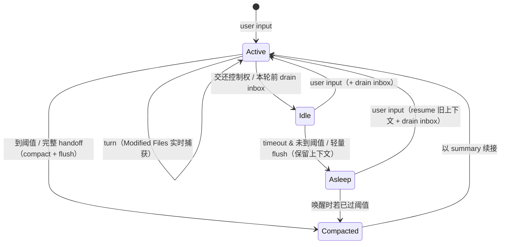

> **Design/reference status:** this document preserves the memory model's
> rationale and proposed invariants, not a guarantee that every rule is enforced
> by the runtime. Several layers are implemented, but exact keyword paths,
> subagent prompt inclusion, working-set coverage, and permission boundaries
> differ. See the source-backed [context and memory reference](docs/architecture.md#context-and-memory).
> Session/project scopes organize relevance; they are not tenant isolation.

# 记忆系统设计（时间层 × scope）

## 目标

记忆有**两个正交维度**：

- **时间 / 易变性**：短期（now）/ 中期（history）/ 长期（durable）。
- **scope / 共享范围**：session / project / agent-global。

从 **prompt 组装** 的角度，把相关内容统一注入到 system prompt 的一个 memory block。
不同 agent（主 / 子）、不同 scope 看到的内容不同。

前提：**所有用户权限相同，memory 的 owner 是 agent 本体**——所以 scope 不是访问控制 /
隐私边界，纯粹是**信噪比与归属**（这条记忆属于哪里、跨不跨 session）。

## scope 维度（共享范围）

| scope | 含义 | 存储 | 注入范围 |
| --- | --- | --- | --- |
| **session** | 本次会话 | `memory/sessions/<id>.md` | 仅本 session |
| **project** | 一段有明确 boundary 的工作 | `memory/projects/<project>/` | 归属该 project 的 session |
| **agent-global** | agent 本体 / 性格 | `identity.md` / `SOUL.md` | 所有 session 常驻 |

- **理想**：引导用户“一个 session 保持一个 project scope”，认知最简单。
- **现实**：难以强制，所以 memory 里显式保留 **project** 作为那个“有边界的锚点”，
  让跨 session 但限定项目的知识（约定 / keyword / 事件）有处安放。
- 时间层与 scope 正交：短期恒为 session；中期事件写进共享池但带 scope 标签；
  长期（keyword / 公约）按 project / agent-global 归置。

## 记忆分层总览（时间层 × scope）

| 层级 | 名称 | 内容 | 存储 | scope | 注入 |
| --- | --- | --- | --- | --- | --- |
| 短期 | Session Memory | Modified Files（+ session 公约） | `memory/sessions/<id>.md` | session | eager |
| 中期 | Events | 事件日志（共享池，带 origin/scope） | `memory/events/YYYY-MM-DD.jsonl` | 全部（读时按相关性过滤） | 本 session eager + 外部相关性门控 |
| 公约 | Conventions | 仍生效的约束 / 规则（全文常驻） | 随 scope：session / project / identity | session / project / agent-global | eager 常驻 |
| 长期·索引 | Keywords | topic / 人名 / concept 关键词（lazy） | `memory/projects/<p>/topics/*`、`identities/*` + 索引 | project / agent-global | lazy lookup |

> **Summary** 不是稳态短期层——它是 compact 的续接载荷（见「时间动态」）。

核心约束：

- **写入长期（索引 / 跨 session 公约）永远只有主 agent**；子 agent 只读。
- **公约按 scope 决定共享范围**：session 公约不外泄；project 公约在同项目 session 间共享；
  agent-global 公约（性格）处处常驻。
- **索引层只有主 agent 注入**；公约对受其约束的 agent（含子 agent）只读注入。

---

## 每层详解

### 短期 — Session Memory

稳态只有一样东西：**Modified Files**（Summary 见末尾，属 compact）。

- **Modified Files**：本会话动过的文件路径。由 **runtime 在每次 write/edit/create 后确定性累加**
  ——无 LLM、**worker 不做书记**、完全可 audit（来自真实工具调用）。也给别的 session
  做“是否在动同一批文件”的碰撞信号。
- **session 公约**：小而黏的约束清单，挂 session memory（见「公约」）。

**旧 `SessionMemoryState`（10 字段）归位**——原字段边界模糊、互相重叠，拆散到各层：

| 旧字段 | 新归属 |
| --- | --- |
| `activeFiles` | → Modified Files（runtime） |
| `themes` | 并入叙述；反复出现者蒸馏成长期 keyword |
| `decisions` | → event（发生）+ 公约（仍生效，按 scope，见下） |
| `openTasks` / `progressSummary` / `currentFocus` | → compact 续接载荷（即 Summary） |
| `rejectedApproaches` | → 中期 event 的 `challenge` |
| `archive` | → 中期 event log 本身 |

**decision 归位（形态 + scope）：**

| decision | 归属 | scope |
| --- | --- | --- |
| 决策发生 | 中期 event（`why`/`challenge`） | 共享池 |
| 会话内仍生效的战术约束 | 公约（session） | session |
| 项目级约定（e.g. `chore:` 前缀） | 公约（project） | project |
| 关于 agent 本体（性格） | `identity.md` | agent-global |

**Summary 已降格**：它不是持续维护的短期组件，而是 **compact 时才物化的“续接载荷”**——
压缩的“当前目标 + 下一步”，只被紧接的续接 session 读。活跃/睡眠（留快照）的 session 有
完整上下文、**不需要它**；别人也不读它（靠 events + keywords）。本质 = 现有 handoff 的续接
prompt，详见「时间动态」。

#### 为什么要这么拆：现状 handoff 不可 audit

现状 session memory **只在 handoff 时**由一个独立 `HandoffSession` loop 重新推导整份写入——
不是常规 call（难 audit）、只在阈值触发（短会话不落盘）、每次批量重推（贵、易漂移）。
新设计把写入按角色拆开（见「时间动态」的分工），审计问题随之解决。

### 中期记忆 — Events（共享事件池）

- **内容**：结构化事件 `{ when, who, what, why?, challenge?, refs?, origin, scope? }`。
  - `who` = 人类 actor；**新增 `origin`** = 产生它的 session / project / agent
    （`who` 与 `origin` 是两码事，不能混）。
- **存储**：`memory/events/YYYY-MM-DD.jsonl`（JSONL，按天）——**全 agent 共享同一池**，
  provenance 靠 per-entry `origin` 区分。
- **写入**：由 **flush scribe** 从增量 transcript 提炼**有意图的高层 event**（不是 per-tool-call），
  append-only；每条打上 `origin`（session/project）。
- **读取（关键）**：不是“最近 N 条”就注入，而是分两路：
  - **本 session 事件** → eager，最近 N 条详列。
  - **外部 session 事件** → **相关性门控**（见下），相关才进，无关只留池子里可查。
- **特点**：时间线记忆，“最近（在我相关范围内）发生了什么”。`refs` 可指向长期文件。

### 公约 — Conventions（active constraints，全文常驻，按 scope）

**keyword 是索引、靠 lazy lookup 才展开，起不到约束作用**；“仍生效的决策 / 规则”必须
**全文常驻**才真正约束行为。所以公约独立于 keyword，且**按 scope 决定共享范围**：

- **session 公约** → 存 session memory，只在本 session 常驻。多数战术约束在此。
- **project 公约** → 存 `memory/projects/<project>/conventions.md`，同项目 session 间共享。
  e.g. “依赖更新用 `chore:` 前缀”。
- **agent-global 公约** → 存 `identity.md`（性格，非普通 decision），处处常驻。

共性：**全文常驻、必须小、失效即删、只有主 agent 能写**；对受其约束的 agent（含子 agent）
**只读注入**。注入时把当前生效的各 scope 公约**合并**成一个 `### Conventions` 小节。

> 为什么要它：跨 turn / 跨 session 的约束不能靠中期 event（会滚动丢失），也不能只做
> keyword（索引无约束力），只能“常驻 + 全文”。

### 长期·索引 — Keywords（reference knowledge，lazy）

- **内容**：一串关键词（topic 名、人名、任意 concept）。
- **存储**：关键词索引 + 背后完整文件（`memory/projects/<p>/topics/<kw>.md`、
  `memory/identities/<id>.md`）；**每个 keyword 带 `source`（origin）**。
- **共享 + 标源**：keyword 池跨 session 共享，但渲染时**按来源标注 / 分组**
  （`kw (from: <project/session>)`），避免分不清哪来的、以及同名冲突。
- **注入形式**：prompt 里**只放关键词列表**，完整内容通过 memory lookup / VFS 按需展开；
  外部来源的 keyword 同样走相关性门控。
- **同名消歧**：两个来源同名 keyword，指同一 topic 则合并到同一文件，否则 disambiguate。
- **owner / 清理**：每条带 owner + last-touched；需要一个**全局 curation** 定期清理
  无人认领 / 长期未被 ref 的孤儿条目（共享池会随死 session 堆积）。
- **子 agent 不注入。** 只有主 agent 拥有并蒸馏。

---

## 跨 session 相关性门控

外部（其他 session）的事件 / keyword **不是“最近”就注入，而是“跟我当前相关”才注入**；
无交集的一律不进 prompt，只留在共享池里可 lookup。相关性信号：

- 与我 **current focus / keywords** 有交集
- 触碰了**相同的文件**（Modified Files 交叉）
- 被我的 **keyword 索引 ref** 到
- 同一 **project**（最强信号——project 边界基本就是天然的相关性分区）

规则：

- **本 session 内容 eager**，外部内容过门控后**小额纳入**，另设一个兑底上限防止外部内容
  挤占 context。
- 排不进的外部内容**折叠成一行指针**（“+N more in other sessions”），保留 lazy lookup 入口，
  而不是静默丢弃。
- 呈现上**分区不交织**：`Recent Events (this session)` 与 `Related Events (other sessions)`
  分成两小节，每条外部事件带 `[origin]`，一眼辨来源。

> note：这里刻意**不做**复杂的动态 token 预算竞价——只做“相关性门控 + 兑底上限”，简单可控。

## Prompt 组装（memory block）

新会话组装 system prompt 时，memory provider 产出**一个**连续 block，顺序自上而下：
公约（合并各生效 scope，常驻）→ 长期·索引（关键词）→ 中期事件（本 session + 相关外部）
→ 短期（summary）。子 agent 省略索引层，保留公约（只读）。

### 主 agent

```md
<!-- mem start -->
## Memory

### Conventions (always in effect)
- [agent] 回答尽量简洁            # agent-global（identity）
- [project:shadow] 依赖更新用 `chore:` 前缀   # project
- [session] 本任务先不动 build 配置          # session

**长期记忆关键词**: plasma-physics (from: shadow), docker-compose (from: shadow), ...
> 关键词可通过 memory lookup 展开完整内容（topic / identity 文件）。

### Recent Events (this session)
- 09:30 **<agent>** — edited src/foo.ts, ran tests

### Related Events (other sessions)      # 相关性门控 + 上限
- 08:10 [wiki-builder / proj:shadow] 更新了 plasma topic
- +12 more in other sessions (lookup 可展开)

### Working Set (this session)
Modified files: src/a.ts, src/b.ts

### Summary            # 仅续接 session 有，否则为空
Current focus: <1-3 句当前目标>
<!-- mem end -->
```

### 子 agent（保留公约只读，省略索引层）

```md
<!-- mem start -->
## Memory

### Conventions (always in effect)   ← 只读，无关键词索引层
- [agent] ...
- [project:shadow] ...

### Recent Events (this session)
- ...

### Working Set (this session)
Modified files: ...
<!-- mem end -->
```

组装规则：

- 任一小节为空则跳过；全空则整个 block 不注入。
- block 用 `<!-- mem start -->` / `<!-- mem end -->` 包裹，方便定位 / 替换 / 调试。
- 固定顺序：公约（最该被遵守，放最上）→ 索引关键词 → 本 session 事件 →
  相关外部事件 → Working Set / Summary（离对话最近）。
- 公约合并各生效 scope 并标 `[scope]`；必须小，超预算主 agent 裁剪 / 失效即删。
- 外部事件经相关性门控 + 兑底上限；超出折叠为 `+N more`。

---

## 读 / 写路径

### 读路径（组装 prompt，新会话）

1. **公约**（主 + 子）：读当前生效的各 scope 公约（identity + project + session）→
   合并全文渲染 `### Conventions`（标 `[scope]`）。
2. **长期·索引**（仅主 agent）：读 keyword 索引（project + global）→ 一行关键词（标 source），
   外部来源过相关性门控。
3. **中期**：读共享事件池 → 本 session 事件 eager；外部事件过相关性门控 + 上限 →
   `Recent Events` / `Related Events` 两小节。
4. **短期**：Modified Files → `### Working Set`；续接 session 的 Summary → `### Summary`（否则空）。
5. 拼成一个 memory block 注入 system prompt。

### 写路径

- **短期**：Modified Files 由 runtime 每 turn 确定性捕获；Summary 由 **compact 产出**
  （仅上下文替换时需要），flush 与 worker 都不产。
- **session 公约**：主 agent 通过工具增删，存 session memory。
- **中期（event log）**：由 **flush scribe** 周期性从增量 transcript 提炼**有意图 event**
  （who/what/why/challenge/refs），append 到共享池、打 `origin`（session/project）；
  worker 不做书记。纯文件改动的机械事实走 Modified Files（runtime、实时）。
- **长期·索引**：flush 的 LLM pass **顺带抽取 salient keyword** 写入
  `memory/projects/<p>/topics/*` 或 `identities/*`（带 source）；过度提升靠 project scope
  收窄 + 全局 curation 清理。
- **project 公约**：主 agent 通过 `update_convention` 增删
  `memory/projects/<project>/conventions.md`。
- **agent-global 公约（性格）**：写 `identity.md`；变更少而慎重。
- 所有长期写入仅主 agent；失效即删以控体积；全局 curation 清理孤儿条目。

---

## 记忆的时间动态（session 生命周期）

前面的分层是**静态**的（新会话怎么 compose）。这里补上**动态**：memory 随 session
生命周期怎么更新、怎么在 agent 之间流动。

### 核心区分：flush（发布）≠ compact（压缩自己）

| 操作 | 目的 | 影响 | 触发 | LLM |
| --- | --- | --- | --- | --- |
| **flush** | 把本 session 进展发布到共享池，让**别人**看得到 | 不动自己上下文 | 周期性（idle / 每 N turn，非每轮） | 是（只吃增量） |
| **compact/handoff** | 压缩**自己**上下文以便继续 | 换成 summary 续接 | 到 threshold | 是（吃更大范围） |

关键：**flush 是给“没有上下文的人”看的；自己不需要它生效**（自己上下文里本来就全知道）。
所以未到阈值的 sleep **只 flush、不换 session**，旧上下文原样保留等唤醒。

→ 推论：**Summary 只在 compact 产出**（自我续接用）；flush 只发**共享的 events + keywords**，
不碰 Summary。别人靠 events + keywords 了解我，不需要我的自我续接摘要。

### flush 是 LLM 驱动的，但“轻”在只吃增量

flush 走 LLM——它从增量 transcript **提炼有意图的 event**（who/what/**why/challenge**/refs）
+ **抽取 salient keyword**，都需要“读得懂意图”。“轻量”不是“无 LLM”，而是**只处理游标
后的增量**、**不重建/替换上下文**（对比 compact 吞更大范围并替换）。

- **flush watermark**：每 session 记 last-flushed id，每次只处理增量 → 天然去重
  （解决“第二次 inactive 别重复 log”）。

### flush 走常规 agent run —— 可 audit

flush scribe **必须是一次常规 agent run**（像 `wiki-builder` 那样：正常 agent loop、
有自己可检视的 transcript、落在 `v:sessions` 里），**不是**藏在旁边的特殊 loop。
这样 memory 的合成写入**全程可 audit**。

于是 audit 边界收敛为：**只剩 compact/handoff 难 audit**（它不是常规 agent run，是对
session 自身上下文的特殊压缩操作）；短期 / 中期 / 长期的写入都经由常规可检视的 flush run。

### 记账分两级：机械事实（确定性）vs 有意图 event（scribe）

**干活的 agent 不做书记。** 但“书记”本身要分两级，因为两者需要的东西根本不同：

1. **机械事实（runtime 确定性、每 turn、无 LLM）**：只有 **Modified Files** 这类**纯事实**
   （哪些文件被动过）。不需要理解意图，是干活的副产品，可实时发布——给别的 session 做
   “是不是在动同一批文件”的实时碰撞信号。
2. **有意图 event（flush scribe、周期、LLM）**：who / what / **why / challenge** / refs 这种
   **高层、带意图与原因**的事件。**机械捕获做不到**——per-tool-call 没有 intention 和 reason，
   记了也没价值。必须由**读得懂意图的 LLM**产出。

关键：**scribe 有意图信息**——它读的是本 session 的增量 transcript，worker 的推理、工具
选择、踩的坑都在里面。所以 scribe 能提炼 why/challenge，而 worker **不必**自己记。

> event schema 沿用现有 `event_log`：`{ who, what, why?, challenge?, refs? }` + `origin`。
> 设计意图不变：**一个 meaningful event 一条**（不是一条 tool call 一条）、**尽量带
> challenge**（喂 skill learning）、**带 refs** 连到长期文件。

### 这套 scribe 取代 wiki-builder

现有 `wiki-builder` 是**离线、批量、滞后**的 subagent：读整段 session memory 产出 (Step3)
event logs + (Step2) wiki items + (规则) 跨 session 合并——正是新系统 flush scribe + 全局
curation 要做的事。新系统把这份职责**内化为 live、增量（watermark）、per-session**：

| wiki-builder 步骤 | 新归属 |
| --- | --- |
| Step3 event logs（who/what/why/challenge/refs） | flush scribe（每次 flush 提炼增量） |
| Step2 wiki items（topics/identities/concepts） | flush scribe 抽 salient keyword + 写长期文件 |
| “merge signals across sessions（2+ 更强）” | 全局 curation（跨 session 合并 / 消歧 / 清孤儿） |

→ 不再需要独立学习管道触发的批处理，**wiki-builder 退休**。scribe 可以是它的演化体
（专职、可用更便宜模型），只是从离线批处理变成 live 增量。

### 长期写入分工（承接 decision 4）

- **公约**：**显式声明**，随决定当下用 `update_convention` 写，不靠蒸馏
  （错误的常驻约束危害大，不该猜）。
- **keyword**：flush 的 LLM pass **顺带抽取 salient keyword**（LLM 判断“是不是值得记的真
  topic”，而非机械词频）；过度提升由 **project scope 天然收窄** + **全局 curation** 清理。

### 外部事件流入 active session：inbox / “看手机”

active 工作时别人产生的相关 event **不实时插进推理**（会带偏），而是：

- 进 **inbox 队列**（同一相关性门控过滤 + 批量折叠）。
- 在**本轮 action 做完、交还控制权之前**投递为一条 prepend 的 FYI system 提示
  （`while you were working, other sessions: ...`）。
- 明确是**补充、非指令**，agent 可以不 action。趁刚做完还“热”时瞥一眼。

### session 生命周期



### 动作分工表

| 动作 | 谁 / 频率 | 干什么 | LLM? | 占 worker 注意力? |
| --- | --- | --- | --- | --- |
| Modified Files（机械事实） | runtime / 每 turn | 确定性捕获文件改动，实时可见 | 否 | 否 |
| 显式公约写入 | worker / 决定时 | `update_convention`（是决策，非书记） | 否 | 轻微（本就是决策） |
| **flush（scribe）** | scribe / 周期（idle 或每 N turn） | 读增量 transcript：提炼有意图 event + 抽 salient keyword（**不产 summary**） | 是（吃增量） | 否 |
| inbox 投递 | runtime / 本轮结束前 | 将外部相关 event 作为 FYI prepend | 否 | 否 |
| compact/handoff | scribe / 到阈值 | 产出续接 Summary + 替换上下文（顺带 flush） | 是（吃更大范围） | 否 |
| 全局 curation | 低频 | 跨 session 合并 / 清孤儿 / 消歧 keyword | 可选(LLM) | 否 |

---

## 与当前架构的差距（需要改的点）

当前 memory provider 只注入两层（daily event log + session memory），无 scope / project
概念、无长期层、无主 / 子区分、事件也没有 provenance 与相关性过滤。为落地本设计需要：

1. **scope / project 骨架**：引入 session / project / agent-global 三 scope；
   `memory/projects/<project>/` 作为项目锚点（复用现有 `projects/<name>/`）。
   session 需能解析出所属 project。
2. **事件加 provenance + 共享池读取**：event 增 `origin`（session/project）字段；
   读取分"本 session eager + 外部相关性门控 + 上限"，渲染成两小节。
3. **相关性门控**：按 current focus / keyword / Modified Files 交叉 / 同 project 打分，
   无交集不注入、只留池子可 lookup；超上限折叠为 `+N more`。
4. **公约层（scoped）**：session（session memory）/ project（project conventions.md）/
   agent-global（identity.md）三处；注入时合并生效 scope、标 `[scope]`、全文常驻。
   主 agent 可写、受约束 agent（含子）只读。
5. **长期·索引层**：keyword 索引（带 source），provider 渲染成关键词行；子 agent 跳过。
6. **memory provider 感知 agent 类型**：主 agent 才注入索引层；公约对受约束 agent 都注入。
7. **统一 block 包裹**：`<!-- mem start/end -->`，固定顺序
   （公约→索引→本 session 事件→相关外部事件→短期）。
8. **lazy lookup 工具**：keyword / 外部事件按需展开（VFS `v:memory` 已可复用）。
9. **长期维护 + curation**（主 agent 专属）：从中期蒸馏 keyword；`update_convention` 管公约；
   全局 curation 清理孤儿 / 消歧同名 keyword。
10. **短期记忆解耦 handoff**：
    - `SessionMemoryState` 瘦身为 **Modified Files（runtime 每 turn）+ session 公约**；
      **Summary 归 compact** 产出（自我续接用）。
    - event log 由 flush scribe 从增量 transcript 提炼（有意图、可 audit）；**Summary 归 compact**
      产出（自我续接用），取代只在 handoff 里跑的 `UpdateSessionMemoryTool`。
    - handoff loop 不再推导整份 session memory，改为直接读取已维护好的短期记忆。
11. **flush 与 compact 分离（生命周期驱动）**：flush（增量、LLM scribe、发布，不换 session）与
    compact（到阈值、换 session）拆开；flush watermark 去重；**有意图 event 由 flush scribe
    提炼**（非 runtime、非 per-tool），Modified Files 走 runtime 实时。
12. **inbox 队列**：外部相关 event 在本轮结束前作为 FYI 投递，不打断当前推理；批量折叠。
13. **wiki-builder 退休**：其 event logs / wiki items / 跨 session 合并职责由 flush scribe +
    全局 curation 承接（live 增量替代离线批处理）。
14. **flush = 常规可 audit agent run**：flush scribe 以常规 agent run 实现（像 wiki-builder，
    有可检视 transcript / 落 `v:sessions`），而非旁路特殊 loop。audit 边界收敛到
    仅 compact/handoff。

---

## 待实现注意（implementation notes）

- **scribe 需读细粒度增量**：flush scribe 要从**含 worker 完整推理 / 工具调用 / 结果**的
  增量 transcript 提炼，而非已压缩的摘要——否则 why/challenge 质量打折。
  （现有 wiki-builder 读的是较粗的 session memory，粒度不够。）
- **flush 用常规 agent run**：见上，保证可 audit（compact/handoff 仍为特殊 run，暂受）。
- **仍待敲定**（留到实现）：project 动态生成时机（fresh 生成 / handoff 复核）；
  Asleep 上下文快照保留策略；inbox 相关性阈值与折叠上限；
  flush 周期的具体触发（idle timeout / 每 N turn / dirty 预算）。