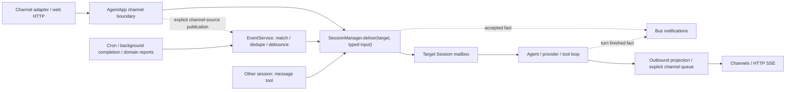

# Shadow architecture

This is the global view of the **implemented local agent** and its evolving
desktop/device infrastructure. It is based on the composition root and source
modules, not solely on design documents.

**Multi-device support is WIP.** A Main/Child protocol, capability executors, and
some real integration paths exist. That does not establish a production-ready
distributed release, feature parity with local tools, or completed operational
and security guarantees.

For setup and commands, use the [README](../README.md). For contribution rules,
use [AGENTS.md](../AGENTS.md). The [documentation index](README.md) separates
current references from historical proposals.

## Contents

- [Product and implementation status](#product-and-implementation-status)
- [Process architecture and startup](#process-architecture-and-startup)
- [A message from input to response](#a-message-from-input-to-response)
- [Sessions and continuity](#sessions-and-continuity)
- [Context and memory](#context-and-memory)
- [Model providers](#model-providers)
- [Tools, skills, and MCP](#tools-skills-and-mcp)
- [Events, background work, and cron](#events-background-work-and-cron)
- [Channels, gateway, and UI](#channels-gateway-and-ui)
- [Electron lifecycle](#electron-lifecycle)
- [Multi-device infrastructure — WIP](#multi-device-infrastructure--wip)
- [Persistence, configuration, and trust](#persistence-configuration-and-trust)
- [Module map and extension points](#module-map-and-extension-points)
- [Limitations and documentation corrections](#limitations-and-documentation-corrections)

## Product and implementation status

| Area | Implemented behavior and boundary |
| --- | --- |
| Personal agent | Persistent conversations, configurable models, tool-use loops, steering, subagents, and slash commands in the local backend |
| Context and memory | Agent prompts, identity, project context, scoped conventions, file-backed memory, daily event summaries, compaction, and learning-agent pipelines |
| Tools | Files, text editing, search, shell processes, background continuations, messaging, plans, conventions, dynamic script tools, and MCP adapters |
| Skills and agent types | Built-in definitions plus watched workspace overrides; progressive skill disclosure and per-type tool filtering |
| Channels | Web plus optional Discord, Feishu, QQ, and WeChat/iLink implementations; credentials and platform setup remain external requirements |
| Browser automation | Lazy Chrome DevTools MCP with per-session browser allocation; requires a usable browser/MCP process |
| Web application | Vue chat/session/files UI, agent views, logs and traces; Workspaces/Nodes/Approvals product screens are still fixture-backed |
| Electron | Main bootstrap, persisted launch profile, backend supervision, narrow preload API, renderer setup/recovery; Child/product integration remains incomplete |
| Device execution | Pairing/challenge/WebSocket code and bounded remote UTF-8 workdir operations exist; full remote tools, artifacts, UI administration, and release hardening remain WIP |

“Implemented” means a source path exists and is composed into the application
where noted. It is not a claim that every external integration was exercised on a
clean machine or that every historical acceptance criterion has been met.

## Process architecture and startup

### Local topology

```text
Browser / Electron renderer              External messaging platforms
          | HTTP + SSE                              |
          v                                         v
                 One Node backend (Main)
  Hono gateway + channels --> AgentApp --> SessionManager.deliver
  Event routing / other sessions ------->      |
                                               |
                               Session / EphemeralSession
                                  |                   |
                            LLM providers         SessionTools
                                                      |
                                 host files/processes, VFS, MCP,
                                 browser, subagents, event services

  Session facts/output --> Bus notifications + outbound queue --> UI/channels

        File/SQLite state beneath the configured agent Home

Electron main, when used:
  setup + preload IPC + authorization + backend process supervision
  (not a second agent engine)

WIP extension:
  Main <-> authenticated device WebSocket <-> Child local executor
```

The backend runs directly on **Node.js 24.15+**. TypeScript development uses
`tsx`; backend production output is Node ESM. The Vue package uses Vite.
Electron launches that Node backend module using Electron's Node runtime in a
separate process. There is no Deno compatibility layer or parallel Deno runtime
to maintain. Package scripts and `build.ts` own compilation/assets; do not infer
current packaging from the older compiled-sidecar proposals.

The backend build emits ESM modules and supporting assets under `dist/src`,
preserving relative paths. Its entry is `dist/src/index.js`; the separate eval
runner is `dist/src/eval/child.js`. Electron packaging uses
`pnpm deploy --prod --node-linker hoisted` to include the built backend and its
runtime dependencies without relying on development-tree symlinks. The renderer
build emits `app/dist`.
The eval child is the separate Node runner used by inline script execution, not
another long-lived agent authority.

### Composition root

[`src/index.ts`](../src/index.ts) wires the local application:

1. Load and validate configuration; derive Home and provider defaults.
2. Create the typed Bus, `EventService`, provider aggregator, background-task
   manager, and SQLite telemetry store.
3. Register base tools, execution hooks, VFS, search fallbacks, and lazy tool/MCP
   sources. Create the Hono application and cluster composition.
4. Initialize the selected session store, `HandoffManager`, `ContextBuilder`,
   `SessionManager`, skill and agent-type managers.
5. Mount VFS providers, register slash commands, messaging/subagent tools,
   schedules, and learning polls.
6. Register gateway plugins and channels, then the frontend fallback last so it
   cannot shadow API routes.
7. Start the agent/watchers and cron; attempt interrupted-session recovery;
   report local readiness.

Shutdown is coordinated through a runtime handle: stop accepting work, stop
polls/sessions/channels/schedules/watchers, release browsers, drain node
connections, stop the gateway, and save cluster state. This is lifecycle
coordination, not a promise that all in-flight work is durably replayable.

`src/runtime/process-entry.ts`, `runtime-cli.ts`, `bootstrap-config.ts`, and
`startup-plan.ts` add explicit Main/Child startup and separate bootstrap data
from the ordinary agent configuration. The simple local `pnpm start` path
remains the primary way to run the agent without Electron.

## A message from input to response

1. **Normalize input at the boundary.** A channel validates its configured sender
   policy and calls its explicit receiver. `AgentApp.receiveChannelMessage`
   translates the existing channel wire shape into `SessionInput`. Only this
   adapter derives the legacy logical ID from `channel:chatId`; directed callers
   supply a session ID without disguising their input as a channel message.
2. **Handle channel commands.** `AgentApp` tries the slash-command dispatcher for
   ordinary channel text, retaining its existing admin checks.
   Commands such as `/help`, `/config`, `/status`, `/sessions`, `/compact`,
   `/dump-prompt`, and `/learn` can respond without an ordinary agent turn.
   Event and other-session inputs do not pass through this command boundary.
   Retry is a typed control, not another copy of the user's content.
3. **Accept into a session.** `SessionManager.deliver(sessionId, input)`
   restores/builds state and history,
   resolves the agent type and workdir, builds context, and supplies the
   session-specific tool overlay, and admits the input to that session's mailbox.
   Its receipt means accepted in this process, not model completion or durable
   persistence. Preparation/admission errors reject the directed caller; web
   requests do not return a successful acceptance for those errors.
4. **Build the message.** `agent/message-builder.ts` converts inbound text,
   explicit user/session/event provenance and supported media into provider-neutral
   **user-role** messages. Sender prefixes and arbitrary metadata do not select
   roles, urgency, or command privileges. The execution context carries logical and physical IDs, effective
   cwd or remote capability, tool overlay, model settings, and an abort signal.
5. **Run the LLM/tool loop.** `BaseSession` calls `LLMProvider.chat`, persists
   assistant messages and usage/reasoning, and emits response/tool activity.
   Tool calls are grouped according to read-only metadata: compatible read-only
   calls can run together; other calls are sequenced. Results are appended as
   paired tool messages before the next model call.
6. **Finish or continue.** No tool calls ends the turn. A context-limit response
   can trigger persistent-session compaction and retry; ordinary errors and
   cancellation follow the session error path. A real `session.turn.finished`
   fact records completed/failed/cancelled status. Independent outbound projections
   retain the channel/web response format; `done` is a display boundary, not the
   source of domain completion.



The channel source is published once after direct acceptance and skips its original
session during subscription fanout. Delivery is never re-published as
`message.inbound`: there is no Message-to-Event-to-Message feedback loop.
`SessionInput` separates target identity from source and optional reply address;
event IDs and original input/session provenance survive fanout, while each delivery
has its own input ID. These envelopes are in-memory contracts, not a new storage
format or network protocol.

This is an iterative conversation loop, not a durable workflow DAG. A frontend
SSE activity stream does not mean every provider is token-streaming to the UI:
the common loop works with completed `chat` responses and tool events.

## Sessions and continuity

### Persistent versus ephemeral

- `Session` owns an inbox, active turn, abort controller, steering queue,
  compaction, and inactivity timer. Different logical sessions can operate
  concurrently in one backend.
- New human input during an LLM request aborts that request and queues the
  message. During tool work it can steer into the next model iteration; longer
  tool work can use `quickModel` to classify steer versus abort.
- Content has an explicit `interactive`, `queue`, `steering`, or `silent` policy.
  Event defaults and trailing-debounce flushes are explicitly queued, including
  during LLM/tool work; they cannot accidentally take the human-interruption path.
  Silent inputs only record content. Retry/cancel/compact are distinct controls;
  debounce exists only in the event router, not as a fourth execution mode.
- `EphemeralSession` serializes admitted work without persistent-session steering,
  idle sleep, or compaction. Admission does not wait for the model; lifetime end
  follows actual processing. Its transcript **is still persisted**. “Ephemeral”
  describes the execution lifecycle, not absence of stored data.

The default persistent-session inactivity period is 15 minutes. Sleep releases
active session resources and dynamically imported tools; state/history remain.
Below the handoff threshold, sleep does not require an LLM summary. Above it,
compaction creates a continuation before the loop stops.

### Logical history, physical segments, and subagents

`SessionState` holds a stable logical session ID, current segment index, activity
and token values, settings, parent/children, agent type, project, report target,
workdir, and preload tools. Physical logs are generated from a sanitized ID and
segment number. Compaction starts a new segment linked to the previous one;
forks can inherit a parent segment up to a record index. History assembly
sanitizes/truncates tool-call/result pairs rather than treating every stored
message as independent.

Local folder projects have a separate persistent registry under Main's workspace.
Their stable `projectId` is not the existing `projectName` used for agent planning
and shared context. Creating a project conversation stores both the project ID
and a local workdir capability reference. The locality resolver obtains its
absolute directory from the backend registry, never from a display-path snapshot.
Managed scratch directories and old unassociated sessions keep their previous
behavior. Session data and uploads remain under their owning session directory
even when filesystem tools execute in an external project folder.

`src/projects/` owns registration, canonical-path deduplication, and cancellable
Git clone operations; `src/index.ts` composes these with session creation and the
existing capability lookup. Electron only exposes a Main-window-validated native
directory picker. Project HTTP routes use the existing gateway authorization
boundary. This local workflow does not implement remote workdir parity or Git
worktree/branch management.

`subagent` **creates the session but does not send its task**. The parent uses
`message` afterward. When supported, a channel thread is created; otherwise a
synthetic session ID is used. Child sessions inherit the root spawner's workdir
ownership, not an isolated git worktree. Persisted `reportTo` routing consumes real
turn facts and sends `subagent-complete` or `subagent-failed` to the callback session.
UI command responses, tool projections, and `outbound.done` cannot produce a
spurious completion report. The `message` tool waits for target acceptance before
displaying its sent projection.
Fresh ephemeral subagents can receive their initial task; concurrent or later
message-tool follow-ups are rejected, including after recovery of an already-used
session. This does not turn ephemeral execution into a persistent conversational agent.
This supports coder/verifier patterns without making verification automatic.

### Compaction is continuity, not full memory reconstruction

`HandoffManager` checks configured context thresholds (default 0.95 in-loop and
0.75 during sleep). It runs a bounded, specialized handoff session to synthesize
the objective/summary/recent context, with a fallback when synthesis fails.
The next physical segment starts with that continuation and a rebuilt system
prompt. Tool-pair boundaries are respected before automatic compaction.

Session memory, scoped conventions, file tracking, and learning events are
separate mechanisms. A handoff is not a distributed transfer to another node.

## Context and memory

### Prompt assembly

`ContextBuilder` concatenates providers in registration order:

1. **Guideline:** selected agent prompt plus applicable safety/chat/tool
   fragments.
2. **Workspace:** Home, effective local workdir or remote/unavailable capability,
   VFS entry points, and `SOUL.md` according to agent-type policy.
3. **Runtime/identity:** platform and shell information, channel/user/admin
   metadata, identity lookup, skill summaries, available types and subagents.
4. **Project:** shared project context associated with the session.
5. **Memory:** conventions, keyword index, recent/related events, working set,
   and session memory.

Providers are not recomputed before every token or every tool call. Prompts are
built at session creation/restoration and rebuilt at relevant lifecycle points,
including compaction. Watchers updating the skill/type registry do not by
themselves rewrite the prompt of an already-running turn.

Runtime types are parsed from
`src/agent/agent-types/agents/<name>/AGENT.md` and workspace `agents/<name>/AGENT.md`.
Frontmatter controls tool allow/block lists, ephemeral behavior, skills/Soul
inclusion, model settings, and visibility. Existing built-ins include `general`,
`sub`, `explore`, `plan`, `verify`, `reflector`, `encapsulator`, and
`soul-reflector`; retained definitions such as `general-legacy` are not a second
engine. Root repository `AGENTS.md` is a contributor guide, not one of these
runtime definitions.

### File-backed memory layers

Paths below are relative to configured Home; they describe schemas, not data
that should be checked into the repository.

| Layer | Storage and use |
| --- | --- |
| Session summary | `memory/sessions/<safe-id>.md`; bounded text injected for continuity |
| Working set | `memory/sessions/<safe-id>.files.jsonl`; runtime hook records successful `write` tool calls, including its edit mode |
| Session conventions | `memory/sessions/<safe-id>.conventions.md` |
| Project conventions | `memory/projects/<project>/conventions.md` |
| Agent conventions | `memory/agent.conventions.md` |
| Daily knowledge events | `memory/events/YYYY-MM-DD.jsonl`; structured `when/who/what/why/challenge/refs/origin` material |
| Keyword/wiki index | Markdown names in `memory/topics`, `identities`, `concepts`, and `tools`; bodies read on demand |
| Learning watermark | `memory/.reflect-watermark.json`; identifies transcript increments already scheduled for reflection |
| Personality/identity | Shared `SOUL.md` and identity-manager files; distinct from user authentication |

Conventions are merged agent → project → session, with labels. Today's own
events are included eagerly; other sessions' events are relevance-gated by
project/shared modified paths when such signals exist, and capped. With no
project/file signals, related events can still be included up to the cap.
This is **relevance selection, not a privacy boundary**.

The current keyword inclusion rule is specifically “not ephemeral and not named
`sub`”; it is not a generic parent/child authorization check. The index reads the
global category directories, not the proposed per-project keyword hierarchy
everywhere. Working-set tracking captures the `write` tool path, not all edits
made by shell commands, MCP tools, other applications, or all descendants.

### Learning pipelines

Composition registers in-process bus polls:

- **Reflector**, default 30 minutes after activity aggregation: compare session
  history with a watermark and ask a specialized agent to process increments.
- **Encapsulator**, default 2-hour poll of reflector completions: derive reusable
  skills/tools/agent definitions from recurring work.
- **Soul reflector**, default 12-hour poll of reflector completions: refine
  personality/identity material.

`/learn` can trigger pipelines manually. These are model-driven file updates,
not training the underlying model. The watermark advances when reflection is
scheduled, rather than a transactional proof that all knowledge writes
completed. Memory-link and working-set hooks assist the process but do not
provide a complete audit or correctness guarantee.

## Model providers

`providers/provider.ts` defines the common chat, message, tool-call, usage, and
model-listing contract. Implementations include:

- Anthropic's message format;
- GitHub Copilot with its own OAuth/authentication flow;
- DeepSeek, including its reasoning/thinking handling;
- generic OpenAI-compatible HTTP providers, used for OpenAI, OpenRouter,
  Gemini's compatibility endpoint, Groq, StepFun, Kimi, and custom base URLs.

`factory.ts` detects the initial provider from the configured model unless an
explicit `model@provider` is supplied. For example, dot-version Claude names
are treated as Copilot models by that heuristic. Prefer explicit provider
selection when ambiguity matters.

`AggregatedProvider` routes **bare model names to the configured primary
provider**; it does not redetect every per-session model override. An
`@provider` suffix chooses another instantiated provider or fails if absent.
Aggregation is routing and model discovery, not automatic failover.

Context windows come from `model-registry.ts` plus provider-specific overrides.
`quickModel` is used for lightweight steering classification; it does not create
an independent scheduler. Generic provider config fields do not guarantee every
specialized adapter consumes all of them.

## Tools, skills, and MCP

### Tool layers

`Tool` supplies a name, description, JSON parameter schema, execution method,
and optional read-only/opt-in/remote-workdir metadata. `Tools` owns base
registration, execution hooks, error conversion, tracing, and large-output
truncation to a Home-local scratch file. Hook failures are logged rather than
treated as authorization failures.

`SessionTools` filters base tools by agent type and owns a session-only dynamic
layer. **Imported tool schemas are not added to the base definitions sent to
the model.** `import_tool` returns invocation contracts; `invoke_tool({name,
args})` executes the active imported tool. In allowlist mode, access to dynamic
tools is gated by `invoke_tool`; this must be considered when designing agent
tool policies. Sleep/reset clears dynamic tools and disconnects session-owned
MCP connections.

| Facility | Main implementation |
| --- | --- |
| `read` | Local text/directories, supported media/URLs, VFS; bounded remote UTF-8 read path |
| `write` | Create/overwrite, append, or match-and-replace edit; local checks and remote workdir path |
| `search` | Unified glob/grep/web search; ripgrep discovery/install helpers |
| `exec` | Managed local shell processes and inline script/tool-bridge execution |
| `kill`, `continuation`, `v:bg` | Cancel background work, attach continuation text, and inspect task status/output |
| `message`, `subagent` | Cross-session messaging and session creation |
| `plan_write`, `update_convention`, `log` | Plan state, scoped constraints, structured knowledge logging |
| `event_subscribe` | Subscribe to normalized system events |
| Lazy tools | Cron, project operations, search/MCP/tool factories |

Names and parameters should be checked in each implementation rather than
copied from a historical prompt. Local `exec` launches a new process per command:
changing directory in one command does not change later invocations.
Its `shell: "node"` mode executes inline TypeScript in a Node child with a
session tool bridge. OS-shell names such as `pwsh`, `bash`, or `cmd` select the
ordinary managed-process path.

### Virtual filesystem

`VirtualFs` exposes logical read/search surfaces mounted in `src/index.ts`:

- `v:sessions`: conversation history;
- `v:bg`: background status/output;
- `v:skills`: skill bodies/categories/resources;
- `v:memory`: shared file-backed knowledge;
- `v:events`: event subscriptions.

`v:tools/<name>` is an import source handled by `ImportTool`, not an ordinary
filesystem directory. `v:memory` writes are mapped to Home's memory directory
by path helpers.

### Skills

Skills are `SKILL.md` instruction documents, not running code. Metadata and
category summaries are disclosed first; full bodies and bundled resources are
read via `v:skills` when needed. Built-ins live in `src/skills/builtin`;
workspace skills can shadow them and are watched for changes. Metadata supports
platform/architecture, category/core presentation, and admin visibility.
These filters are not an execution sandbox for scripts referenced by a skill.

### Dynamic imports and MCP

`import_tool` accepts a registered virtual source, a TypeScript tool module, or
a JSON MCP configuration. A script module exposes metadata/parameters and
`execute(args, callTool)`, optionally `init`; it can compose existing tools.
Importing such a module executes trusted host code, not sandboxed data.

User-authored TypeScript uses Node's `registerHooks` and
`stripTypeScriptTypes` in transform mode, rather than requiring packaged `tsx`.
This supports enums and parameter properties; relative imports must include
their extensions. JSX and decorators are not supported in user scripts.
Backend source decorators are handled by the build compiler instead.

`McpConnection` uses the MCP SDK for stdio, SSE, and streamable HTTP transports.
Adapters translate MCP tool definitions/results to Shadow's tool contract.
Configured servers are initially offered as lazy sources. A separate
`McpManager`/watcher path can reload config servers into the base registry; do
not assume all MCP lifetime is exclusively per-session.

Chrome DevTools is split into common and full lazy entries sharing a connection.
`ChromeManager` allocates session-specific debugging ports/profiles and releases
browsers on cleanup. Browser/Windows automation comes from optional external
tools/services; configuration fields alone do not establish native automation
availability.

Web search preference in composition is configured Firecrawl, then Brave, then
reachable SearXNG; a keyless Firecrawl path is the fallback. Service reachability,
rate limits, and provider behavior remain external dependencies.

## Events, background work, and cron

Three mechanisms must not be conflated:

1. **Bus:** in-memory typed notifications with immediate subscribers and bounded
   polling buffers/aggregators. A work queue exists only after `declareQueue`;
   composition explicitly declares `message.outbound` before publishing, preserving
   FIFO messages sent before the channel consumer starts. Ordinary notification
   topics never accumulate hidden consume buffers. Async/sync observer failures
   reach the error reporter; notification emission is not an input-acceptance API.
   Shutdown stops session producers, then drains the outbound dispatcher before
   stopping the Bus. Pending event deliveries are still not crash-durable.
   It is not Redis, a message broker, or a durable event log.
2. **EventService:** normalized events with source descriptors, subscriptions,
   targets, urgency, and trailing debounce. Definitions persist under `.events`;
   writes are serialized, failures are reported, and `flush`/`stop` await pending
   writes. Delivery/debounce state remains in memory. It calls typed session delivery
   directly. `emit` awaits directed admission (or schedules the debounce window);
   independent fanout targets can partially succeed, with failures returned to the
   producer. Timer-triggered failures report correlation IDs. There is no automatic
   retry or crash replay of this pending work.
3. **Memory event log:** model-curated daily knowledge in `memory/events`, not
   the transport log of every Bus event.

`BackgroundTaskManager` keeps task records and callbacks in memory. `exec` and
other operations can outlive the originating turn and report completion through
events. Continuation text tells the resumed agent what to do; it is not a
serialized execution stack. Restarting the backend does not restore OS
processes from these records. Session-bound tasks use turn facts rather than UI
`done`. Callback delivery errors are reported separately from the real task result.

`CronService` persists definitions in `.cron/jobs.json` and schedules them only
while the backend is running. Jobs can target an existing session or an isolated
`cron:<job-id>` session and may remove themselves after running. The handler emits
a normalized event; it is not a second LLM loop. The Node implementation uses
Croner with a configured timezone for cron expressions and UTC for `every`
shorthand schedules. Weekdays use standard cron numbering (`0`/`7` = Sunday,
`1` = Monday), not Deno's old `1` = Sunday convention. The persisted format is
`{ "version": 1, "jobs": [...] }`; startup rejects legacy unversioned arrays
without executing or overwriting them. Existing schedules must be backed up
and recreated after review, not automatically converted.
Scheduler overlap protection covers the job callback, not
completion of the resulting agent turn. There is no claim of
exactly-once execution, cross-machine leader election, or missed-tick replay.

`HEARTBEAT.pulse` is a periodically written local timestamp, distinct from cron
jobs, learning polls, and the WIP device-transport heartbeat.

## Channels, gateway, and UI

### Channels and media

`ChannelManager` instantiates Discord, Feishu, QQ, and WeChat when enabled.
The **web adapter is created unconditionally**, even though a web `enabled`
field exists in the schema. WeChat uses the iLink implementation; a
`wechatDesktop` schema entry is not a separately wired desktop channel.
Likewise, a comment mentioning Telegram is not a shipped Telegram adapter.

`AbstractChannel` provides sender allowlisting and response update behavior.
No/empty `allowFrom` means allow all; direct chats are admin by default, selected
groups may be admin, and the web channel is always-admin at this layer.
Those are local-agent trust assumptions, not a multi-tenant account system.

Uploads are normally placed under the session's `uploads` directory. Message
construction and media helpers translate supported attachments for providers
and channels. Optional speech-to-text uses the configured external STT service;
it is not an embedded universal speech backend.

### Hono gateway

The default host is `127.0.0.1`, port `3123`; environment/options can override
them. Plugins expose:

- chat input/activity, uploads/media, and provider authentication;
- session/history/configuration/agent management;
- provider discovery and runtime control;
- OTLP JSON ingest at `/v1/traces`, `/v1/logs`, `/v1/metrics`;
- telemetry queries and SSE at `/v1/query/*` and `/v1/stream/*`;
- WIP pairing/node protocol endpoints.

An explicit launch bearer can protect gateway requests; some pairing/challenge/
node paths use their own protocol checks instead. Origin policy accepts the
same origin or configured origins and handles authenticated opaque Electron
origins. **CORS is not authentication**: non-browser callers need not send an
Origin header, and ordinary local startup may have no launch credential.
Provider OAuth endpoints are not a general login/authorization system for all
gateway data.

Frontend serving is registered last: use a Vite development proxy if configured,
otherwise an available built UI, otherwise expose APIs without a frontend.
The development UI normally runs on `5273`; static UI can share the gateway.
`OtelStore` persists telemetry separately from conversations. Traces can contain
tool arguments or other sensitive operational context.

Node tracing is initialized explicitly by `src/otel/runtime.ts`. The
OpenTelemetry Node SDK sends application spans directly to the local store;
console records are stored with their active trace/span IDs. Shutdown restores
the console and releases the provider. This replaces Deno's implicit telemetry
integration; the OTLP endpoints remain available for external ingestion.

Node's built-in `WebSocket` is used for outbound connections, including the
development proxy. Inbound HTTP upgrades use Hono's Node adapter and `ws` because
Node does not provide a native WebSocket server.

### Vue application

`app/src` uses Vue 3, Vue Router, and Vite. Chat views include conversation and
tool activity, session navigation, files/previews, and related controls;
agent, span, and log views use backend APIs. Electron `file:` loading uses hash
history; browser deployment uses web history.

Installation context and route policy distinguish Main/Child and UI scope.
These client-side policies are presentation rules, not server authorization.
`app/src/main.ts` still installs `createProductFixturesProvider()`;
Workspaces/Nodes/Approvals consume fixtures. Approval decision buttons explicitly
remain disabled until a local service is connected. Do not describe these
screens as live device management merely because the routes render.

## Electron lifecycle

`desktop/src/main.ts` owns the BrowserWindow, navigation policy, external-link
handling, directory selection, bootstrap IPC, and backend host. Web preferences
enable context isolation and sandboxing and disable renderer Node integration.
`preload.ts` exposes a narrow setup/runtime API, not arbitrary filesystem or
process execution.

The bootstrap coordinator persists setup state and a launch profile, initializes
Main configuration, and starts/resumes the backend before mounting the product
UI. The renderer can show first-run setup or recovery rather than pretending the
backend is ready.

The runtime host/supervisor launches the backend module in a separate process
using `ELECTRON_RUN_AS_NODE=1`, checks authenticated loopback readiness, and
requests shutdown during app quit. The launch credential remains in Electron
main; request authorization is attached only to the current renderer's requests
to the expected literal-loopback backend origin.

`pnpm desktop:dev` is the local desktop development path; `pnpm desktop` targets
the current Windows installer pipeline. Build configuration and artifacts are
not evidence of clean-machine certification, signing/notarization, automated
updates, or completed Child onboarding. Those require their own validation.

## Multi-device infrastructure — WIP

### Intended boundary

Main is the agent authority: providers, sessions, memory, orchestration, and
gateway data. Child supplies machine-local capabilities rather than a second
federated agent brain. Installation role, UI permission scope, and a particular
session's execution locality are distinct concepts.

### Implemented slices

- Versioned registry/protocol contracts, PIN pairing offers/presentation, admin
  approval, device challenge proofs, and node WebSocket sessions.
- Main composition in `cluster/main-cluster.ts`, including a persisted registry
  snapshot and a `RemoteExecutor` bound to connected node sessions.
- Production Child composition with Ed25519 credential references, protected
  key-store adapters, challenge-based connection/reconnection, advertised shell
  and configured workdir capabilities.
- Versioned jobs with acceptance/status/events, cancellation/deadline handling,
  and capability/permission checks.
- Child-authoritative local approvals and in-memory grants exposed through an
  authenticated loopback control API.
- Workdir capability operations for bounded UTF-8 file reads/writes; higher
  layers provide listing, edit, and text-preview paths without giving Main the
  Child's physical root.

The credential-store adapters include Windows/WSL DPAPI and Linux Secret Service
paths. That implementation scope is not a portability or secret-protection
guarantee on every supported desktop OS.

### Locality contract

`WorkdirRefV1` contains a node ID and opaque capability ID. Display names/paths
are presentation snapshots, not authority. The resolver returns one of:

- managed local workdir with an actual local path;
- available remote workdir with no Main-local path;
- explicit missing/offline/revoked/incompatible status.

Legacy local sessions normalize to managed capabilities derived from the owning
session. The current local resolver does not turn an arbitrary display path into
an external local-folder capability.

Tools reject remote contexts unless they explicitly opt in.
`read`/`write` have remote filesystem implementations, but `exec`, search,
dynamic/MCP imports, browser operations, and other local tools must not be
assumed remotely usable. A Child advertising shell capability and implementing
`process.execute` does **not** mean the ordinary agent's `exec` can execute in a
selected remote workdir.

### Not complete

Binary artifact transfer/staging, full remote tool parity, general remote UI
proxy/admin flows, live node/workdir/approval UI, recovery/retention semantics,
version-skew deployment policy, and release hardening remain incomplete.
`production-child.ts` still composes passive services for some planned roles.
Job/approval/process state includes in-memory components; a persisted node
registry is not durable replay for the entire execution system.

## Persistence, configuration, and trust

### Home, session data, and effective workdir

`agent.workspace` (default `./workspace`) is shared **Home**. Ordinary local
sessions use a managed subdirectory derived from a safe logical session ID.
`workspaceRoot`, when present, is the owner session ID inherited by subagents.
The locality resolver separates Home, session-data storage, and effective
workdir, even when the latter two coincide in the local managed case.

`resolveAgentPath` keeps shared prefixes such as `memory`, `skills`, `agents`,
`projects`, `.sessions`, `.plans`, and `.tmp` at Home. Other relative paths,
including `uploads`, resolve against cwd. Absolute paths are supported by the
local helper. A managed folder therefore provides organization, **not isolation
from the host or other sessions**.

### State inventory

| Data | Persistence/lifetime |
| --- | --- |
| Session state and logs | `.sessions`: JSONL files/state or SQLite `sessions.db` |
| Memory and learning | Markdown/JSONL under `memory`, plus watermark and Soul/identity files |
| Agent types and skills | Workspace `agents` and `skills`; shipped definitions are application assets |
| Plans/projects | Home-local files maintained by their tools |
| Event subscriptions/sources | `.events/subscriptions.json`, `.events/sources.json` |
| Cron definitions | `.cron/jobs.json` |
| Telemetry | `.otel.db` by default; `OTEL_DB_PATH` can select another location |
| WIP device registry | `.cluster/registry.v1.json` in ordinary Main composition |
| Electron installation | Bootstrap/runtime configuration and launch profile under Electron user data, separate from agent Home |
| Active work | Bus buffers, debounce timers, session loops, task/process registries, executor job records, and Child grants have in-memory lifetimes |

Both `JsonlSessionStore` and `SqliteSessionStore` implement the same interface.
SQLite persists versioned session metadata including lineage, project/workdir,
and preload tools, not just token counters. JSONL-to-SQLite migration is an
explicit script with legacy handling; changing the backend setting is not a
promise that existing history was migrated automatically.

No general replication, backup, multi-writer transaction protocol, or
exactly-once durability follows from these stores. Some write failures are
logged while execution continues. Back up real user state deliberately rather
than using it as a test fixture.

### Configuration

`config/loader.ts` loads an explicit config or discovers `bot.config.json` /
`.bot/config.json`, overlays recognized environment variables, and validates
with Zod schemas. It can fall back to defaults when no implicit config exists.
Use the committed example for setup; local credentials/configuration are private.

`bot.config.example.json` selects `gpt-4.1`, SQLite session storage, web settings,
and `restrictToWorkspace: true`. These are example choices, not all schema
defaults: the schema still defaults session storage to JSONL, and the web channel
is instantiated regardless of that example's enabled flag.

Provider keys, channel credentials, tool/search settings, voice, learning
intervals, workspace/storage, and model settings belong to the agent config.
Gateway options and runtime/bootstrap configuration are separate concerns.
Environment credential overlays can auto-enable some channels.

Configuration HTTP updates rebuild selected provider/default settings; separate
watchers handle skills, agent types, and MCP. This is not a full live reload of
every service. In particular, existing sessions retain dependencies captured at
creation while new sessions receive the new provider; changing persistent
configuration need not replace every active connection immediately.

### Trust boundaries

- **Host authority:** shell execution, imported TypeScript, MCP stdio processes,
  and automation act with the backend user's OS permissions.
- **Tool policies:** allow/block lists and remote-workdir checks apply at tool
  dispatch. `restrictToWorkspace` is a write-tool option, not blanket filesystem,
  process, network, or MCP confinement. Self-code admin checks also do not
  constrain arbitrary host code.
- **Untrusted content:** user text, attachments, web pages, tool output, and
  learned files can influence the model. Prompt guidelines are not enforced
  access-control rules.
- **Shared knowledge:** session/project scopes improve relevance, not
  multi-tenant privacy. Local web access can expose agent-owned state.
- **External services:** providers receive assembled context; MCP, STT, search,
  and messaging services have their own credentials and data boundaries.
- **Gateway:** keep loopback defaults. Explicit non-loopback hosting needs
  deployment authentication, transport protection, and exposure review.
- **Electron:** renderer restrictions and credential ownership reduce the IPC
  surface, but do not sandbox the trusted backend's tools.
- **WIP Child:** approval/capability/device protocol checks are separate from
  local tool policy; their presence is not a completed security assessment.

The development Docker stack deliberately exposes additional services, including
inspector/Xpra paths. It is a development environment, not a safe public default.
The Docker build context excludes the runtime `workspace`, local configuration,
and environment files; runtime data must be supplied separately rather than
baked into the image.

## Module map and extension points

| Module | Responsibility |
| --- | --- |
| `src/index.ts` | Application service graph, registration, startup/shutdown |
| `src/runtime` | CLI/process roles, bootstrap schemas, readiness/control, Child composition |
| `src/agent` | Message router, identity, memory, prompts, process/background managers |
| `src/sessions` | Persistent/ephemeral loops, state/history stores, locality, session APIs |
| `src/handoff` | Context-threshold decisions and continuation synthesis |
| `src/providers` | Provider contracts, adapters, aggregation, model registry/auth APIs |
| `src/tools`, `src/eval` | Tool implementations, dynamic invocation, local script bridge |
| `src/hooks` | Post-tool memory-link and working-set processing |
| `src/skills`, `src/agent/agent-types` | Built-ins, parsing, registries, workspace watchers |
| `src/mcp` | MCP client/transports/adapters and config watcher |
| `src/bus`, `src/events`, `src/cron` | In-process messaging, subscriptions, scheduling |
| `src/commands` | Slash-command handlers |
| `src/channels`, `src/voice` | Platform adapters, web chat/media, optional STT |
| `src/gateway` | Hono policy/serving, plugin contract, UI proxy/static serving |
| `src/otel` | Telemetry storage/query/streaming and distributed-job audit helpers |
| `src/vfs` | Logical resource mounts |
| `src/cluster`, `src/execution` | WIP device plane, capability/job contracts and executors |
| `src/utils`, `src/testing` | Paths/platform/media/watch/process helpers and test utilities |
| `app/src` | Browser renderer, HTTP/SSE clients, desktop bootstrap UI, product fixtures |
| `desktop/src` | Electron main/preload, setup state, authorization, process supervisor |
| `scripts`, `build.ts` | Local development, compilation/packaging, pairing, migration |

To extend the system:

1. **Tool:** implement `Tool`, register in composition or a lazy source, and add
   execution/policy tests. Treat read-only and remote support as behavior claims.
2. **Skill/type:** add a built-in or workspace definition, validate frontmatter,
   and use existing parser/watcher conventions. Tool policy and prompt text are
   independent.
3. **Provider:** implement `LLMProvider`, wire factory/config/model discovery,
   and test tool calls, reasoning, errors, and cancellation.
4. **Context section:** implement `SystemPromptProvider` and register its order;
   keep bounded content and clear scope.
5. **Channel:** implement the channel contract, wire configuration/manager,
   normalize messages/media, and preserve admin/sender and lifecycle behavior.
6. **Gateway feature:** add a plugin and runtime validation; keep renderer-only
   state out of authority decisions and mount before the SPA fallback.
7. **Persistence/locality:** update both stores and migration fixtures; keep
   node/capability references opaque and unavailable states explicit.
8. **Device capability:** extend validated contracts, Child handling and
   approval policy, Main routing, tool locality, and UI only as each slice is
   genuinely integrated. Do not relabel an incomplete protocol as released.

## Limitations and documentation corrections

Important differences from older plans:

- Deno commands and compiled-backend designs in historical documents describe
  the earlier baseline. Current development is direct Node/pnpm.
- “Wave integrated” and recorded test counts in `docs/implementation` are
  checkpoint reports, not current validation or distributed release readiness.
- The older SQLite “only counters/config persist” diagnosis no longer describes
  the versioned metadata store.
- Memory scopes and prompt permissions are not tenant isolation. Keyword paths
  and working-set coverage are narrower than some proposed memory invariants.
- Registry watchers do not mean every active prompt is refreshed immediately.
- A selectable WIP remote reference does not provide remote `exec`/search/MCP/
  browser parity, binary artifacts, or a fully wired approval UI.
- Config fields are not sufficient evidence of integration: web is always
  instantiated, and `wechatDesktop`/native Windows settings are not a second
  wired channel/tool merely by existing in the schema.
- `maxToolIterations` exists in config, but the common `BaseSession` loop
  currently uses a hard-coded 100-iteration bound; do not document that setting
  as an enforced per-turn limit.
- In-memory event/task/process state, best-effort persistence paths, limited
  recovery, and external-service failures prevent claims of lossless or
  exactly-once execution.

Keep these distinctions when updating documentation: local behavior,
implemented-but-WIP infrastructure, and planned design each need their own
evidence.
