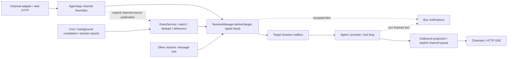

# Shadow architecture

This is the global view of the **implemented local agent** and its evolving
desktop/device infrastructure. It is based on the composition root and source
modules, not solely on design documents.

**Multi-device support is WIP.** A Main/Child protocol, capability executors, and
some real integration paths exist. That does not establish a production-ready
distributed release, feature parity with local tools, or completed operational
and security guarantees.

For setup and commands, use the [README](../README.md). For contribution rules,
use [AGENTS.md](../AGENTS.md). The [documentation index](README.md) separates
current references from historical proposals.

## Contents

- [Product and implementation status](#product-and-implementation-status)
- [Process architecture and startup](#process-architecture-and-startup)
- [Projects: ownership, storage, and routing](#projects-ownership-storage-and-routing)
- [A message from input to response](#a-message-from-input-to-response)
- [Sessions and continuity](#sessions-and-continuity)
- [Context and memory](#context-and-memory)
- [Model providers](#model-providers)
- [Tools, skills, and MCP](#tools-skills-and-mcp)
- [Events, background work, and cron](#events-background-work-and-cron)
- [Channels, gateway, and UI](#channels-gateway-and-ui)
- [Programmable browser I/O](#programmable-browser-io)
- [Electron lifecycle](#electron-lifecycle)
- [Multi-device infrastructure — WIP](#multi-device-infrastructure--wip)
- [Persistence, configuration, and trust](#persistence-configuration-and-trust)
- [Module map and extension points](#module-map-and-extension-points)
- [Limitations and documentation corrections](#limitations-and-documentation-corrections)

## Product and implementation status

| Area | Implemented behavior and boundary |
| --- | --- |
| Personal agent | Persistent conversations, configurable models, tool-use loops, steering, subagents, and slash commands in the local backend |
| Projects | Concurrent project runtimes with separate Homes, sessions, context, bots, learning, and diagnostics; shared provider credentials/devices, not separate OS sandboxes |
| Context and memory | Agent prompts, identity, project context, Project conventions, file-backed memory, daily event summaries, compaction, and learning-agent pipelines |
| Tools | Files, text editing, search, shell processes, background continuations, messaging, plans, conventions, dynamic script tools, and MCP adapters |
| Skills and agent types | Built-in definitions plus watched workspace overrides; progressive skill disclosure and per-type tool filtering |
| Channels | Web plus project-owned Discord, Feishu, and QQ bot instances; legacy WeChat/iLink implementation is not started by project runtimes |
| Browser automation | Lazy Chrome DevTools MCP with session-local launch/attach instances; requires a usable browser/CDP target and MCP process |
| Web application | Vue chat/session/files UI, agent views, logs and traces; Nodes reads device/capability inventory and provides Main desktop pairing controls; paired nodes execute without operation approvals |
| Electron | Main/Child bootstrap, persisted launch profile, backend supervision, narrow preload API and renderer setup/recovery; separate-device/native-platform acceptance remains required |
| Device execution | Explicit trusted-network device listener, pairing/challenge/WebSocket and bounded remote workdir operations; full remote tools, artifacts, revocation UI and release hardening remain WIP |

“Implemented” means a source path exists and is composed into the application
where noted. It is not a claim that every external integration was exercised on a
clean machine or that every historical acceptance criterion has been met.

## Process architecture and startup

### Local topology

```text
Browser / Electron renderer              External messaging platforms
          | HTTP + SSE                              |
          v                                         v
                 One Node backend (Main host)
  Shared gateway / project catalog / provider credentials / devices
              |
              +--> Project runtime A (flow below)
              +--> Project runtime B (same flow, separate state)

  Within each project:
  Hono gateway + channels --> AgentApp --> SessionManager.deliver
  Event routing / other sessions ------->      |
                                               |
                               Session / EphemeralSession
                                  |                   |
                            LLM providers         SessionTools
                                                      |
                                 host files/processes, VFS, MCP,
                                 browser, subagents, event services

  Session facts/output --> Bus notifications + outbound queue --> UI/channels

        File/SQLite state beneath that project's Home

Electron main, when used:
  setup + preload IPC + authorization + backend process supervision
  (not a second agent engine)

WIP extension:
  Main <-> authenticated device WebSocket <-> Child local executor
```

The backend runs directly on **Node.js 24.15+**. TypeScript development uses
`tsx`; backend production output is Node ESM. The Vue package uses Vite.
Electron launches that Node backend module in an Electron `utilityProcess`,
owned by the desktop main process rather than the renderer. There is no Deno compatibility layer or parallel Deno runtime
to maintain. Package scripts and `build.ts` own compilation/assets; do not infer
current packaging from the older compiled-sidecar proposals.

The backend build emits ESM modules and supporting assets under `dist/src`,
preserving relative paths. Its entry is `dist/src/index.js`; the shared script
worker is `dist/src/script-runtime/worker.js`. Electron packaging uses
`pnpm deploy --prod --node-linker hoisted` to include the built backend and its
runtime dependencies without relying on development-tree symlinks. The renderer
build emits `app/dist`.
The release command gates packaging on backend/Electron/Vue typechecks and
focused release tests, then verifies source-bound hashes of the fresh package's
resources and ASAR. See [release verification](release.md) for its exact limits.
Opt-in Windows service mode uses a pinned WinSW host to run Electron in Node
mode independently of the UI. Desktop service attachment has been removed;
independent services retain browser access and CLI management. Desktop
utility processes stop on explicit application quit, not window close. Installation
and SCM lifecycle acceptance remain distinct from a passing packaged smoke.
The eval child is the separate Node runner used by inline script execution, not
another long-lived agent authority.

### Composition root

[`src/index.ts`](../src/index.ts) is the stable, thin process entrypoint.
[`src/runtime/main/`](../src/runtime/main/) owns `startProjectHost` and
the `createProjectRuntime` composition factory:

1. Load configuration and initialize the canonical Project catalog. A new
   catalog starts Default with a fresh Home; old Homes are not imported.
2. Create the shared gateway, provider setup/authentication, device cluster,
   host diagnostics, and browser-port allocator.
3. For each catalog entry, create its immutable Home/configuration/scope and
   compose a separate Bus, `EventService`, provider aggregator, background-task
   manager, telemetry store, tools, VFS, identity, and eval bridge.
4. Initialize that project's folder registry and selected session store,
   `HandoffManager`, `ContextBuilder`, `SessionManager`, skills and agent types.
5. Mount its VFS and routes, register commands, messaging/subagent tools,
   schedules, and `LearningService`; start channels, watchers, and recovery.
6. Mount scoped project dispatch alongside shared host routes, then the
   frontend fallback. Start catalogued projects with at most three concurrent
   starts, independently tracking their ready/failed state rather than
   selecting one global runtime. Reserve persisted remote-workdir ownership
   before starting any Project.

Main's local readiness still waits for the initial Project starts to settle;
it does not declare incomplete Project services ready. Optional web-search
network discovery is deferred to the first search, and external channel
connections continue independently of local readiness. MCP startup registers
its lazy catalog; it does not connect every configured server.

Fixed-shape `[startup]` records report host/Project phases, completion/failure,
elapsed milliseconds and phase durations. They include no configuration values,
workspace paths, conversation contents, or error payloads. These timings separate
local store/recovery work from desktop process-launch overhead.

Electron validates these records through a bounded startup-only parser and
persists safe lifecycle/failure events and phase timings to
`<userData>/logs/startup.jsonl`. Project IDs become per-attempt numeric ordinals;
raw child output is not persisted. The current log and two rotations are each
bounded to 256 KiB. Recovery displays the failure category, runtime role and
elapsed time, and a main-window-only, argument-free IPC action reveals that
fixed log. Retry awaits failed-process cleanup. The readiness watchdog remains
15 seconds; the optimization removes optional network discovery from startup
rather than masking slow initialization with a longer timeout.

Shutdown is coordinated through a runtime handle: stop accepting work, stop
polls/sessions/channels/schedules/watchers, release browsers, drain node
connections, stop the gateway, and save cluster state. This is lifecycle
coordination, not a promise that all in-flight work is durably replayable.

`src/runtime/process-entry.ts`, `runtime-cli.ts`, `bootstrap-config.ts`, and
`startup-plan.ts` add explicit Main/Child startup and separate bootstrap data
from the ordinary agent configuration. The simple local `pnpm start` path
remains the primary way to run the agent without Electron.
Startup plans contain validated arguments and normalized configuration, not
descriptive service-name catalogs. Actual services are assembled by the Main
and production Child factories.

For `server start`, `--local-executor` enables Main task execution; without it,
the existing parsed `false` value now reaches all Project runtimes. Electron
persists the Main-only role-page choice (enabled by default) in setup state and
the launch profile. Legacy direct runtime callers that omit `localExecutor`
retain enabled behavior. The [coordinator execution policy](../src/execution/coordinator-policy.ts)
enforces an identity-based allowlist through base and session tool registries,
including cloned registries, plus an importer gate before executable tool
initialization. Explicit Child shell/filesystem routes remain available; local
shell/Node, unreviewed executable tools, and Quick Action runs fail closed, with
no automatic remote placement or Main fallback. Main does not advertise a shell
capability when disabled. This is not process isolation: Main storage, network
operations, installed search helpers, provider/auth/channel infrastructure and
owner-driven configuration discovery remain active. See
[desktop setup](using-shadow.md#desktop-setup-main-or-child) for user-facing
behavior and remote-execution limitations.

The Child lifecycle starts credential validation, local executor lifecycle
management, the Main connector, and an optional authenticated loopback control
listener in that order; shutdown and partial-start rollback reverse the
successfully started services. Capability descriptors are supplied directly to
the connector, not hosted in an empty registry service. No placeholder service
is created for artifact staging or for an absent local control listener.

## Projects: ownership, storage, and routing

Project owns a runtime and its data. Folder/Repository names the file resources
within it. Initiative is
coordinated work within that Project, not another runtime or isolation boundary.

### Ownership is not presentation

[`ProjectCatalog`](../src/projects/catalog.ts) persists stable IDs and
renameable names. [`ProjectsWorkspace.vue`](../app/src/components/ProjectsWorkspace.vue)
renders all project groups together and retains conversation resources keyed
by project and session; there is no global project switcher. Changing
the visible conversation does not move a runtime, draft, bot, or learning job.
Project settings expose General, Models, Bots, and Learning; Providers and
Nodes remain App-level views.

A project owns Home, session history and continuity, folder membership,
context/memory/identity, learned skills and agent overrides, MCP/browser state,
events/cron, background work, bots, learning, and scoped diagnostics. These are
separate service instances, not just `projectId` labels on a shared mutable
session manager. Built-in instruction assets can be reused read-only.
**Automations**, Chats, and folder/repository rows are UI groupings inside a
project, not independent ownership or authorization boundaries.

Each session persists `projectId` and at most one `folderId`.
[`SessionManager`](../src/sessions/session-manager.ts) validates project
membership for folder/workdir references, parent/child/report links, messages,
fork/call context, and yield handling. An agent cannot address another
project's history, fork, or message target through these APIs. Scoped VFS
views do not expose the host catalog as cross-project conversation data.
Local folder ownership is checked centrally after directory canonicalization:
another project's identical or parent/child-overlapping folder is rejected,
including clone destination reservations. Same-project directory rules
remain unchanged. Files stay in their registered folders.

Folder membership can be removed or moved through the owning project's
folder API and folder-row menu. A move creates a new folder identity in the
destination; neither operation transfers files, conversation history, or
learned knowledge. Retained source conversations cannot keep using the former
folder workdir, including after moving the folder back. Busy checks conservatively
cover the source project, not only the selected folder. Overlapping folder
registrations can prevent a safe transfer. Unconfirmed remote termination remains
durably blocked across restart, without automatic recovery. Retired folder
identities prevent removed membership from being reused.
This is not a project migration or a filesystem move.

Shared provider connections/credentials are merged into project configs.
Model defaults, quick-model choice, temperature and reasoning settings resolve
from conversation overrides, then project overrides, then App defaults, then
built-in defaults. Unset project fields are not materialized on disk; explicit
choices from existing records are retained.
[`ProjectConfigStore`](../src/projects/config-store.ts) excludes
provider credentials from its persisted file and rejects attempts to change
shared connections or relocate Home through the project config endpoint.
Devices and pairing are shared; visibility of a device alone does not assign
its folders to every project.

Identity observations also retain the source bot address.
[`userlink verify <channel> <senderId> [targetBotInstanceId]`](../src/tools/shell-commands/userlink.ts)
selects an observed target in the same project; ambiguous targets require
the bot selector. Confirmation checks the pinned project, bot, platform,
conversation, and sender instead of guessing a same-platform bot. Default's
legacy account links remain compatible; unknown or ambiguous targets fail
explicitly before sending a challenge.

This is enforced application ownership, not team/RBAC isolation or host
confinement. Local exec, script imports, MCP, and external processes still run
with host-user permissions. No whole-project move/merge/delete, cross-project
knowledge sharing, cross-project coordination, or separate process sandbox is
provided by this catalog.

### Actual storage

The [Main host](../src/runtime/main/) resolves the configured
`agent.workspace` and appends `.projects` to obtain the host root.
[`projectPaths`](../src/projects/contracts.ts) defines this layout:

```text
<workspaceBase>\                      configured base / shared device state
  .cluster\registry.v1.json            shared registry unless overridden
<workspaceBase>.projects\              sibling of the configured base
  projects.v2.json                     catalog and folder ownership index
  .host.otel.db                        host-only diagnostics
  projects\
    default\                          stable ID; display name may change
      config\
        project.json                  Project settings, no shared providers
        bots.v1.json                  private bot-instance configuration
      workspace\                      Default's active Home
        .sessions\                    JSONL and/or SQLite history
        memory\                       wiki, decisions, events; legacy watermark
        .learning\state.v1.json        learning batches, outcomes and retries
        skills\ / agents\ / SOUL.md    project-owned learned content
        .events\ / .cron\ / .otel.db    Project-owned state
    <project-id>\
      config\...
      workspace\...
```

Only canonical Project storage is loaded. Unsupported catalogs,
ownership formats, and storage locations are not upgraded or imported.
New catalogs initialize Default without copying an existing Home, its session
history, memory, skills, or folder registrations. Old directories remain
untouched but are not visible through this catalog. This is an intentional
compatibility break, not an automatic data migration.

Shared provider configuration and Copilot credentials stay in their existing
host/profile locations. The device registry remains at the configured base
unless explicitly overridden, so this cleanup does not reset device pairing.
Current JSONL and SQLite records keep distinct `projectId` and `folderId`
ownership; unsupported formats fail rather than reinterpret old IDs.

### Routes, failures, and scoped services

[`gateway.ts`](../src/projects/gateway.ts) exposes:

| Surface | Scope |
| --- | --- |
| `/api/projects`, `/api/projects/:id` | App catalog list/create and rename |
| `/api/projects/:id/status`, `/retry` | Project startup state and explicit retry |
| `/projects/<id>/api/...` | Project sessions, folders, bots, config, learning and content |
| `/projects/<id>/v1/...` | Existing project telemetry/compatible API suffixes |
| Root provider setup/discovery and device routes | Shared App services |
| `/host/v1/...` | Separate host diagnostics |

The base is `/projects/<id>/`, **not** `/api/projects/<id>/api/`.
Frontend content clients preserve the existing `api/...` and `v1/...` suffixes;
HTTP/SSE/file URLs and conversation cache identity include the owning
project. Legacy unscoped content routes dispatch to `default`, not to the
current UI selection. Old chat/agent/log routes similarly redirect to Default.
Existing gateway authorization still applies; a route prefix is not a new
multi-tenant login system.

The host tracks each runtime as starting, ready, or failed. A failed runtime
returns `503 project_unavailable` for scoped content; catalog status/retry
remain available, and [`ProjectGroup.vue`](../app/src/components/ProjectGroup.vue)
shows its startup error/retry without disabling healthy groups. Failed partial
startup cleans up owned resources. Host initialization failures occur
earlier and can still prevent host startup. Shutdown stops project
producers/sessions and flushes/closes owned services before releasing shared
gateway/device/telemetry infrastructure; in-memory work is not crash-durable.

[`LearningService`](../src/agent/learning/service.ts) owns per-project activity buffers,
subscriptions, activity gates, dispatch cancellation, and status at
`/projects/<id>/api/learning`. Enabled/interval settings apply live.
Its managed fresh jobs run on the project's `CronService`, rather than
independent learning timers.
`lastDispatchedAt` means dispatch acceptance, not that a learning agent completed
or successfully wrote knowledge. [`otel/runtime.ts`](../src/otel/runtime.ts)
routes spans/logs to an explicitly bound project scope; unscoped host
diagnostics use a separate store rather than broadcasting into every project.
[`EvalBridgeRuntime`](../src/script-runtime/bridge.ts) and remote job IDs are also
project-bound; this does not sandbox the code they execute.

### Remote folder ownership and upgrade boundary

Project composition wires
[`RemoteFolderOwnership`](../src/folders/remote-ownership.ts) into the folder
registry and [`remote-session-routes.ts`](../src/sessions/remote-session-routes.ts).
New remote-session creation registers or reuses a project-owned remote
folder, then persists its `folderId` and opaque node/capability workdir
reference. `POST /projects/<id>/api/sessions/remote` accepts `nodeId`,
`capabilityId`, and an optional UUID `requestId` for retry-stable session
creation; it does not accept an execution path. A reused request ID targeting a
different capability is a conflict.

For a reopened registered-folder draft,
`POST /projects/<id>/api/folders/<folder-id>/sessions` accepts an optional
`{requestId: UUID}` object; an empty body remains compatible. It verifies the
saved remote folder identity before creating a session, rather than reselecting
its node/capability. Concurrent requests and retries after a lost response reuse
the same persisted conversation; a request ID already bound to another folder
returns a conflict.

[`CapabilityWorkdirIdentity`](../src/execution/capability-workdir-identity.ts)
implements the advertised Child operation `workdir.identity`. It resolves the
configured root on Child using `realpath`, then hashes filesystem device/inode
identities for the root and its ancestors. Main validates the bounded
[`WorkdirIdentityV1`](../src/execution/workdir-identity.ts) response and checks
same-node root/ancestor overlap in the host catalog, rejecting cross-project
identical, aliased, or nested folders. Remote display paths remain display-only,
never inputs to Main's local filesystem. A filesystem without stable directory
identity fails explicitly rather than guessing ownership from its path.

Startup reserves legacy remote workdirs from **both JSONL and SQLite** for
Default. Both direct registration and registered-folder `requireAvailable`
revalidate every saved claim and folder on that device. An unavailable or
retargeted **other** saved capability can block not only new registration but
also opening a new session in an existing folder or accessing its
resources. These ownership checks intentionally fail closed until the affected
capability is restored and revalidated; they never fall back to Main.
Existing session records remain preserved.
Migrated existing sessions retain their references and supported execution
paths. An older Child without `workdir.identity` returns
`409 remote_workdir_identity_unsupported` / `upgrade_node` for new folder
actions, not a blanket prohibition on existing remote sessions. Deploy updated
Main and Child and reconnect; Mac/WSL SSH test fixtures need this rollout too,
and are not a portable/autostart release. An unavailable device/workdir returns
`503 remote_workdir_unavailable`. Native test execution is not an upgrade or
restart of already-running Child processes.

[`FolderService`](../src/folders/routes.ts) routes registered remote folder
file listings, UTF-8 text previews, and Git status/diffs through Child, including
folder browsing before a conversation exists. Remote raw/static media remains
`501 remote_raw_unavailable` in
[`remote-files.ts`](../src/folders/remote-files.ts); alternate text encodings
and remote cloning remain unsupported. Errors never select a Main-local folder.
These changes do not alter pairing or add per-operation approvals, OS isolation,
cross-node filesystem identity guarantees, or distributed release readiness.

## A message from input to response

1. **Normalize input at the boundary.** A channel validates its configured sender
   policy and calls its explicit receiver. `AgentApp.receiveChannelMessage`
   translates the existing channel wire shape into `SessionInput`. Only this
   adapter preserves legacy `channel:chatId` addresses for migrated bots while
   new bot instances carry project/instance-qualified addresses. Directed
   callers supply a session ID without disguising input as a channel message.
2. **Handle channel commands.** `AgentApp` tries the slash-command dispatcher for
   ordinary channel text, retaining its existing admin checks.
   Commands such as `/help`, `/config`, `/status`, `/sessions`, `/compact`, `/clear`,
   `/dump-prompt`, and `/learn` can respond without an ordinary agent turn.
   Command admission initializes session identity and Main-owned session data,
   without creating external folder paths or interpreting remote display paths.
   Results are persisted as non-message `command_result` records in both stores,
   returned separately as `commandResults` by display-history APIs, and delivered
   as typed web receipts (also included in the send acknowledgement). They do not
   enter provider history, inherited fork context, or channel-message fanout.
   Other channel adapters retain their ordinary textual command response.
   Event and other-session inputs do not pass through this command boundary.
   Retry is a typed control, not another copy of the user's content.
   `/clear` serializes with input admission, requires an idle persistent session,
   refreshes its installed agent definition, retires its in-memory context/tools,
   and persists an empty next segment without invoking handoff or the provider.
   Logical identity, locality, lineage, and old logs remain unchanged. Fork
   inheritance applies only to segment zero. Both stores persist `contextResetAt`,
   which excludes older transient memory from prompt injection without deleting
   files or long-term conventions. The next turn builds a new prompt/tool overlay.
3. **Accept into a session.** `SessionManager.deliver(sessionId, input)`
   restores/builds state and history,
   resolves the agent type and workdir, builds context, and supplies the
   session-specific tool overlay, and admits the input to that session's mailbox.
   Its receipt means accepted in this process, not model completion or durable
   persistence. Preparation/admission errors reject the directed caller; web
   requests do not return a successful acceptance for those errors.
4. **Build the message.** `agent/message-builder.ts` converts inbound text,
   explicit user/session/event provenance and supported media into provider-neutral
   **user-role** messages. Sender prefixes and arbitrary metadata do not select
   roles, urgency, or command privileges. The execution context carries logical and physical IDs, effective
   cwd or remote capability, tool overlay, model settings, and an abort signal.
5. **Run the LLM/tool loop.** `BaseSession` calls `LLMProvider.chat`, persists
   assistant messages and usage/reasoning, and emits response/tool activity.
   Tool calls are grouped according to read-only metadata: compatible read-only
   calls can run together; other calls are sequenced. Results are appended as
   paired tool messages before the next model call.
   `ask(kind="decision")` holds that tool call while `SessionManager.yields` waits for a
   correlated human/parent answer or a configured default timeout. No separate
   provider loop is created; parent requests enter the normal session mailbox.
6. **Finish or continue.** No tool calls ends the turn. A context-limit response
   can trigger persistent-session compaction and retry; ordinary errors and
   cancellation follow the session error path. A real `session.turn.finished`
   fact records completed/failed/cancelled status. Independent outbound projections
   retain the channel/web response format; `done` is a display boundary, not the
   source of domain completion.



The channel source is published once after direct acceptance and skips its original
session during subscription fanout. Delivery is never re-published as
`message.inbound`: there is no Message-to-Event-to-Message feedback loop.
`SessionInput` separates target identity from source and optional reply address;
event IDs and original input/session provenance survive fanout, while each delivery
has its own input ID. These envelopes are in-memory contracts, not a new storage
format or network protocol.

This is an iterative conversation loop, not a durable workflow DAG. A frontend
SSE activity stream does not mean every provider is token-streaming to the UI:
the common loop works with completed `chat` responses and tool events.

The renderer uses an application-owned, per-Main connection pool
(`app/src/live-client.ts`, `app/src/composables/useLiveClient.ts`). Its
`GET /api/live` stream multiplexes project-qualified chat, session
invalidations, logs and spans; cached Vue panes own subscriptions, not sockets.
Backend publisher leases attribute events to their owning project, and
the host and standalone Main integrate the same shared transport. Legacy
per-chat, per-request, and standalone telemetry streams have been removed;
retired streaming APIs return explicit HTTP 410 migration errors.

The wire contract is `src/realtime/protocol.ts`: named `realtime` SSE envelopes
carry epoch/sequence cursors, ordered data, explicit reset/ready controls and
observable heartbeats. A failed catalog Project is reported with an explicit
`unavailable` topic list rather than rejecting the whole multiplexed connection.
Only its readiness waits fail; healthy Projects keep receiving updates, and a
successful retry resets/re-enables its topics on the existing connection.
The server bounds its replay journal and client queues;
slow consumers disconnect rather than growing an unbounded server queue.
The renderer closes the old transport before replacing a subscription set,
deduplicates replayed cursors, reconnects with bounded backoff, and detects
half-open connections with a heartbeat watchdog. New subscriptions and
unrecoverable cursors trigger authoritative snapshot reads. Snapshots and
invalidations are coalesced; hidden idle chat panes do not render token updates
or retain individual network connections. A hidden submitted request can retain
its shared subscription to observe completion.
Execution cards also observe the owning project's sessions topic and
coalesce graph refreshes; metadata-only call-wait changes update mounted cards
without reloading the conversation or discarding its draft.

This is not a durable token-event ledger. Replay is bounded and in memory.
After a Main restart or replay gap, committed session history is authoritative;
temporary generated output may be replaced during reconciliation. Reconnecting
the UI never re-admits a command or implicitly resumes interrupted execution.
The host-wide `projects` topic invalidates the project catalog after committed
creation or rename. Session phase transitions, blocking-call waits and yield
changes publish `activity` invalidations on the owning `sessions` topic; these
refresh only the lightweight stages snapshot, not the session graph. Committed
session creation, metadata/configuration changes and deletion invalidate the graph.
Runtime startup also resets affected subscriptions once its HTTP routes are ready.
The renderer's `project-live-state.ts` shares one catalog per host and one graph
and activity snapshot per Project across chat panes, sidebars and notification
sounds. Reads start on subscription and subsequently on invalidation, explicit
refresh or reset; reconnect recovery also refreshes these snapshots even when
the cursor is replayable, so failed HTTP reads cannot leave them stale.
Bursts coalesce and changes during a read get one serialized
follow-up. Reset/disposal abort obsolete reads. There is no periodic HTTP polling
of `projects`, `graph` or `stages`, including when a notification monitor keeps
the shared state alive on another page. Snapshot failures remain visible until
retry, a new event or reset; they are not presented as empty successful state.
Not every other resource has push hooks: Nodes still use visible-only polling,
and provider configuration uses ordinary bounded HTTP reads.

`app/src/chat-request-control.ts` manages composer Stop state across preparation,
admission, streaming and cancellation. The Send button becomes Stop in the same
position while a request is busy, remains disabled while cancellation is pending,
and returns to Send when the request finishes. Enter can still send guidance
during active work. The renderer waits for its shared chat
subscription, then submits `/api/chat/send` with `stream:false` and reads the
short JSON `{requestId,chatId}` acknowledgement. It does not keep a per-request
SSE response open or automatically retry an uncertain admission. Omitting
`stream` also returns the admission JSON; `stream:true` fails before submission.
Restored activity gets the same identity from
`/api/sessions/stages`'s `activeRequestIds`. The UI always captures and submits
that ID, failing closed if it is unavailable. `POST /api/sessions/:key/cancel` uses a URL-encoded
logical session ID and an optional `{requestId}` body. A supplied ID must match
the active input's reply-address message ID (or its input/event ID); a mismatch returns
`409 request_not_active`. Omitting it explicitly targets the current turn.
The `requested` response acknowledges `Session.cancel()`, not completed cleanup;
the UI retains activity until a terminal event or confirmed inactivity, and
shows cancellation errors without pretending work stopped. Provider/tool abort
is cooperative, preserves queued inputs and does not kill unrelated background
tasks or roll back completed side effects.

The composer also exposes an explicit Continue action from
`/api/sessions/stages`'s `recoveries`. `SessionState.recovery` stores a recovery ID
and stopped/interrupted/failed reason through JSONL and SQLite, including their
migration path. Provider failures also retain a validated, credential-free
category (authentication, proxy, network, rate limit, availability, storage, or
request) so the composer can explain the failure after a reload and link to
provider settings. Raw upstream error bodies are not stored in this metadata.
`POST /api/sessions/:key/resume` accepts only `{recoveryId}` and
returns a 202 admission receipt with a new request ID. Serialized admission
rejects stale, duplicate, wrong-session or busy/queued resumes with 409. The
normal session loop handles a distinct resume control, continuing saved history
rather than retrying the original content or attachments. Resume appends no
user/event instruction to the model context. Pending calls from the trailing
assistant tool batch execute with their original IDs and arguments before the
next provider request; calls with persisted results are not executed again.

Startup recovery marks interrupted reusable sessions without invoking a model.
It changes recovery metadata only: unfinished calls remain unfinished, without
fabricated result messages. Reusable sessions persist each completed tool result
without waiting for sibling tools; a real result returned during cooperative
cancellation is retained. A new message supersedes unfinished calls with cancellation
results, whereas Continue/Retry finish the saved batch. Successful completion
clears recovery; unsent preparation cancellation creates none. After a crash,
explicit continuation may repeat effects from calls whose results were never
saved; exactly-once external effects are not guaranteed. In-memory queues are
not restored. Unrelated scheduled activity is unchanged.

## Sessions and continuity

### Roles and execution modes

`agent_type` selects the role, instructions, and tool constraints. `mode` is a
separate per-execution contract: `session` is reusable, `task` is a fresh
one-assignment worker with asynchronous completion, and `call` is a bounded
invocation inheriting a caller-context snapshot and returning its final result
through the original blocking tool call. Task creation returns after admission,
not model completion; their caller can work independently or finish its turn.
There is no independently configurable
`ephemeral` execution flag. Agent definitions provide `defaultMode`, not a fixed
lifetime. `subagent` accepts only task/call, defaulting omission to task regardless
of role default; durable topics use a separate creation surface. Mode is stored with execution state rather than inferred repeatedly
from a role that can be edited later.

The delegation capability matrix is enforced at runtime as well as described in
the prompt: durable root/topic → task/call; task → explicit call; call → none.
Role tool restrictions can narrow this further. The Project coordinator cannot
delegate. Structural delegation ownership applies to temporary executions, not
topic provenance; neither the agent type's visibility flag nor context-only fork
ancestry establishes coordination authority.

### Project coordination and peer sessions

Each Project has exactly one `web:orchestrator`, pinned as the default UI routing
entry. Its built-in role and canonical runtime guard permit only
read/search/session/message/work/sql, Project configuration and skill-authoring
controls, owner-only Discord `channel_config`, and ask/reply, excluding invoke_tool/exec/write/subagent.
It routes to reusable sessions and lets users continue there, rather than owning
their session hierarchy. Ensuring its existence never automatically runs an LLM.

Opening Coord shows a **Project workbench**, not a second kind of session.
Its default canvas is an expandable causal outline of goals, approaches, tasks
and findings, with current notes, optional read-only HTML exhibits and native
questions anchored at the affected goal. The lower technical origin stays
available on demand. An Initiative-grouped board and parent/dependency graph
remain alternate views. The existing coordinator conversation is a collapsible
side panel; discussing a premise appends a draft, not an automatic message.
On wide containers the side panel's left separator supports
dragging and keyboard resizing (arrows, Home/End), retaining the preferred width
across panel switches and temporary container shrinkage. It reserves at least
360px for the workbench; narrow containers keep the single-panel layout without
a resize handle. The graph is a
read-only layout, not a drag-to-reassign interface. Work
progress comes from Work records; a session's running/idle stage never implies
that its work is in progress or complete. Unassigned and historical work remain
visible, and filters do not change assignments. Untracked conversations and
questions also remain visible, including when the goal map is empty.

The authorized Project-scoped `GET /api/work` exposes a thin overview of all
Work records in the bound Project, known sessions, live human requests and
unresolved operation effects. `GET /api/work/:key` loads current notes;
history is opt-in with `?history=1`. `POST /api/work/:key` uses the human note
update/assignment/impact-review operations and exact current note version.
Viewing or selecting work does not create a session or confer authority. Discuss/New work
append an editable coordinator draft; they do not send it automatically.
Request links reveal the native question in its goal context. Credential and
publication controls retain their separate scope.

Ordinary chat no longer has permanent Decision reporting / Work alignment
buttons. Relevant work appears as a compact task link (loaded without history);
note editing and assigned-session reporting settings remain in work
details. Background-task and subagent disclosures are unchanged.

The workbench's **GitHub** panel binds explicitly allowed repositories to this
Project. Issue/PR snapshots and Work links live in Project Home's
`github-integration.json`; Work definitions still belong to WorkAlignment.
Owner-confirmed Issue imports create unassigned Work, not sessions. Cards show
linked resources and last-read CI/review facts. Publishing requires a saved
preview and a separate confirmation, with Work revision/sequence, repository
identity and remote snapshot/head checks. Write receipts and uncertain outcomes
are durable; uncertain writes remain in the existing effect store for the
integration's recovery controls, not a general notebook execution fence.
Explicit subscriptions poll one linked resource per minute, round-robin, and
deliver through EventService to the bound durable session, either silently or
as an explicitly enabled queued turn. Neither GitHub state nor review approval
revises goals, grants permissions, reassigns Work or proves acceptance.
See [GitHub collaboration](github.md) for setup, recovery and polling limitations.

Durable conversations are `web:chat-UUID` root peers. Topic is no longer a
separate business object. Project-scoped `search({space: "grep:v:sessions", query})`
searches histories and session metadata.
Read `v:sessions/<session-id>/brief` for title/description, folderId,
initiativeId, createdBySessionId, status and conversationUrl.
Prefer reuse before creating a session. Metadata and create/update receipts return `conversationUrl` in
`/projects/<encodedProjectId>/chat/<encodedLogicalSessionId>` form. Coordinator
handoffs link the session title to that returned URL, making the peer conversation
directly accessible rather than merely reporting an ID.
Remote-workdir sessions may use `v:sessions` search and typed Project messaging
as control-plane operations. This does not enable other remote search spaces,
which remain explicitly rejected.
`session` creation requires only title; optional description, folderId,
agentType, initiativeId, initialMessage, and requestId refine it. Kickoff admission
is optional and never creates a work item or transfers an assignment. Idempotent requestId
retries do not replay kickoff; initialMessageStatus distinguishes accepted,
not_requested, and not_replayed.

Session update takes sessionId, title and optional description; only
self/coordinator or authorized UI may update it. Metadata does not revise work
goals or acceptance. `register_folder` with path
uses the existing Project registry for an existing Main-local folder. List with
`read("v:project/folders")`; never translate a remote session's display path into
a Main filesystem path. Task/call executions cannot create/manage durable sessions
or register folders.

Authorized routes expose GET `/projects/:projectId/api/sessions/discover`, POST
`/projects/:projectId/api/sessions`, PATCH
`/projects/:projectId/api/sessions/:key/metadata`, and POST
`/projects/:projectId/api/orchestrator`. Historical Topic metadata remains in
stored records; current details and graph use session names/descriptions.
Discovery returns a paginated `sessions` array and `metadataSource`; neither
session creation nor renaming creates or revises a Work definition.

JSONL and SQLite migration flatten old reusable structural children without
losing context parents or changing effective workdirs. `createdBySessionId`
preserves provenance. `workspaceRoot` remains an owner-ID compatibility reference
for managed-session data/workdir locality, not structural/dependency ownership.
Graph parentage comes from delegation ownership, not a historical context parent.

- `Session` owns an inbox, active turn, abort controller, steering queue,
  compaction, and inactivity timer. Different logical sessions can operate
  concurrently in one backend.
- New human input during an LLM request aborts that request and queues the
  message. During tool work it can steer into the next model iteration; longer
  tool work can use `quickModel` to classify steer versus abort.
- Content has an explicit `interactive`, `queue`, `steering`, `next-step`, or `silent` policy.
  General event defaults and trailing-debounce flushes are explicitly queued, including
  during LLM/tool work; they cannot accidentally take the human-interruption path.
  Background execution results default to `next-step`: an active persistent
  session incorporates them before its next inference without aborting the current
  request or tool. Results arriving after that checkpoint retain a queued wake;
  idle receivers still wake normally. Explicit event delivery, matching broadcast
  subscription policies, and persisted source overrides take precedence. Directed
  events retain their existing source/event policy rather than subscription routing.
  This does not acknowledge reads,
  discard completion payloads, or change the existing `queue`/`steering` semantics.
  Silent inputs only record content after any active turn; they neither inject
  into its context nor start a later model turn. The `message` tool defaults to
  `next-step` for actionable context without interrupting active tools; explicit
  `delivery: "queue"` requests later work in reusable sessions. Routine progress/
  acknowledgements archive by default. The unadvertised legacy `silent` alias maps
  true to `silent`, false to `next-step`, never implicitly to queue. `attention`
  marks blockers, decisions, corrections and milestones; these cannot be archived
  and do not change an explicitly requested delivery.
  Required materials and unblocking instructions need a non-silent request;
  multi-part context must end with one, not with silent follow-ups.
  Retry/cancel/compact are distinct controls;
  debounce exists only in the event router, not as another admission policy.
- `EphemeralSession` serializes admitted work without persistent-session steering,
  idle sleep, or compaction. Admission does not wait for the model; lifetime end
  follows actual processing. Its transcript **is still persisted**. The internal
  class name describes one-shot execution, not a public role property or absence
  of stored data.

The default persistent-session inactivity period is 15 minutes. Sleep releases
active session resources and dynamically imported tools; state/history remain.
Below the handoff threshold, sleep does not require an LLM summary. Above it,
compaction creates a continuation before the loop stops.

### Logical history, physical segments, and subagents

`SessionState` holds a stable logical session ID, current segment index, activity
and token values, settings, parent/children, agent type, execution mode, project, report target,
workdir, and preload tools. New sessions persist `physicalIdVersion: 2` in both
JSONL and SQLite. Their physical log addresses combine a readable sanitized prefix,
a SHA-256 digest of the **complete** logical ID, and the segment number. This keeps
same-bot private chats and groups distinct even when their logical IDs share a long
Project/bot prefix. Compaction starts a new segment linked to the previous one;
forks can inherit a parent segment up to a record index. History assembly
sanitizes/truncates tool-call/result pairs rather than treating every stored
message as independent.

Absent `physicalIdVersion` retains the old log addresses for inspection; startup
does not rename, split, discard, or automatically migrate old transcripts. Legacy
IDs truncated at 48 characters may already reference mixed histories. Those
sessions (and forks inheriting their history) reject further execution and new
forks pending repair; automatic recovery/reporting also skips them. Explicit
deletion removes the selected session and recursively owned tasks/calls, including
finished executions missing from the optional `children` index. It drains active
execution, in-flight child creation and final receipt/report writes before deleting
persisted state and traces in JSONL or SQLite. Independent topics remain separate;
ambiguous legacy logs and history still referenced by another conversation are
preserved. A subsequent
message recreates the deleted address with a fresh v2 transcript, without adopting
the retained legacy log. Failed storage deletions remain errors, not successful
deletion confirmations. Short legacy sessions retain their previous behavior. This is
history-address isolation, not a change to shared Project memory or tool permissions.

Registered folders have a project-filtered registry backed by the host
catalog's ownership index.
Their stable `folderId` is distinct from the `initiativeId` used for coordinated
work and shared context. Creating a folder conversation stores the folder ID
and a local workdir capability reference. The locality resolver obtains its
absolute directory from the backend registry, never from a display-path snapshot.
Managed scratch directories and old unassociated sessions keep their previous
behavior. Session data and uploads remain under their owning session directory
even when filesystem tools execute in an external registered folder.

`src/folders/` owns registration, canonical-path deduplication, and cancellable
Git clone operations; `src/runtime/main/` composes these with session creation and the
existing capability lookup. Electron only exposes a Main-window-validated native
directory picker. Folder HTTP routes use the existing gateway authorization
boundary. The Main sidebar also offers Open remote folder, which opens the
existing remote-capability draft picker rather than registering a Main-local
path. Git worktree/branch management is not implemented.

`subagent` requires the initial `task` for task/call execution. Legacy
`mode: "session"` fails explicitly with guidance to use the `session` tool.
Tasks/calls start their assignment as part of
creation and do not accept later message-tool assignments. Child sessions inherit
the spawner's workdir ownership, not an isolated git worktree.

For asynchronous task execution, persisted `reportTo` routing consumes
real turn facts and sends `subagent-complete` or `subagent-failed` to the callback.
UI command responses, tool projections, and `outbound.done` cannot produce a
spurious completion report. Calls have no `report_to`: the original tool invocation
awaits their final result and no separate completion event is emitted to the caller.
The message tool enforces execution/ownership boundaries as well as waiting for
target admission before displaying its sent projection. Optional message intent
is request/question/progress/handoff/acknowledgement. Project-validated
initiativeId/itemId references appear in the first trusted sender envelope as
context only. Receipt is not acceptance of responsibility, completion, or an
ownership transfer; use explicit guarded Initiative release/handoff/claim.
Runtime work-revision references also travel in the trusted envelope. Messages
already obsolete at admission, or found obsolete when dequeued, are archived as
historical evidence rather than waking a new execution turn.

The conversation's right-hand message history rail includes human turns, incoming
session messages, and session-sourced events (including execution completions).
Previews identify the sender and message type, retaining the source session ID
when a display name is available. Selecting a marker scrolls to that message or
event in the current conversation; it does not switch to the source session.
These navigation entries do not make session messages or events resendable as
human prompts.

Call context is a snapshot, not a live shared message array. Internal tool calls
and intermediate responses stay in the child trace. Calls are blocking leaves:
no yield, session messaging, subagent creation, or deferred coordination. Missing
information/permission returns as a blocker, including partial work and side
effects, so the caller can decide or yield before another invocation. No yield
decision continuation or asynchronous one-shot child-receipt lifecycle is needed.
Caller cancellation stops its call, and cancellation/errors preserve paired tool
history. Durable topics yield to the human; temporary tasks yield to their
delegation owner, not a topic creator or historical context parent. Persisted
trace does not imply a blocked in-memory call survives a backend restart.

Call receipts retain their structured `completed`, `blocked`, `failed`, or
`cancelled` status without generic tool-output truncation. A model can return raw
JSON with `status: "blocked"`, `reason`, and `partialWork`, or `status: "failed"`
and `error` (including partial work/side effects), to make non-success explicit.
Only native subagent tool invocation supports blocking calls; embedding one in
exec/scripts/invoke_tool is rejected because those wrappers do not establish the
same caller-bound lifetime. Calls have a 120-second execution deadline and up to
10 seconds of cancellation cleanup.

Leaf calls retain role-permitted local exec with a foreground-only policy.
Its `timeout_ms` is 1–120000, defaults to 120000, and cannot be zero. Timeout/abort
waits for managed process-tree cleanup rather than detaching work or scheduling a
background completion event. Remote foreground exec inside calls is explicitly
unsupported; this does not change ordinary session/task execution. These lifecycle
rules do not constitute an OS sandbox or roll back external side effects.

The session graph exposes mode, role, structural parent, execution status, and the
optional native `parentToolCallId`. Both JSONL and SQLite preserve this correlation
field; older records can still be matched through their tool admission receipts.
The UI pins the coordinator and lists durable topic peers, while displaying delegated one-shot
tasks/calls as inspectable execution cards at their originating native tool calls,
not in a separate footer. Outbound tool events retain their IDs so parallel
results cannot overwrite or cross-pair. Executions without a matching native call
in the loaded history (such as older segments or script-created work) retain
compact inspector links under Other execution traces, rather than losing access
or guessing an invocation from a description. After a user-role message is persisted,
`session.message.appended` notifies observers; the web channel forwards received
event envelopes on the owning chat topic of the shared live connection. Completion bodies
are expanded inline, with raw metadata secondary, consistently with loaded
history. They are not synthetic assistant replies or additional call completions.
System reflection remains a separate
root activity. Internal execution records are retained even when they are not
listed as ordinary conversations.

### Compaction is continuity, not full memory reconstruction

`HandoffManager` checks configured context thresholds (default 0.95 in-loop and
0.75 during sleep). It runs a bounded, specialized handoff session to synthesize
the objective/summary/recent context, with a fallback when synthesis fails.
The next physical segment starts with that continuation as a user-role message
and a rebuilt system prompt. The continuation is persisted in the segment's
`summary_context` and restored as a `__compaction_summary__` message on reload,
for both JSONL and SQLite stores. The system prompt does not also inject the
session-summary file; that file remains available for explicit reads.
Tool-pair boundaries are respected before automatic compaction.
After a successful handoff, context usage is cleared and persisted with the new
segment so subsequent messages cannot trigger another handoff from stale usage.
The triggering response retains its own usage in history and outbound events.

Context-window resolution prefers a provider's per-model `modelContextWindows`
override, then the built-in model registry. Unknown models default to 400,000
tokens, giving default thresholds of 380,000 in-loop and 300,000 during sleep.
Registered model limits and explicit overrides are unchanged.

Session memory, Project conventions, file tracking, and learning events are
separate mechanisms. A handoff is not a distributed transfer to another node.

## Context and memory

### Prompt assembly

For ordinary local Project sessions, `ContextBuilder` concatenates providers in registration order:

1. **Runtime identity and execution contract:** platform, shell, channel/audience,
   role, permissions, and the session/task/call lifecycle. Role and mode limits
   remain enforced by the runtime, not by prompt ordering.
2. **Initiative view:** a derived root Work/descendant view when explicitly linked.
   There is no independently editable Topic brief or duplicate session goal.
   Recorded definitions are work context, not new human authorization.
3. **Current environment:** Project identity and directory-resource selection,
   one **Working directory** (local path, remote capability, or unavailable),
   directory source, private uploads, and **Project data directory (Home)**.
   Home is not the working directory. Registered folders are selectable resources,
   not parallel working directories: only the selected resource's metadata is
   included; the full catalog is discovered through `v:project/folders`.
   VFS entry points, memory usage and role-gated `SOUL.md` remain here.
4. **Behavior and scoped tool guidance:** the selected role owns work strategy;
   compact tool protocols cover work revisions, decisions and coordination.
   Session/task/call and role gating still suppress unavailable tool instructions.
5. **Capability discovery:** bounded Skill metadata, selectable role templates,
   and active temporary executions only for their delegation owner. Session-only
   coordinators see templates without acquiring subagent capabilities.
6. **Historical reference:** keyword index, dated events,
   and previously touched files. Compaction summaries appear only in the
   continuation message, not again in this system-prompt section. A summary's
   "Current Focus" remains a historical claim, not the current task state.
   Stored files are not rewritten or deleted by prompt assembly.
   Conflicts require checking source, scope, version and
   explicit supersession; a newer agent report cannot lift a human restriction.

Before each inference, `withCurrentWork` inserts the current work agreement after
runtime identity, ahead of cached Initiative context and history. It also
places agreement facts early in compaction input, without caching them in the
next segment's base prompt even when prompt rebuilding fails. Stamps and the execution fence
remain the enforcement mechanism; ordering and labels do not prove understanding.

Critical MCP invocation/recovery boundaries stay inline: live schemas win,
partial discovery is not absence, unknown execution must be reconciled before
retry, and failures grant no new permissions or credential access. Configuration,
indexing, Skill maintenance and managed Bot authoring details are available on
demand through the bundled `tool-operations` and `mcp-config` Skills. Prompt
snapshots and size budgets pin this deliberate division.

Conversation guidance depends on actual audience context: direct and
explicitly configured trusted groups use normal assistant behavior; other groups
and unknown audiences receive a short shared-conversation reminder. Audience
trust is descriptive context, not tool authorization or a verified member list.

Providers are not recomputed before every token or every tool call. Prompts are
built at session creation/restoration and rebuilt at relevant lifecycle points,
including compaction. Saving a changed `trustedChats` list invalidates reusable
prompts; they rebuild before the next model request, including when preparation
was already in flight. Failed refreshes surface as failed turns rather than
sending a stale prompt. Requests already sent to a provider and one-shot tasks/
calls keep their existing context. No persisted session trust field is used:
rebuilds resolve the current bot configuration. Watchers updating the skill/type
registry do not by themselves rewrite the prompt of an already-running turn.

Runtime types are parsed from
`src/agent/types/builtin/<name>/AGENT.md` and workspace `agents/<name>/AGENT.md`.
Frontmatter controls tool allow/block lists, default execution mode, skills/Soul
inclusion, model settings, and visibility. Existing built-ins include `general`,
`sub`, `explore`, `plan`, `verify`, `reflector`, `encapsulator`, and
`soul-reflector`; retained definitions such as `general-legacy` are not a second
engine. Root repository `AGENTS.md` is a contributor guide, not one of these
runtime definitions.

Legacy `ephemeral` frontmatter maps to `defaultMode` with a visible deprecation
warning; conflicting old/new fields are rejected. `soul` is an explicit role
context preference, independent of mode. The general role prompt favors direct
work for simple continuous tasks and leaves concrete mode selection and completion
instructions to the scoped guide. It no longer requires every nontrivial action
to create agents or an alignment document.

### File-backed memory layers

Paths below are relative to the owning project's Home; they describe schemas, not data
that should be checked into the repository.

| Layer | Storage and use |
| --- | --- |
| Session summary | `memory/sessions/<safe-id>.md`; compact-written snapshot for explicit reads, not system-prompt injection; automatic continuity comes from the segment's summary message |
| Working set | `memory/sessions/<safe-id>.files.jsonl`; runtime hook records successful `write` tool calls, including its edit mode |
| Project conventions | `conventions.sqlite`; guarded `sql` writes and append-only audit; shared current prompt context |
| Legacy conventions | `memory/sessions/<safe-id>.conventions.md`, `memory/projects/<initiative>/conventions.md`, `memory/agent.conventions.md`; preserved historical files, not injected as current rules |
| Personal preferences | Identified user profiles under `memory/identities/`; model-driven memory/learning retains sources and corrections |
| Daily knowledge events | `memory/events/YYYY-MM-DD.jsonl`; structured `when/who/what/why/challenge/refs/origin` material |
| Keyword/wiki index | Markdown names in `memory/decisions`, `topics`, `identities`, `concepts`, and `tools`; bodies read on demand |
| Learning progress and outcomes | Project `.learning/state.v1.json`; bounded source cursors, pending batches, verified receipts, event consumption and retry state; legacy `memory/.reflect-watermark.json` is imported without replay |
| Personality/identity | Project-shared `SOUL.md` and identity-manager files; distinct from user authentication |

Project conventions have no Session or Initiative scope. Work owns task
boundaries and acceptance; temporary presentation instructions remain in the
conversation. Decisions record the choice and its source, not a second rule
store. See [Project conventions](project-conventions.md) for SQL access,
human-source validation, limits and legacy handling. Today's own events are
included eagerly; other sessions' events are relevance-gated by
initiative/shared modified paths when such signals exist, and capped. With no
initiative/file signals, related events can still be included up to the cap.
This is **relevance selection within a project, not a privacy boundary
between its sessions**. Other projects have separate memory stores.

The keyword index is included for the main `general` and `general-legacy` roles,
independently of their execution mode; it is not a parent/child authorization
check. The index reads the
project-wide category directories, not the proposed per-project keyword hierarchy
everywhere. Working-set tracking captures the `write` tool path, not all edits
made by shell commands, MCP tools, other applications, or all descendants.

### Discord memory-domain boundary

Managed Discord execution bypasses the ordinary Project prompt providers.
`channels/integration.ts` supplies the approved Agent/skill snapshot, bounded
platform metadata and authorized catalog context. It excludes global SOUL,
identity, working sets, Project event/keyword indexes, conventions and generic
resource/tool discovery before provider input is built. Names, paths, counts
and source metadata are protected along with bodies; relevance never grants
access.

`memory/domains.ts` owns Project-private, Conversation, Shared and explicit
Agent-private domains. WeakMap-backed leases bind runtime identity, domain
revisions, conversation epoch and current-policy checks. The protected catalog
stores immutable content versions and provenance; observed sources constrain
derived notes, summaries, decisions and skills. A human-approved publication
declassifies only its fixed reviewed copy, hiding private provenance from its
external readers. Revocation blocks future use, not already-delivered content.
Legacy uncatalogued files remain private by exclusion rather than an automatic
full historical import.

Each Bot/conversation/current authorization epoch gets its own domain, even
when multiple channels use the same Agent. Binding saves and permission changes
cancel old execution and open a fresh physical segment without replaying earlier
history, summaries or provider conversation state. Logical IDs and owner-visible
old history remain. Both session stores validate/persist the boundary metadata.
Generic VFS rejects scoped memory leases; restricted execution uses a separate
closed registry, not prompts or hidden tool names as its boundary.

Same-scope blocking leaf calls and compaction preserve the owner's source
restrictions. Output leases are checked before individual Discord sends/edits
and cannot survive a changed connection generation or policy. The private
memory catalog is under the owning Project's
`config/channel-integrations/memory`, separate from the file-backed owner
Knowledge browser. Trusted `exec` is deliberately outside an OS sandbox and
can bypass application memory controls through host authority.

### Learning pipelines

Each project's `LearningService` registers in-process activity aggregation
and managed fresh jobs on its existing `CronService`:

- **Reflector**, default 30-minute poll: process pinned physical-segment ranges
  (at most eight ranges of 100 messages per batch). Select useful conditional
  goals, reasoning, facts or procedures instead of building a wiki for every
  entity. `learning_memory` stores evidence, stated/inferred interpretation,
  applicability, exceptions and revalidation triggers in `memory/decisions`.
  Later evidence can support, correct or retire a decision.
- **Encapsulator**, default 2-hour poll: consume exact unconsumed events from
  verified reflection batches, including earlier dates. `learned_skill` uses
  the shared Skill edit store, checks revisions and verifies immediate discovery
  of lesson-only skills. Executable packages, bundled skills and admin/core
  capabilities are not automatically installed.
- **Soul reflector**, default 12-hour poll: conservatively review the same
  durable events, with a separate consumption cursor. `learning_soul` requires
  two distinct source sessions and retention of the user-notification clause.

`LearningRuntime` binds each batch to its actual run. The Project-local journal
is independent of the JSONL/SQLite session-store selection; both persist the
execution receipt used for recovery. `learning_result` proposes an explicit
`applied`, `no_change`, `partial`, `blocked` or `draft_only` outcome. Only successful
session completion plus verified artifacts/events and an applied/no-change
receipt acknowledges input. Historical runs have no fabricated receipt.
Failures retain their batch and effects; event keys are idempotent within the
batch. No-op reflections do not start downstream model calls.

`/learn` explicitly retries a paused pipeline. Configuration/authentication
errors pause automatic retries; transient failures back off (one minute,
doubling) and pause after three attempts. Retry state and unconsumed batches
survive restart. Valid legacy watermarks are retained, not reset to reprocess
private history. Corrupt progress is surfaced rather than silently discarded.

These are model-driven external-memory updates, not weight training. Verified
persistence/discovery is not proof of semantic truth or improved performance.
Memory guidance asks future sessions to identify useful or contradicted
decisions; reflection records evidence-backed evaluations rather than treating
repeated summaries as reinforcement. See
[learning outcomes](tools-and-automations.md#learning-outcomes-and-recovery).

Managed Discord sources and their children are excluded from this Project-wide
pipeline, including legacy pending-batch recovery. `DiscordLearning` participates
in the same scheduler with per-conversation/epoch/revision protected journals,
source snapshots, independent cursors and retries. It reuses bounded
SessionManager/BaseSession calls, not a new provider loop. Workers receive only
exact versioned batch reads, `learning_record` and `learning_result`; no global
memory or Discord output. New user input and revocation fence background work.
Decision/event/skill output retains source restrictions in the Conversation
domain. Soul reflection produces a private draft, never a global SOUL update.
Prepared effects and idempotent atomic catalog writes permit interrupted-commit
recovery without re-inference; conflicting edits require reconciliation.
See [domain learning](tools-and-automations.md#discord-conversation-learning)
for limits and the owner-visible status surface.

## Model providers

`providers/provider.ts` defines the common chat, message, tool-call, usage, and
model-listing contract. Implementations include:

- Anthropic's message format;
- GitHub Copilot with its own OAuth/authentication flow;
- DeepSeek, including its reasoning/thinking handling;
- generic OpenAI-compatible HTTP providers, used for OpenAI, OpenRouter,
  Gemini's compatibility endpoint, Groq, StepFun, Kimi, and custom base URLs.

`factory.ts` detects the initial provider from the configured model unless an
explicit `model@provider` is supplied. For example, dot-version Claude names
are treated as Copilot models by that heuristic. Prefer explicit provider
selection when ambiguity matters.

`AggregatedProvider` routes **bare model names to the configured primary
provider**; it does not redetect every per-session model override. An
`@provider` suffix chooses another instantiated provider or fails if absent.
Aggregation is routing and model discovery, not automatic failover.

Explicit Copilot sign-in requests a fresh GitHub device code rather than silently
reusing cached authentication. `POST /api/auth/login` accepts an optional `host`
for `github.com` or a single-tenant `*.ghe.com` GitHub Enterprise Cloud host;
omitting it uses the installation's active host (initially `github.com`). Login
statuses and Copilot provider inventory/readiness include the host, not secrets.
Device authorization, token exchange, refresh, and allowed API endpoints are
bound to that host. The renderer and Electron validate the corresponding HTTPS
device-authorization link rather than accepting arbitrary external login URLs.
Concurrent login attempts for different hosts are rejected instead of aliased.

Credentials and model caches are isolated by host; legacy GitHub.com files remain
compatible. Successful authorization persists the active host for all projects
in the installation. Failed attempts expose safe error codes, including
system-proxy/PAC failures, without deleting the existing credentials. The
authenticated `POST /api/auth/logout` endpoint cancels pending sign-in and removes
the active host's local Copilot access token, API token, and model cache, retaining
the selected host and other hosts' caches. It does not revoke GitHub authorization
or sign out the browser. A refresh that was already in flight cannot restore
credentials after their removal or send them to a newly selected host. Arbitrary
self-hosted GitHub Enterprise Server domains are not supported.

Context windows come from `model-registry.ts` plus provider-specific overrides.
`quickModel` is used for lightweight steering classification; it does not create
an independent scheduler. Generic provider config fields do not guarantee every
specialized adapter consumes all of them.

## Tools, skills, and MCP

### Tool layers

`Tool` supplies a name, description, JSON parameter schema, execution method,
and optional read-only/opt-in/remote-workdir metadata. `Tools` owns base
registration, execution hooks, error conversion, tracing, and large-output
truncation to a Home-local scratch file. Hook failures are logged rather than
treated as authorization failures.

`SessionTools` filters base tools by agent type and owns a session-only dynamic
layer. **Dynamic tool schemas are not added to the base definitions sent to
the model.** `search` with `space: "grep:v:tools"` returns matching lines and paths;
read an individual tool path for its complete invocation contract.
`invoke_tool({name, args})` resolves known catalog IDs lazily and validates
arguments before execution. There is no "contract already disclosed" flag or
extra first-call round trip. Invalid arguments return only the affected tool's
contract, without execution; unsupported schemas fail closed. Validators are
scoped to tool instances, so reused schema IDs cannot alias across sources or
versions. Validation is not authorization. In allowlist mode, access to dynamic
tools is gated by `invoke_tool`; this must be considered when designing agent
tool policies. Sleep/reset clears dynamic tools and disconnects session-owned
MCP connections. Configuration changes and MCP tool-list notifications invalidate
affected adapters, including tools borrowed by blocking call snapshots.
After context compaction, an agent can search for an exact ID again if it needs
the schema; runtime correctness does not depend on a stale disclosure marker.

| Facility | Main implementation |
| --- | --- |
| `read` | Local text/directories, supported media/URLs, VFS; bounded remote UTF-8 read path |
| `write` | Create/overwrite, append, or match-and-replace edit; local checks and remote workdir path |
| `search` | Glob/grep over physical files or VFS resources, plus web search; virtual results have read paths and pagination |
| `v:config/mcp.json` via `read`/`write` | Revision-checked, atomic Project MCP configuration without connecting |
| `invoke_tool` | Lazy connections and current-schema argument validation |
| `exec` | Managed local shell processes and inline script/tool-bridge execution |
| `cancel`, `continuation`, `v:bg` | Inspect/cancel owned background, task/call and A2A executions; continuation applies only to `bg:` callbacks |
| `session` | Durable peer creation/naming and Main-local folder registration; no work definition |
| `message`, `subagent` | Authorized session messaging and temporary task/call execution |
| `ask`, `reply` | Ordinary text input or structured decisions, authenticated recipient routing, correlated answers and configurable waiting |
| `work` | Optional current notes, causal goal paths, assignments, reported progress and impact reviews |
| `plan_write`, `sql`, `log` | Planning documents, guarded Project conventions/read-only current Work queries, structured knowledge logging |
| `event_subscribe`, `event_source` (lazy) | Subscribe to normalized events or manage restricted Project polling producers; discover via `v:tools/events` and invoke through `invoke_tool` |
| Lazy tools | Events, cron, search/MCP/tool factories |

### Initiative coordination

[`InitiativeStore`](../src/initiatives/store.ts) opens one `initiatives.sqlite`
per Project Home, independently of the selected JSONL/SQLite session backend.
Version 6 atomically migrates its old initiative tables into unified records in
`work_contracts`, preserving keys, definitions, assignments, status, dependencies,
audit history and effect references. Legacy SQL tables become read-only archives;
the `initiative` SQL tool is no longer registered. Work without historical
acceptance is marked for review, never silently human-approved.

An Initiative is a root work item and its descendants. `work list` discovers
Project work; `work tree` derives membership and aggregate progress. Both return
compact paginated indexes (default 5, maximum 20); read `context` with an exact
key for the definition. Parent/completion dependency cycles are rejected. A completed
child does not automatically satisfy the root's acceptance. `work create`,
`update`, `assign` and `review` provide one bounded, validated mutation interface.
Updates use the current record sequence as `version`. Definitions have a
separate semantic revision; ordinary progress does
not change the goal. No second editable todo/goal store is maintained.

An explicit `initiativeId` survives delegation, compaction, and storage reload.
It accepts a canonical root Work key as well as a historical Initiative slug;
this link selects a derived view, not an assignment.
Absent that link, prompt summaries show only work the session created, owns, or
is assigned. Runtime activity is separate from recorded task status; an
inactive owner or assignee retains responsibility across sleep/recovery and needs
explicit reassignment, not automatic completion, stealing, or
reassignment. Session creation and message admission do not transfer work.
Inactive or unknown ownership is never claimable merely because its session
is unavailable. Schema version 3 adds `needs_attention`; deprecated
`needs_handoff` is an attention-only compatibility signal, not a claim/recovery
authorization. Ownership belonging to an already-deleted session remains recorded
as needing attention; it never becomes automatically claimable.
Deleting a session does not release its work.
The note's controller or an authenticated human may explicitly reassign it.
That operation does not cancel the prior executor or settle its side effects.
Actual operation recovery belongs to the owning service, not an adoption or
checkpoint requirement on the note.
Session todos are a query view of shared items. `plan_write`
remains a planning-document tool, not another authoritative task list.
Here active means a live, accepting session without pending recovery, not proof
that a model turn is currently running.

Startup imports legacy `projects/<slug>/project.md` files once, retaining their
original contents as an archive and recording migration provenance. Invalid or
changed legacy inputs fail explicitly. JSONL and SQLite session metadata
normalize legacy `projectName`/`initiativeName` to `initiativeId`, separately
from canonical Project/Folder ownership validation.

Work operations edit the owning Project's Home, never a remote display path.
They do not enable arbitrary remote scripts, MCP imports or tool factories.

### Tool execution details

Names and parameters should be checked in each implementation rather than
copied from a historical prompt. Local `exec` launches a new process per command:
changing directory in one command does not change later invocations.
Its `shell: "node"` mode executes inline TypeScript in a Node child with a
session tool bridge. OS-shell names such as `pwsh`, `bash`, or `cmd` select the
ordinary managed-process path.

Local OS-shell failures include the exit code, actual shell (including automatic
Windows `cmd` to `sh` escalation), resolved working directory, and separate
stdout/stderr sections with explicit `(empty)` markers when a stream has no
output. Signal termination also reports the signal. Foreground results and
background completion failures share this format; successful output is unchanged.
A nonzero exit remains a failure, but its meaning is command-specific: for
example, `git grep` exits with code 1 when there are no matches, usually without
diagnostic output. Node-script and remote-execution results retain their own
formats.

`ask(kind="decision")` is called directly, not through the Node script bridge. Its question
advertises two distinct suggested options and one default; legacy three-option
requests remain readable. Both binary and legacy three-option questions use the
same square-edged, lettered selection list and an explicit **Continue** action;
choosing a row never submits immediately. Letter keys select options while the
question is focused, and Enter confirms a focused preset. The application adds its own
custom-response entry for humans, separate from the chat composer. Root sessions expose the
question to the human; a child addresses its stored parent, not `reportTo`.
Only that parent can answer through `reply({request_id, text})`; human answers
use the session `/ask` HTTP endpoint or the `/reply` channel command. The
coordinator checks recipient, request ID and exact option before resolving
the suspended call. Session stages report `waiting` while a request is active.
Human free-text replies use the separate HTTP body `{requestId, customText}` or
`/reply <request-id> text <your response>`, with the same recipient and initiating
channel-user checks. Mixing `option` and `customText` is rejected. Text is bounded
to 4000 characters and trimmed, never accepted as an arbitrary preset or parent
answer. The tool receipt contains the text in `option` with `custom: true` and is
persisted through the ordinary paired tool result in both stores.

Ordinary `ask(kind="input")` uses `InputRequests` instead of the decision journal:
no brief, options, default or authorization is manufactured. Local roots ask the
human, tasks ask the stored parent, and an active A2A runner binds only its
authenticated caller. `reply` selects the pending request, not a conversation.
Replies return text and resume the original tool call. Both stores retain
`input_request` facts without restoring in-memory waiters on restart. A2A task
state and question-bound remote references are described in [A2A](a2a.md).

The waiting-policy field remains `tools.yield.timeoutMs` and defaults to indefinite waiting (`null`).
`SessionConfig.yield` can override it, including explicit indefinite waiting;
removing the override restores the global default. Positive timeouts choose
the declared default on the backend, with timeout provenance in the tool
result for decisions; ordinary input instead fails without choosing an answer.
Policy is captured when each question opens. Cancellation never
chooses a default. This workflow is not an authorization or capability
approval mechanism.

Calls, results and policy overrides persist through the normal JSONL/SQLite
paths. `YieldRecords` also appends versioned `yield_decision` facts to the
request's physical segment. The server assigns the request ID and pins its
segment/tool-call origin before publication. Answers (including timeout
defaults) are saved before acknowledging or resuming the suspended call;
concurrent responses cannot replace an in-flight settlement. A persistence
failure rejects the operation rather than approving work. Cancellation and
delivery failure record a separate closed outcome. These facts are excluded
from provider messages and model-history fork offsets.

The optional `sources` argument cites up to three existing decisions by
`{sessionId, physicalId, requestId}`. Each reference must resolve in this
Project's session store and belong to the named session segment. The server
checks existence/identity, not the agent's causal interpretation; linking a
record neither answers it nor changes routing or permissions. The read-only
`GET /api/sessions/:key/decisions?physicalId=...` endpoint exposes records for
one owned segment. JSONL-to-SQLite migration preserves the raw facts; old logs
without them remain readable through their tool-call/result pairs.
New answer receipts include a complete `reference` for later citations;
pending parent notifications expose the same identity through the request's
`id`, `sessionId` and `origin.physicalId`.

New `ask(kind="decision")` calls require a structured `brief`: original goal,
reason for human judgment, recommendation, tradeoff, blocked/unaffected work,
and separately typed user constraints, observations, assumptions and proposals.
`ask(action="context")` provides the on-demand schema and recent attributable
human inputs from the session and its reporting owner, including older segments.
Runtime `decision_input` facts record actual human-input envelopes; provider
role `user`, sender markup and a worker's claim about the user are not proof of
human authorship. Evidence names its logical session, physical segment,
input/tool ID and exact quote. A user constraint must equal its human quote;
observations need a recorded source, otherwise they must remain assumptions.
This validates provenance, not the truth, completeness or interpretation of
the source. Older traces without these facts cannot retroactively prove authorship.

Users can set `decisionOwnerSessionId` through the reporting-responsibility
control (`GET/POST /api/sessions/:key/decisions/owner`). The setting persists
in both stores, targets an existing durable root in this Project, and is
captured in each question as `reportingSessionId`. It does not reparent a
session, delegate answering rights or transfer Initiative assignments.
Changing it while a question is pending is rejected. A separate normal
SessionManager input asks that reporter to check premises and synthesize a
self-contained explanation rather than forward worker jargon.

`POST /api/sessions/:key/ask/follow-up` accepts an investigation or deferral
instruction from the original user-addressed session. Unlike clarification,
it closes the old wait durably and returns `approved:false`, a disposition,
reason and blocked/unaffected scope to the original tool call. It never selects
an option. Investigation uses that session's existing tools and permissions;
deferral permits only already-authorized independent work. The old request
cannot subsequently be answered. A later question may use `reconsiders` to
link the earlier version without inheriting it as a still-valid premise.

`ask(action="invalidate")` can invalidate the agent's own recorded premise;
the authenticated UI can mark a decision obsolete through
`POST /api/sessions/:key/decisions/invalidate`. An append-only
`yield_invalidation` fact preserves past answers while read-time traversal
marks transitive `sources` dependents for revalidation. Missing source records
also require revalidation rather than implying approval. Dependency traversal
is bounded to 1000 records; larger closures fail explicitly. New requests and
answer commits reject obsolete premises. Affected live waits close with an
explicit non-approval result; durable sessions/reporters receive notifications,
and resumed contexts include saved restrictions. Scan/notification failures
are returned explicitly even when the root invalidation is already saved.
These events do not roll back completed side effects or automatically mutate
Initiative items. Assignees must maintain their existing guarded work records;
scope text is not a new per-item scheduler or sandbox.

For a live user-addressed request, `POST /api/sessions/:key/ask/reviews`
accepts an idempotent clarification or revision request. `YieldDiscussions`
persists `yield_review` facts in the original segment and keeps one job per
owner session. Accepted discussion pauses the automatic default for the
remainder of that wait; failure does not silently restore it. Clarification
does not select an option, send an ordinary chat input, or resume the blocked
yield tool. `GET /api/sessions/:key/decisions/reviews` reads that version's
discussion history. These facts are excluded from provider history/fork offsets.

`SessionManager` runs the explanation through a separate server-owned
`EphemeralSession`, using the normal model loop but an empty tool registry and
allowlist. It receives the saved request, direct cited records, up to six earlier
discussions of this version (agent responses capped at 4000 characters), and at
most twelve recent conversation messages (1600 characters each). A fixed prompt
requires distinguishing user constraints, observations, assumptions and missing
context. This is an explanation of supplied context, not an investigation or
independent fact check. Work is bounded to three model rounds, 3072 output
tokens per round and two minutes of model execution. The helper cannot answer
the original decision or report a task completion to its owner. Shutdown and
owner deletion abort/drain discussions; persisted running reviews without an
active job are shown as interrupted, never automatically replayed.

A successful revision records the old request as `superseded` and opens a new
immutable request in the same segment, retaining owner, recipient, tool-call
origin and citations. Both versions link to each other; the new version records
the user's revision instruction and the explanation session. A new request ID
invalidates old answer controls without resolving the original tool promise.
Only an explicit answer to the current version resumes it; its receipt includes
`revisedQuestion` so the model sees the question actually answered. A late
revision cannot overwrite an already answered or cancelled request. This path
does not change parent-answer authority or assign cross-topic ownership.

Waiters/timers remain process-local, are cancelled on shutdown/deletion,
and are not resurrected after restart. An opening with no saved outcome
means no confirmed answer, not a live wait. Normal interrupted-tool history
recovery still applies and may produce a new request; an old answer is not
automatically replayed against that new request.

### Causal notes, questions and execution facts

`src/initiatives/work-notes.ts`, `work-contract.ts`, `InitiativeStore`, and
`src/sessions/work-alignment.ts` keep a current shared notebook in the existing
`initiatives.sqlite`, independently of the JSONL/SQLite session backend. There
is no separate canvas/task database. Legacy records remain readable; adoption,
policy, checkpoint, settlement and proposal fields are historical/internal
compatibility data, not the current public tool protocol.

Work never gates ordinary execution, even for sessions with old required-policy
metadata. Creating or renaming a session does not create notes; untracked sessions
are visible. Existing role, capability, channel and owner approvals remain the
actual authorization boundaries. Notebook status and boundary prose are not an
access grant, OS sandbox, cancellation operation or outcome attestation.

Nodes have a kind (goal/approach/task/finding), a current summary, editable plan,
next action, artifact links and optional read-only HTML. Child links describe
chosen support, an actual requirement, or an assumption, with a reason.
Parents/controllers maintain structure; assigned workers maintain local facts.
Temporary workers may update the branch linked to their execution, not an
unrelated owner assignment. Only durable sessions receive assignments.

The note `version` is its sequence for optimistic concurrency. Semantic revisions
track changes to goals, dependencies, kinds and causal relations, separately from
routine progress. Assignment has its own revision. Human-authored goals and
agent interpretations are distinct; an agent revision of a human/source-backed
goal needs a verified quote from the current authenticated user input. Ordinary
peer messages, metadata and stale quotations cannot establish that provenance.

Current notes replace repeated status narratives. Audit entries record changed
fields and semantic definitions, not copies of large HTML/current plans in every
event. `context` reads current notes and host-built paths without history or
schemas by default. Mutations return compact receipts. Inference gets a bounded
goal-path/current-state index, not full notes, HTML, schema dumps or every event.
Full detail is an explicit read. `list/tree` derive indexes and Initiative progress.

Ordinary changes invalidate the Project live-state UI, without sending messages
to agents. Material notes.attention wakes the controller once while impact review
is pending. Goal/assignment changes notify affected durable assignees and retire
stale questions. A newly created peer receives its linked note before kickoff
without an extra assignment-triggered turn. These are post-save notifications,
not an atomic distributed transaction: failure explicitly reports saved data and
failed delivery, and no durable notification retry queue is provided.

Host-owned ancestor revision snapshots leave a descendant **not yet reassessed**
when an upstream premise changes. Local edits do not erase this marker. An
explicit version-checked `review` records the controller/human conclusion and
the current ancestry. This is an impact assessment, never operation approval.
No parent polling loop or required worker reporting cadence was introduced.

`ask` can carry an originating workKey and ancestor decisionKey; the host resolves
their root-to-origin path, titles, objectives, relation types and provenance.
One unambiguous assignment/focus can supply a default path, but notes are not
required to ask. The canvas positions native questions at decisionKey, exposing
lower technical detail on demand. A user can change the ancestor rather than
accept an incorrect implementation prerequisite. Large evidence briefs are
optional. Real stored lineage still decides who may answer; reporting ownership
and canvas placement confer no authority.

Input and decision persistence retain the original context in both session stores.
Goal/assignment changes invalidate pending questions, including a request still
being persisted, and prevent settlement against a stale basis. Routine note
progress leaves it valid. Invalidation and plain input replies do not approve
operations. Historical decisions keep their old paths and exact ask identities;
they are not rewritten to look current. Waiters remain process-local.
New questions also retain host-owned per-node reassessment warnings and current
impact conclusions, so a new request ID cannot hide an unassessed descendant
behind a current ancestor revision. Warnings remain visible outside collapsed
technical details. They do not enforce semantic agreement or gate execution.
The bounded inference index reports its active/shown/omitted counts and directs
agents to discover other assignments rather than silently hiding their existence.

`ProjectContextCanvas.vue` reuses Project SSE invalidations and coalesced HTTP
refreshes, keeping expansion and native answer drafts stable across note updates.
The mounted overview retains its last snapshot while hidden, without keeping its
live subscription. Visibility changes preserve same-question drafts; reopening
must fetch the current question before an answer is enabled. A changed Project,
session or question identity clears the old draft.
The note editor pins its write version and retains a draft on conflict; reloading
the latest note or review basis is explicit. HTML is sanitized and rendered in
an opaque empty-sandbox iframe with CSP blocking scripts, network, forms and
navigation, with no privileged bridge. It is a read-only exhibit, not a Micro App
or another authorization surface.

Micro App publication separately captures the selected/unambiguous goal path's
version-bound acceptance criteria; removal of general inference Work stamps
does not drop that report baseline. Exact-version app owner approval and the
owning integration's uncertain-operation recovery remain separate.
Native failures retain their no-effect/returned-error/unknown distinctions, but
ordinary failed tools do not add mandatory notebook settlement paperwork.

Conversation controls retain **Background tasks** and **Subagents**, which appear
when active work exists (or task inventory is unavailable) and open the same
keyboard-accessible popup rather than a separate full-width task bar.
Background tasks retain their scoped inventory, retry, and live refresh;
Subagents lists active delegated tasks and nested blocking calls, with links to
the existing execution inspector. Completed execution traces remain in history.

Sidebar conversations separately summarize active subagents from the Project's
shared graph and activity snapshots, including while another conversation is
selected. Three staggered vertical bars indicate subagent work; waiting for a
human and pending execution have distinct static branch icons. The parent's
own thinking, tool use, needs-reply, and failure indicators remain separate.
Rollups follow explicit task/call ownership, stop at persistent conversations,
deduplicate nested executions in group summaries, and honor durable terminal
states over stale activity. They do not change the parent's runtime stage or
enable its Stop action while only a child is working.

The shared note editor uses `GET/POST /api/sessions/:key/work` and the corresponding
Project Work routes for current notes, version-checked edits, assignment and
impact review. It shows user-defined versus interpreted goals separately from
the local plan and never sends an ordinary chat message to impersonate an edit.

These controls enforce provenance, version boundaries and answer authority,
not semantic understanding. The regression provider is deterministic; passing
tests does not establish live-model alignment reliability or autonomous remote
job cancellation. Routine reports archive by default, while important attention
events still wake their recipient; content classification remains a model duty.

The `write` tool returns a bounded success report after the filesystem operation
completes: path, mode, UTF-8 bytes written, resulting line count, and line-numbered
boundary excerpts. Edits also report the actual matching strategy and replacement
count; CRLF normalization, no-op edits, and the fuzzy fallback's single-region
behavior with `g` are explicit. Replacement text is literal, including `$&`.
Full writes show the head/tail, edits show surrounding context, and appends show
the old/new seam. Long lines show clipped windows around the change; their column
labels use UTF-16 code units. Reports cap output at 8,000 characters, 24 snippets,
and four replacement regions, with omissions labeled.

These previews describe the written payload and pre-write context, not a separate
post-write read-back or a guarantee against concurrent modifications. Remote
append reads its previous contents through the owning capability before the
append job; missing files start at line 1. If the existing content exceeds the
remote read limit or is not readable as text, the append can still succeed, but
its preview explicitly uses appended-text-relative lines without a whole-file
range. Other remote read failures stop the operation. Local append uses append
mode rather than rewriting the previously read contents.

### Virtual filesystem

`VirtualFs` exposes logical resources mounted in `src/runtime/main/`:

- `v:sessions`: conversation history;
- `v:bg`: owned execution status/output across background work, local task/call and A2A; projected from their existing managers/stores, not a second lifecycle;
- `v:skills`: skill bodies/categories/resources;
- `v:config/mcp.json`: revisioned Project MCP configuration with redacted secrets;
- `v:tools`: dynamic tool and MCP source discovery without starting servers or
  revealing commands, environment values, URLs, or authentication headers;
- `v:memory`: shared file-backed knowledge;
- `v:events`: event subscriptions.
- `v:github`: read-only cached GitHub snapshots for this Project's enabled
  repositories, including source timestamps and refresh errors; unpublished
  operation drafts are not exposed. External content remains data, not authority.

The public `search` tool accepts only grep/glob/web protocols. Use
`grep:v:memory`, `glob:v:skills` or another searchable virtual path; a bare
`v:` path is not a protocol. Virtual grep uses case-sensitive JavaScript regexes;
virtual glob uses POSIX glob matching with recursive patterns. Subpaths restrict
the scope and output retains canonical read paths. Explicit `path` separates the
search root from grep's `include` file glob. Limit/offset page file and virtual
results (default/max 100); continuation footers and source warnings stay visible.
Unknown/non-searchable mounts fail explicitly, never fall through to Main's
filesystem or trigger ripgrep installation. Virtual memory resolves against the
owning Project Home, independent of the session workdir. Skill listing includes
visible bodies and bundled resources without registering tools. Session grep
uses the complete history available through SessionManager, not a last-50 window;
topic metadata is separately readable at `<session-id>/brief`.
Read's one-based text ranges apply to virtual and URL text as well as files;
local session line ranges use that same complete-history search view, while
unpaged reads retain the recent-message default.

`v:tools/<name>` identifies a virtual catalog source for the internal lazy
loader, not an ordinary filesystem directory. Models
select it through `search({ space: "grep:v:tools/<name>", query })` or invoke a known
tool ID. The Project-bound `v:memory` write handler maps wiki Markdown writes
to Home's memory directory and reuses the filesystem writer and its write-history
recording. Existing tool filtering and local/non-call restrictions still apply.
This entry point rejects session records, event logs, internal state, traversal
and linked destinations; event appends use `log`. It is not a host filesystem
sandbox or a revision-based concurrent-edit protocol.

### Skills

Skills are `SKILL.md` instruction documents, not running code. A bounded selection
of metadata is disclosed first; full bodies and bundled resources are
read via `v:skills` when needed. Built-ins live in `src/skills/builtin`;
workspace skills can shadow them and are watched for changes. Metadata supports
platform/architecture, category/core presentation, and admin visibility.
These filters are not an execution sandbox for scripts referenced by a skill.
`SkillDisclosure` limits the entire metadata summary to 1,200 estimated tokens:
capped core hints, session LRU, then Project recency/cold fallback. Learned Skills
participate; admin filtering happens before ranking. Successful exact reads and
saves record use, not discovery or prompt rebuilding. Recency is memory-only,
bounded per Project/session, and never removes files or active tools. Search
continues to expose the complete permitted catalog.

`SkillEditStore` and `skill_read`/`skill_save` provide ordinary shared Skill
editing, including bundled tool sources, to durable local web topics and the
coordinator. The coordinator receives only scoped Skill access, not generic
write/exec. Raw editing reads do not register tools. Session-local read
baselines detect stale saves without model-provided revisions. The save path
validates the complete candidate, rejects unsafe paths/symlinks and invalid
declarations, stages files, and swaps directories with rollback on ordinary
commit failures. This is not crash-recovery infrastructure or an OS sandbox.
There is no retained backup/history, Git repository, or bounded-session pinning.
Built-in-only entries cannot be edited through this API. Existing Bot
authoring/publication is unchanged and remains a separate resource system.
Watcher scans discard reads racing direct manager mutations; exact Skill reads
also reload current instructions instead of waiting for the watcher debounce.

Skills are optional workflow guidance, not an MCP admission requirement. A server
does not need a corresponding skill; a workflow may use several servers, and
several skills may guide use of the same server. Indexed MCP schemas can be stale;
the current live invocation contract overrides indexed metadata and copied examples.
JavaScript/erasable TypeScript tools require an owning skill's frontmatter
`tools` map. Each alias declares `source`, `description`, `parameters` and
`imports`. Source files export ESM `async function run(args)`. Sources must be relative to the
skill directory and pass realpath containment checks; absolute paths and
standalone external modules are not accepted.

Published conversation tools use a separate immutable resource path under
`src/agent-authoring`, with the same shared execution engine as generic skill
tools. Their SKILL.md tool declaration specifies exact
`imports: [node:path, '@shadow/service-read']`; the authored role's AGENT.md must
explicitly allow each import in `allowedModules`. Absent/empty module lists
deny imports. This authored role ceiling adds to controlled skill-tool import
policy; ordinary host exec does not use the authored role ceiling.
Runtime selectors, duplicate capabilities declarations and legacy
`run(args, capabilities)` entrypoints are unsupported. Owners recreate old
tools; no local runtime data or configuration is migrated.
`@shadow/<grant-id>` exports named `call` and the same
function as default; selected bindings still grant exact HTTP targets/routes/
secretRefs and inbox IDs, never all main tools.

The shared `src/script-runtime/runtime.ts` core executes authored tools, generic
skill tools and host exec in disposable Node children. Controlled tools use
`vm.SourceTextModule`, with controlled
static/dynamic import resolution, no global process/require/fetch or default
Node loader; exec retains host authority under a separate host policy, not a
separate engine. The catalog in `src/script-runtime/module-policy.ts` permits exact
supported node: identifiers, not wildcards, npm installs or arbitrary package/
file/data/http imports. Defaults are 15 seconds wall including startup, 64 MiB
V8 old-space (not RSS/total OS memory), 32 capability calls and 256 KiB source/
JSON bounds; timeout, cancellation, completion and crash clean up the child.
Module policy and the child process are not an OS sandbox for hostile code.
Approved immutable main/developer-authored tools are trusted implementations.
Raw fs/network modules require explicit author/owner approval and carry the
child user's OS authority: they are not readFolders-limited and bypass named
HTTP-grant restrictions by design when granted. Prefer @shadow grants for scoped
HTTP/credentials. Production native filesystem tools run on Main with cwd set
to Project Home; remote workdir sessions reject them without fallback.
Raw native I/O can have nontransactional side effects even when cancellation or
a revision change later rejects the result; process isolation does not roll
those effects back.

Tests/live use the shared runner but explicit test/probe policy permits only
`PURE_NODE_MODULES`, rejecting effectful native imports even unused. Authoring
tests use synthetic @shadow receipts (including sequences and safe thrown
errors). `authoring_change` maintains independent published-base Changes with
scoped, revocable editor assignments and immutable-version check evidence.
Virtual authoring files never become live loader files. The coordinator can
edit a small prompt directly or delegate explicit paths without relaying source
bundles. Rebase is explicit and conflicts on divergent file/binding changes.

Change probe reviews pin exact source/arguments, expose only GET grant scope,
expire and authorize one bounded execution after an authenticated owner click
in the topic or coordination. New test connections need no production release.
Legacy `project_config` probes retain their unchanged-published-grant rule.
Neither route permits writes/inbox delivery. Source revision/hash and authorization
revision are distinct; no staging or publication is needed for candidate tests.
Only an explicit published target tests deployed code. Probe receipts retain
failures and transport/response evidence even when guest code catches errors.
Developers test native fs/http with
normal exec and project-local disposable fixtures, not synthetic tests.
Prompt scenarios use the ordinary ephemeral session loop with only synthetic
tools and bounded model execution, not a separate provider/tool implementation.
Preview is assembly evidence, not a model behavior test. Runs are persisted by
identity instead of recovered from chat logs or manually maintained reports.

Publication remains owner-reviewed. Durable review stores pin exact snapshots,
base revisions and affected bindings; Change publication does not overwrite a
legacy shared draft. The coordinator still has no shell/write/dynamic invocation
authority. Delegated Change operations do not confer live or deployment rights.
Nonmutating `project_config` actions `schema`, `inspect`, `read`, `preview`, and
synthetic `test` are available in
session/event-triggered turns of that same Project's coordinator. All other
actions of that legacy tool retain the direct-owner-turn requirement. The
separate Change tool validates Project, durable authoring session and assigned
resource paths on every operation; bot/group conversations and other Projects
are not authoring principals. Reads never return stored credential values.
See [Conversation agent authoring](agent-authoring.md) for formats, test inputs,
source hashes, approval and credential boundaries.

`search({ space: "grep:v:skills", query: "CSV", limit: 5, offset: 0 })` returns
matching lines and read paths. Scope to `v:skills/<name>` or grep frontmatter in
its `SKILL.md` resource to inspect metadata such as category.
Search, index/category reads, and bundled resource reads never activate tools.
Only an exact `read("v:skills/csv-utils")` registers that skill's declarations
in the current session. This never imports source into Main for metadata.
The skill body documents arguments, so an agent can invoke a declared alias
directly after reading, without a separate preparation step; invocation
validates the declared schema and executes the source in the shared child.

Declarations persist only in `SKILL.md`; there is no Project persistence of
skill-tool registrations. New sessions and sleep/reset require another exact
skill read. Source files remain in their original locations.
After activation, `read({path: "v:tools/<alias>/<alias>"})`
reads schema metadata without executing source. Skill search never activates
tools. Registration captures a whole-package content fingerprint and executable
text. Imports and pre/post execution checks reject changed instructions,
declarations, code or resources with an explicit reread requirement. A fresh
exact read updates only that session; no historical package is preserved.
These checks are not execution isolation and cannot undo side effects of edits
racing a running script. Rereading the exact skill refreshes
changed bundles; registrations are not shared across
sessions. Invalid frontmatter tools remain discoverable with warnings,
while an exact skill read fails explicitly.
Metadata belongs exclusively to `SKILL.md`; `init`, `execute`, `callTool`,
executable metadata exports and source-path tool loading are unsupported.
Declared `@shadow/<tool-name>` imports can compose session-authorized tools
through module-call bindings, without granting access to every tool.

### Project MCP configuration and lazy loading

[`ImportTool.virtualEntries`](../src/tools/load-tool.ts) exposes source records
and individual tool contracts beneath `v:tools`. Each contract has an encoded
tool-name path and includes its name, description, parameters and optional
indexedAt/instance. Search uses static declarations, active contracts or the
configuration-bound persistent MCP index; it never connects, calls `tools/list`,
initializes factories or registers dynamic tools. Source warnings expose missing,
invalid or deferred metadata even when a regex matches nothing.
The metadata index is not an embedding provider or a second tool registry.

After restart, persisted Project MCP configuration restores the source catalog,
not live connections or tool registrations. Cold and repeated searches work
offline from indexed metadata: 100 installed servers will not start from search.
Missing, mismatched or corrupt records produce explicit source warnings, never
fallback auto-connections. Read/save MCP configuration to build missing metadata,
including a no-op resave of legacy configuration. Regex misses are not proof of
absent capabilities. A session-only JSON import is not a persistent install.

MCP configuration is persistent **current Project** state. Agents use existing
`read`/`write` tools on `v:config/mcp.json`, not application configuration or
source files. The document is `{ revision, mcpServers }`, with an opaque revision
returned by the read. Reads redact secrets as placeholders; unchanged placeholders
preserve stored values. Writes retain that revision and validate the whole
document before atomic `ProjectConfigStore` persistence. Stale revisions are
rejected with a reread instruction, rather than overwriting concurrent edits.
Whole-document `write({path, content})` includes the revision explicitly.
Exact edits use `write({path, match, content, flag?})`, with `flag: "g"` for
global replacement. They operate on a remembered redacted read snapshot scoped
to both logical and physical session, require a prior read, and retain its
revision for checking inside the configuration update. Missing snapshots require
a reread, not a silent edit against current configuration.

Each `mcpServers` key names a server. Stdio entries use `{ command, args, env, ... }`;
HTTP entries use `{ type: "streamable-http", url, headers, ... }`. Add or edit
entries for configuration, remove keys for removal, and submit several changes
in one document for an atomic batch. The dedicated `mcp-config` skill documents
the read/edit workflow and secret handling. No extra installation tool or
explicit model-visible import tool is exposed.

Before writing configuration, `ProjectConfigStore` ensures persistent metadata
for each installed MCP. Missing/new/config-changed records use temporary connections
and paginated `tools/list` only, in batches of up to three with 60-second
per-source timeouts. Connections close after indexing; no tools execute and no
runtime connection is retained. Matching cached records are reused, and removal
requires no new connection. Index failure aborts the save, leaving the previous
configuration and runtime catalog unchanged.

Private content-addressed index records under Project Home `.mcp-tool-index`
are atomically persisted before the configuration commit. Records bind metadata
to configuration without storing raw configuration or credentials. Unreferenced
records may remain for rollback; ConfigStore activation rollback remains in place.
Successful installation/indexing does not guarantee current availability or future
execution. Metadata can become stale. Invoking an exact known ID still lazily
connects, lists live tools and refreshes the index, then validates the current
schema before `tools/call`; the current live invocation contract wins.

The internal lazy loader remains responsible for session connections and
modules. Unchanged connections are reused; changed configuration invalidates old
connections. Loads within a session are serialized, and sleep cancels pending
loads so they cannot repopulate a reset session. Sleep clears live session state,
not Project MCP configuration. Skill declarations must be activated again by
reading the skill. Legacy internal preload restoration is session-only
and never writes persistent configuration. See the
[Project MCP configuration guide](tools-and-automations.md#configure-project-mcp-servers).

User-authored TypeScript uses Node's `registerHooks` and
`stripTypeScriptTypes` in transform mode, rather than requiring packaged `tsx`.
This supports enums and parameter properties; relative imports must include
their extensions. JSX and decorators are not supported in user scripts.
Backend source decorators are handled by the build compiler instead.

`McpConnection` uses the MCP SDK for stdio, SSE, and streamable HTTP transports.
HTTP authentication can use configured headers; Shadow does not automatically
authorize OAuth or retry an executing tool with another transport. Tool discovery
follows pagination, and cancellation reaches startup and RPC requests.
Text-only successful results remain text. Errors, structured
results, and non-text content are preserved in a JSON envelope with `isError`,
`content`, and `structuredContent`; protocol-private `_meta` is not projected.
Shadow's tool-result interface is still a string: retaining image/audio/resource
blocks is not native multimodal rendering or automatic resource fetching.
[`mcp/text.ts`](../src/mcp/text.ts) normalizes Unicode escapes in string tokens of
complete JSON text, before tool-result truncation. It preserves exact numeric
literals, duplicate keys and nested string values; it does not blindly unescape
arbitrary text or change a `rawResponse` string into an object. Historical records
remain unchanged.

[`mcp/errors.ts`](../src/mcp/errors.ts) provides sanitized `mcp_error` diagnostics
inside the existing string tool-result interface. These retain the failing phase
(config read/validation, connection, listing, invocation, cleanup), server/source,
available HTTP/RPC/OS codes, safe cause messages, and recovery guidance.
Stdio stderr is captured in bounded memory and sanitized before inclusion on
failure. Known configured/inherited credential values and credential-shaped text
are redacted; arbitrary SDK objects, headers, protocol data and raw causes are
not attached to the exception. This is not a guarantee of detecting every
unlabelled secret emitted by an arbitrary server.

Cleanup failures are reported alongside the primary failure, not instead of it.
Listing failures no longer trigger a hidden reconnect/retry. The agent receives
the diagnostic through indexing or live invocation and can attempt bounded
recovery; its tool guidance asks it to explain the server, phase, sanitized cause
and required help to the user when needed. The existing conversation/tool-result
projection is reused; there is no new automatic notification or credential repair
service. A failed `tools/call` reports an unknown execution outcome and is not
marked safe to retry automatically.

Configured servers are always lazy catalog sources, including after config
reload. `McpManager`/watcher updates that catalog and invalidates affected
session connections; it never registers raw MCP tools in the base registry.
Discovery through `read("v:tools")` exposes source names and descriptions without
connections; `search({space: "grep:v:tools/<source>", query})` returns matching lines
and read paths. `glob:v:tools/<source>` with `query: "**"` lists paths in stable
order. `limit` (default/max 100) and `offset` bound virtual results; a continuation
footer identifies the next offset. Partial failures and deferred sources remain
explicit. Complete contract reads and self-limited virtual grep/glob results bypass
generic result truncation. All search modes are parallel reads: explicit source
selection no longer initializes resources.
Known MCP IDs can be invoked directly with current-schema validation. Skill
aliases can be invoked directly after the exact owning skill read. There is no
explicit model-visible import step. Saving configuration reports installed/indexed,
not guaranteed live availability; targeted MCP search reads the index too, and
tool execution is a separate operation with its own possible side effects.

Chrome DevTools has one public lazy source, `chrome-devtools`, with no
`chrome-devtools-full` alias, exposing all advertised tools without a common/full
filter. Search returns matching paths/lines; read the selected path for its
contract. Loading the source does not inject all schemas into the base tool list.
The dynamic catalog also exposes `browser_setup`: global
`search({space: "grep:v:tools", query: "browser_setup"})` discovers its metadata without
initializing browsers. Global VFS search includes already-loaded browser contracts
under instance-specific paths without reconnecting. Uninitialized browser sources
remain deferred even when explicitly selected; browser_setup initializes them.
Installed MCP global search remains offline.
Invoke the known setup ID with `args: {action: "launch", browser: "edge"}` to
select `edge`, `brave`, `chrome`, or `default`, or supply `executablePath` instead
of `browser`. Explicit selections fail without fallback. Each owned launch gets
a fresh private profile; host profiles are never copied and Project configuration
is unchanged. Without setup, automatic lazy default launch remains available
on invocation in an owning session.

Explicit `{action: "attach", endpoint}` accepts only loopback HTTP(S)/WS(S)
preenabled CDP targets, including compatible Electron. Examples are
`http://127.0.0.1:9222` and `ws://127.0.0.1:9222/devtools/browser/...`.
This is separate from import arguments: raw endpoint/profile/executable flags
remain rejected. Startup import/preload arguments are pinned per instance;
changing arguments cannot silently create a second browser. Empty
`preload_tools: { "chrome-devtools": [] }` still works.

Setup connects/lists live contracts without business tool RPCs and returns
`{instance, source: "v:tools/chrome-devtools", mode, owned, ready, ...}`.
`search({space: "grep:v:tools/chrome-devtools/<instance>", query: "snapshot"})`
finds that instance's contracts. Read the returned paths for full schemas.
`invoke_tool({name: "chrome-devtools__take_snapshot", instance: id, args: {...}})`
routes canonical tool names to isolated instance registries, never prefix variants.
One instance allows an omitted ID; two or more require explicit selection, with
no mutable current browser. Invalid/other-session IDs fail without fallback;
IDs are scoped to the session lifecycle.

Use `browser_setup` with `{action: "list"}` or `{action: "close", instance: id}`.
Separate ordinary tasks/sessions remain independent, but blocking leaf
calls/snapshots borrow their owner's instance IDs and may interact/list, not
launch/attach/close. If the owner has no browser, automatic discovery/invocation
fails asking the owner to initialize first, never silently creates a persistent
resource in a leaf.
Session sleep/reset closes owned instances and only disconnects attached targets,
never kills external targets. Browser/host tests are synthetic, not actual browser
end-to-end coverage. Browser/Windows automation still depends on optional external
tools/services; configuration fields alone do not establish native automation availability.

Web search service selection and Firecrawl, Brave, Exa and Tavily credentials
belong to App configuration. `/api/app/web-search` exposes credential presence,
not values, and saves through the shared configuration store. Projects inherit
these fields and cannot override them or persist inherited keys. Legacy
Project-local search fields are ignored with a warning, not automatically
promoted to App credentials. Existing legacy keys may remain in old files.
The runtime resolves the active App selection for each search, so saved changes
reach running Projects without replacing their tool registry. Automatic mode
prefers configured Firecrawl, Brave, Exa, then Tavily, finally keyless Firecrawl;
explicit selection does not switch services when a request fails or a key is
missing. The unified `search` tool's `web:` scheme is the entry point;
there is no separate loadable `web_search` tool or local search service.
Provider selection does not perform network probes, and requests observe the
turn's abort signal. Service reachability, rate limits, and provider behavior
remain external dependencies.

## Events, background work, and cron

Three mechanisms must not be conflated:

1. **Bus:** in-memory typed notifications with immediate subscribers and bounded
   polling buffers/aggregators. A work queue exists only after `declareQueue`;
   composition explicitly declares `message.outbound` before publishing, preserving
   FIFO messages sent before the channel consumer starts. Ordinary notification
   topics never accumulate hidden consume buffers. Async/sync observer failures
   reach the error reporter; notification emission is not an input-acceptance API.
   Shutdown stops session producers, then drains the outbound dispatcher before
   stopping the Bus. Pending event deliveries are still not crash-durable.
   It is not Redis, a message broker, or a durable event log.
2. **EventService:** normalized events with source descriptors, subscriptions,
   targets, urgency, and trailing debounce. Definitions persist under `.events`;
   writes are serialized, failures are reported, and `flush`/`stop` await pending
   writes. Delivery/debounce state remains in memory. It calls typed session delivery
   directly. `emit` awaits directed admission (or schedules the debounce window);
   independent fanout targets can partially succeed, with failures returned to the
   producer. Timer-triggered failures report correlation IDs. There is no automatic
   retry or crash replay of this pending work. `event_subscribe` and `event_source`
   are registered in the on-demand `events` tool catalog, not the base prompt;
   `v:skills/event-sources` guides discovery and `invoke_tool` usage.
   **PollingSources** persists immutable script definitions, HTTP grants, checkpoints
   and bounded occurrence IDs in `.events/polling-sources.json`. A local durable
   authoring session may create one on a direct user turn with `event_source`.
   Each timer tick runs the script in a disposable restricted child. Its
   `@shadow/fetch` module sends path-scoped HTTP requests through the existing
   Project capability broker, which injects host-held credentials; the script
   cannot directly emit events or select recipients. Results are validated and
   routed through EventService. A checkpoint is saved after accepted events, so
   failures do not advance it; a crash between admission and saving may redeliver.
   Source code cannot be updated in place, and explicit user permission is required
   before changing its grant. The stored checksum covers code and grants, but is
   not a signature or an OS-level defense against a host user modifying both
   the definition and its checksum. There is no general webhook or streaming
   source runner.
3. **Memory event log:** model-curated daily knowledge in `memory/events`, not
   the transport log of every Bus event.

`BackgroundTaskManager` keeps task records and callbacks in memory. `exec` and
other operations can outlive the originating turn and report completion through
events. Continuation text tells the resumed agent what to do; it is not a
serialized execution stack. Restarting the backend does not restore OS
processes from these records. Session-bound tasks use turn facts rather than UI
`done`. Callback delivery errors are reported separately from the real task result.
`continuation` annotates running tasks only. Terminal tasks report no change,
without replaying an already queued/delivered callback or retrying failed delivery.

`CronService` persists user definitions in `.cron/jobs.json` and schedules them
only while the backend is running. `cron_add`, `cron_list` and `cron_remove`
are separate dynamically loaded tools, discoverable individually or via the
`cron` catalog source. No action-dispatch tool is exposed and no scheduling
tools are added to the base prompt. `cron_add` exposes `existing` (append to
an explicit `targetSessionId`, defaulting to the creating session) and `fresh`
(an independent context per run). Existing jobs require durable source/target
sessions in the current Project and messaging permission for a peer target.
`SessionManager.assertCanScheduleSession` checks access at creation and each
dispatch; missing targets are never implicitly recreated. Events carry creator
session provenance, not user/admin authority. The target retains its own agent,
tools, workdir and history. Dedicated recurring conversations are ordinary topics
created before scheduling, not a separate cron mode. The former `origin` and
`isolated` modes/boolean are rejected without migration.
Learning registers managed fresh
jobs on this same scheduler; learning configuration remains its durable source.
[`CronDispatcher`](../src/cron/dispatch.ts) delivers normalized events for append
mode and calls `SessionManager.startSession` for fresh runs. It does not create
a second provider/tool loop. Fresh runs retain validated project/workdir
references without parent transcript inheritance, and persist explicit
automation/run identity plus configuration snapshots in both session stores.
The Node implementation uses
Croner with a configured timezone for cron expressions and UTC for `every`
shorthand schedules. Weekdays use standard cron numbering (`0`/`7` = Sunday,
`1` = Monday), not Deno's old `1` = Sunday convention. The persisted format is
`{ "version": 1, "jobs": [...] }`; startup rejects legacy unversioned arrays
without executing or overwriting them. Existing schedules must be backed up
and recreated after review, not automatically converted.
Fresh dispatch waits for the actual execution lifecycle, so overlap protection
covers that run. Existing mode retains event-admission behavior: acceptance is
not completion of the resulting agent turn. There is no claim of
exactly-once execution, cross-machine leader election, or missed-tick replay.

Project-scoped `/api/automations` and `/api/automations/:id/runs` provide a
read-only fresh-job catalog and bounded run pages. Definitions without runs and
retained history for removed definitions are represented; legacy outcomes stay
unknown. The renderer groups by explicit graph metadata, keeps append sessions
in ordinary conversation lists, and reuses the shared sessions live topic to
refresh catalog/run snapshots without switching the selected history.
The sidebar and detail view share an application-injected automation catalog
keyed by normalized full API base, keeping Main hosts and projects separate.
Visible active consumers hold reference-counted leases: concurrent catalog reads,
live observers, and refresh timers are shared. The last release aborts reads,
removes the entry, and stops its observer/timer; late responses cannot update a
replacement project. Detail pagination only fetches run pages, not the
catalog again. Run-page refresh is coalesced within each detail view, not cached
globally across unrelated views. Dedicated conversation/automation navigation
composables preserve selected off-page runs without creating draft sessions.

`HEARTBEAT.pulse` is a periodically written local timestamp, distinct from cron
jobs, learning polls, and the WIP device-transport heartbeat.

## Channels, gateway, and UI

### A2A text boundary

[`src/a2a/`](../src/a2a/) adds an opt-in Project-owned A2A 1.0 JSON-RPC
endpoint and outbound tools. It uses the existing Hono host and
`SessionManager.deliver()`; no parallel model/tool loop is introduced.
Protocol task records are separate from session history, with authenticated
caller ownership, durable admission deduplication and conservative restart
failure. Both JSONL and SQLite remain valid session backends.

Machine credentials only authorize exact scoped A2A paths, not host APIs.
The surface supports text, task-state SSE, query, requested-input continuation
and cancellation. Outbound calls use configured URL pairs and session-owned
handles; bounded polling queues completion/input updates to the owning session
as external events. Uncertain submissions and notification deliveries are not
blindly replayed.

The independent [`integrations/a2a/`](../integrations/a2a/) workspace hosts
official Claude, Codex and Copilot SDKs behind the same protocol service. These
processes own explicit local workdirs and private SDK state, never replacing
Shadow's session loop or importing those SDKs into Electron. A stdio MCP entry
lets external coding clients call configured A2A endpoints. Text input does not
grant permissions. This is not a general remote-workdir capability or complete
A2A binding parity. See [A2A setup and limitations](a2a.md).

### Channels and media

`ChannelManager` instantiates enabled project bot instances for Discord,
Feishu, and QQ.
The **web adapter is created unconditionally**, even though a web `enabled`
field exists in the schema. Legacy WeChat/iLink code remains, but project
runtimes explicitly warn and do not start it; a `wechatDesktop` schema entry is
not a separately wired desktop channel. Migrated configuration is not evidence
of a running adapter.
Likewise, a comment mentioning Telegram is not a shipped Telegram adapter.

App settings retain shared Providers; each project's Bots section owns
QQ, Feishu, and Discord setup.
Within `/projects/<id>/`, `GET /api/channels` returns public bot-instance
configuration, credential-presence flags, and actual runtime state.
[`bot-setup.ts`](../src/channels/bot-setup.ts) provides POST creation and
PATCH/DELETE at `/api/channels/:instanceId`; names, credentials, and lifecycle
are independent even for multiple bots on the same platform.
[`BotInstanceStore`](../src/channels/bot-store.ts) persists the private
project-owned records. Deleting a bot retains existing conversation history.
These are Main-administration endpoints, not unauthenticated platform callbacks.
Enabling connects or reconnects; disabling stops the adapter without erasing its
credentials. Omitted secrets remain unchanged and are never returned to the UI.
Reconfiguration is serialized, and replaced adapters cannot publish stale
connection updates or deliver old inbound events.

Configuration is not connectivity: QQ and Discord become connected on gateway
readiness, not merely after saving credentials. Feishu reports `running` because
its SDK does not expose verifiable connection readiness. That SDK runs in a
terminable worker so disconnect can stop its pending requests and retries; the
session/agent loop remains in Main. Failed connections report sanitized status
messages; external configuration changes can require a restart or reapplication
through Channels. UI status polling pauses when the Channels section is hidden.

`AbstractChannel` provides sender allowlisting and response update behavior.
No/empty `allowFrom` means allow all; direct chats are admin by default, selected
groups may be admin, and the web channel is always-admin at this layer.
Those are local-agent trust assumptions, not a multi-tenant account system.
Managed Discord is explicitly exempt: admission occurs before downloads,
reactions, silent history or legacy slash routing, and both the shared channel
assembly and manager force non-owner input. Unassigned channels and DMs fail
closed; `adminChats`, Discord roles and DM defaults cannot create Shadow authority.

`IntegrationStore` separates approved Agent snapshots from per-Bot assignments,
validates current platform references and ceilings, and saves expiring
revision/hash-bound reviews. `DiscordDirectory` discovers named servers,
channels, roles and members with explicit completeness, bounded retry and fresh
permission checks. Explicit thread bindings/disables win over inheritance;
inheriting configuration never imports parent history. Private/archived-thread
enumeration and forum/media parent bindings are not implemented.

The authenticated `/api/integrations/discord` routes and owner/authorized-manager
`channel_config` tools use that one configuration service. Models can propose,
not approve. The coordinator's canonical cap explicitly exposes this opt-in
tool, while manager chat gets a same-Bot ceiling. Agent file recovery preserves
later manual edits. Vue's **Discord access** manages Agents, assignments,
knowledge publication, learning status and reviews; Project-scoped
`integrations` SSE carries invalidation only, never private content. Main blocks
Discord publication through legacy `authoring_change`; QQ/Feishu retain that
existing route. See [Messaging channels](channels.md) for operation and the
outstanding live Discord acceptance boundary.

`trustedChats` separately names exact group/channel IDs whose complete audience
the operator trusts. It is configured per bot in the same validated settings
path as other public channel fields. `ChannelManager.isTrustedConversation`
resolves the exact project, bot instance and conversation; neither `allowFrom`
nor `adminChats`, an incoming message claim, another bot, or a parent Discord
channel grants audience trust. Threads must be listed separately. Missing
configuration leaves group audiences shared, and trust does not change sender
admission, tool permissions or platform capabilities.

Adapters declare destination-specific capabilities in
`src/channels/capabilities.ts`: conversation kind, formatting, outbound media,
updates, native threads, and decision presentation. `ChannelManager` filters out
missing, disconnected, stale, or failed-cleanup connections. Runtime prompt
assembly uses this capability snapshot together with role/execution-mode scope;
thread creation checks capabilities again at execution. A platform name or an
`update`/`createThread` method alone does not enable that feature. Progressive
output also respects the adapter's declared update support.

Subagent task/call executions remain internal and never create native threads.
Durable Project topics are web-visible root peers, not platform threads created
by subagent. Existing platform conversation routing remains separate from
delegation ownership and never widens tool permissions.

Discord checks the destination and permissions before creating a public thread.
Feishu keeps root message IDs as compatible routing handles, but only treats
messages carrying actual topic metadata as topic traffic; ordinary reply ancestry
is not a child session. Topic creation must be confirmed before returning a
successful handle. Card replacement is not CardKit streaming. QQ exposes its
implemented group/C2C/guild differences without advertising unimplemented stream
or button APIs; iLink declares text/image output and no editing or threads.

`ask` creates a request and `reply` answers it. Discord/Feishu native controls call the same
coordinator as text choices, using validated request IDs and choice indexes rather
than model-generated commands. The requesting human's channel identity is frozen
in the in-memory waiter; other group members cannot answer or cancel it.
External root requests without a human source fail explicitly. Native presentation
has an isolated text fallback, and production delivery errors reject the waiter
instead of leaving an apparently delivered question waiting forever. These channel
decisions bypass the ordinary progressive response buffer. Parent-directed requests
and authenticated application-side decisions retain their existing authorization.
Raw platform messaging/history/moderation APIs are not added to base tools.
Project composition registers `channel_operations`, `discord_history`,
`discord_message_get`, `feishu_history` and `feishu_message_get` as lazy dynamic
tools. `ChannelManager` binds them to the
current admitted channel user and exact Project/bot/platform conversation, with
live sender admission and connection-generation checks; loading a tool is not
authorization. Discord reads re-resolve both bot and requesting member View
Channel/Read Message History permissions, including parent-thread overwrites,
or validate the current DM recipient. Private threads remain unsupported.
An explicitly platform-bound thread child may read its own thread regardless
of parent lineage. Internal virtual tasks/calls never inherit a channel binding
through generic dynamic-tool discovery. Managed Discord's closed registry may
explicitly lend the same scope to a blocking leaf call; reads remain limited
to the current conversation and authorization epoch.
Feishu reads verify native sender/chat proof and current group membership;
an explicitly bound root message is resolved to its real thread ID and reads
cannot widen to the parent chat. Authorization uses app scopes and bot visibility,
not the human's OAuth/history visibility. QQ advertises no platform read
operations rather than substituting local session history.
Read results are bounded external data, not new session inputs;
Message Content intent can still limit visible fields. Web/peer/event/internal-virtual
and remote-workdir contexts do not inherit a channel read capability. See
[channel platform reads](tools-and-automations.md#channel-platform-reads).

These changes do not select an execution node. A new external-channel root without
an explicit workdir uses Main's `<workspace>/<safeSessionId>` managed directory;
session storage stays under Main's `<workspace>/.sessions`. Remote execution
requires a workdir capability; automatic per-channel/group node selection remains
unimplemented.

Uploads are normally placed under the session's `uploads` directory. Message
construction and media helpers translate supported attachments for providers
and channels. Optional speech-to-text uses the configured external STT service;
it is not an embedded universal speech backend.

### Hono gateway

The default host is `127.0.0.1`, port `3123`; environment/options can override
them. Plugins expose:

- chat input/activity, uploads/media, and provider authentication;
- session/history/configuration/agent management;
- provider discovery and runtime control;
- OTLP JSON ingest at `/v1/traces`, `/v1/logs`, `/v1/metrics`;
- telemetry queries at `/v1/query/*`, with live logs/spans on `/api/live`;
- WIP pairing/node protocol endpoints.

An explicit launch bearer can protect gateway requests; some pairing/challenge/
node paths use their own protocol checks instead. Origin policy accepts the
same origin or configured origins and handles authenticated opaque Electron
origins. **CORS is not authentication**: non-browser callers need not send an
Origin header, and ordinary local startup may have no launch credential.
Provider OAuth endpoints are not a general login/authorization system for all
gateway data.

Main additionally owns browser authentication in `src/gateway/web-auth.ts`;
Electron is not an authentication dependency. Public frontend pages/assets and
`/api/web-auth/*` are reachable before login, while ordinary APIs remain protected.
An authorized local CLI issues a five-minute, single-use code through the
management-only `POST /local/v1/web-pairing` endpoint. The browser exchanges it at
`POST /api/web-auth/pair` for a twelve-hour HttpOnly/SameSite=Strict cookie.
Only hashes of random codes/session secrets are retained in bounded in-memory
stores. Failed exchanges are rate-limited. Restart drops all browser sessions;
logout and expiry abort associated live feeds and WebSocket connections.
Browser authorization is carried through scoped Project requests as well as the
shared API gateway. Browser cookies never authorize `/local`, device-pairing or
cluster-control routes; those retain their management/protocol checks.

The browser flow requires a loopback target and the TCP peer captured at the
server boundary, not forwarded client-address headers. Mutations require a
same-origin request (or the explicitly configured development Vite origin);
opaque Electron origins do not authorize browser cookies. Cookie names include
the backend port to avoid collisions between local runtimes. This is a local
browser session, not a remote deployment, per-user permissions model, or OS
sandbox. Legacy local startup without a launch credential remains unprotected.

Frontend serving is registered last: use a Vite development proxy if configured,
otherwise an available built UI, otherwise expose APIs without a frontend.
The development UI normally runs on `5273`; static UI can share the gateway.
The reverse development proxy strips management authorization and browser
cookies before forwarding frontend assets to Vite.
`OtelStore` persists telemetry separately from conversations. Traces can contain
tool arguments or other sensitive operational context.

Node tracing is initialized explicitly by `src/otel/runtime.ts`. The
OpenTelemetry Node SDK sends application spans directly to the local store;
console records are stored with their active trace/span IDs. Shutdown restores
the console and releases the provider. This replaces Deno's implicit telemetry
integration; the OTLP endpoints remain available for external ingestion.

Node's built-in `WebSocket` is used for outbound connections, including the
development proxy. Inbound HTTP upgrades use Hono's Node adapter and `ws` because
Node does not provide a native WebSocket server.

### Vue application

`app/src` uses Vue 3, Vue Router, and Vite. Chat views include conversation and
tool activity, session navigation, files/previews, and related controls;
agent, span, and log views use backend APIs. Electron `file:` loading uses hash
history; browser deployment uses web history.

Shared button styles live in `app/src/styles.css`, not `App.vue`'s scoped styles.
Use `btn` for a standard action, `btn primary` for its main action, `btn ghost`
for a quiet action, and `btn btn-sm` for compact controls. Low-specificity
defaults cover theme, focus and disabled states while preserving component-owned
icon buttons, navigation rows and other specialized controls.

The [visual design system](../DESIGN.md) records the implemented Quiet Workbench
palette. Shared light/dark tokens separate neutral surfaces, readable text,
blue interaction/selection, and success/attention/error states. Conversation
surface aliases distinguish incoming input, assistant content, and supporting
tool actions without assigning a status color to a sender identity. Ordinary
thinking, tool activity and ready states stay neutral; completed, failed and
needs-reply states retain explicit text and semantic colors.

Sidebar spacing is defined by the `--sidebar-*` tokens in `app/src/styles.css`:
32px navigation rows, 36px project headers, 16px nesting, 4px heading-to-list
spacing, 12px between projects, and 16px before separate sections. Narrow or
coarse-pointer layouts use 44px rows and action controls. Project, folder, bot,
and automation labels share explicit alignment columns; long names truncate
instead of changing row height. `FoldersSidebar` supplies these dimensions to
`TreeRow` through scoped variables, leaving the file workbench's tree density
independent.

The file explorer and ordinary file tabs use Material Icon Theme via Iconify's
`@iconify-json/material-icon-theme` collection. `app/src/file-icons.ts` maps
file names, compound extensions, and common directory names to complete UnoCSS
classes, with generic document/folder fallbacks and open/closed folder variants.
UnoCSS embeds the selected colored SVGs in local CSS; no runtime icon service is
needed. Loading spinners, remote-workspace indicators, Git decorations, and diff
tab icons retain their existing meaning.

`Ctrl+Shift+E` toggles the available file explorer in the active workbench,
including its narrow-screen drawer and remote-workspace view. The shortcut
ignores key repeats, IME composition, and open dialogs/menus. Closing it while
focus is inside the tree returns focus to the explorer control.
Electron forwards the same action through the existing document-shortcut bridge
so editor iframe focus does not prevent toggling; the renderer owns eligibility.
The file tree's path search uses `rg --files` in the owning local or remote
workdir, honors ripgrep ignore rules, and returns at most 200 matching paths.
It does not search file contents or fall back to Main's filesystem when a remote
executor is unavailable. The Changes view still filters its loaded Git entries.
Missing ripgrep and remote failures are displayed as errors, not empty results.
Git inspection errors and their retry action belong to Changes, not Files.
Changes remains accessible during Git loading or failure, including when the
first inspection fails; ordinary file browsing does not depend on Git success.
Local Git inspection streams index records with a 64 MiB byte budget rather
than rejecting repositories with more than 5,000 tracked files. It validates
distinct tracked parent paths before running status and retains the 2 MiB
ordinary command-output, timeout and concurrency guards. Returned changes and
untracked traversal candidates are bounded to 5,000; reaching either budget
returns an explicit incomplete status, never a false clean state. A smaller
workdir can reveal omitted changes. Git LFS does not reduce index path counts.

Knowledge shares the explorer position on desktop: category filters, search,
and entry navigation replace the file tree while Knowledge is selected. The
catalog stays open as its own document tab, and each entry opens a separate
deduplicated tab. `panel=knowledge&entry=...` identifies the active entry in
the conversation URL; browser back/forward and Alt+Left/Right move through
visited views, while the Knowledge breadcrumb returns to the catalog. On narrow
layouts the navigation stays inside Knowledge instead of taking a second pane.
Project Settings (General, Models, Bots, Learning) and Agents also open as
deduplicated, closable tabs in the selected project's conversation workbench.
Their project-scoped URLs remain deep links; switching tabs keeps the current
conversation mounted. Agents is reached from the project sidebar rather than
the Diagnostics navigation, which still owns Spans and Logs. Session Diagnosis
remains a separate permanent conversation tab.

Folder registry loading does not insert a sidebar text row. Existing folder
icons become same-size loading indicators, with a header indicator for initial
loads, an accessible status announcement, and reduced-motion support. Refreshes
retain the current rows; load failures still expose the error and retry action.

Project navigation has pinned and hidden states, not a persistent initials rail.
When hidden, the content toolbar shows the current project and opens the full
navigation as a temporary overlay without resizing the work area. Selecting a
conversation, folder draft, knowledge view, or automation closes the overlay;
Escape and outside clicks dismiss it, and keyboard focus returns to the trigger.
Desktop users can pin it again at their saved width. The tree stays mounted to
retain disclosure and scroll state. Mobile always uses the overlay without
changing the desktop preference. Existing sidebar `collapsed` preferences now
mean fully hidden; the storage key and preferred width remain compatible.

On phone-width browser views (700px and below), `MobileChrome` replaces the four
stacked navigation rows with one 56px header. Existing global navigation and the
project sidebar are teleported into a shared drawer; the active `FileWorkbench`
owns the header's view picker and contextual actions. Hidden cached conversations
cannot retain header ownership. Desktop Electron chrome and desktop pane layout
are unchanged. Session details, rename, diagnosis, Knowledge, files and child
return remain reachable through sheets rather than extra persistent bars.

Existing conversations expose permanent, square-edged **Conversation** and
**Diagnosis** tabs before the scrollable file tabs. Diagnosis is reachable
directly from any open document; it is not a title-row action or a closable file.
Both views participate in document keyboard navigation. On phones, Diagnosis
lives in **Switch view**, not the actions sheet. Blank drafts omit it until a
session exists. The diagnosis view mounts lazily, retains its selected section
between document switches, and hides the composer without discarding the draft
or conversation scroll position.

Composer text is saved to `localStorage` as it changes, scoped by API base,
Project, and logical session (with a separate unsent draft per Project).
Refresh and conversation switches restore that text. First-send preparation
moves it to the assigned session key; only confirmed admission clears matching
submitted text, so failures and newer edits remain recoverable. Deleting a
session removes its saved text. Storage failures are visible in the composer.
This is device-local text persistence, not a server draft or attachment backup:
selected files, image edits, and file/folder context chips are not persisted.

Diagnosis uses `panel=diagnosis&diagnosis=trace|prompt|tools` in the conversation
URL. Refresh and URL navigation restore both the document and the selected
Diagnosis section; `prompt` selects System prompt. Child panes independently use
`childPanel` and `childDiagnosis`, without replacing the primary pane's state.
Only the conversation owning the current route may update these keys. Existing
Knowledge navigation, child selection, and unrelated query parameters remain
intact. Trace filters, expanded events, and historical segment selection remain
in-memory; they are not encoded by these view-selection parameters.

The drawer supports rightward swipes from anywhere in the viewport's left half
and leftward swipes inside the open drawer. Once horizontal intent is established,
its position and backdrop track the held finger; a 64px threshold commits the
change on release, otherwise it settles back. Vertical scrolling, multi-touch,
editing controls and code surfaces do not initiate it; browser-owned
history gestures may take precedence. The hamburger remains the reliable entry.
The mobile composer exposes plus/options and send/stop around a single-row
16px textarea; options retain attachments, model settings, execution location
and guidance for a running agent. Plain Enter inserts a newline on phones.
The frame follows the visual viewport to accommodate keyboard resizing and uses
safe-area insets. Hardware/browser-specific keyboard and gesture behavior still
requires real-phone validation.
Phone messages use 8px safe-area-aware gutters rather than the desktop 112px
column allowance. Assistant/action rows can fill the column; user bubbles retain
a 92% cap. The history rail becomes a touch-sized list in contextual actions,
reusing the same markers and scroll navigation instead of covering message text.
The compact history minimap fades its top and bottom edges independently only
when more markers can be scrolled into view in that direction. Its alpha mask
updates after scrolling, marker changes, and viewport/composer resizing; it does
not fade the mobile history list or teleported message previews.

Custom tooltips, hover information cards, composer popovers, context and selection
menus, slash suggestions, history previews, connection notices, folder forms and
session-work popups share `OverlayTransition.vue`. They fade in over 160ms and out
over 100ms. `HoverInfo` sources share one floating surface: moving
between sidebar/chat controls updates its content and accessibility owner in place,
with a 180ms translation to the next anchor. Its first appearance adds a small
4px rise; anchor placement uses unscaled dimensions and clamps to the viewport.
Interactive hover cards reuse that surface with their dialog role and focus
behavior intact. The chat history rail also reuses and translates its preview
between markers. Other anchored
popups use opacity-only motion to preserve their measurements. Leaving
content is immediately inert and hidden from accessibility APIs, while its DOM
remains for the exit transition. Interrupted exits restore interaction on reopening.
Mobile bottom sheets use the same timing with a short 12px rise; side drawers
keep their existing swipe-driven motion. Composer sheets remain mounted through
exit and are then released, rather than disappearing before their transition.
All these transitions respect `prefers-reduced-motion`. Browser-owned `title`
tooltips are not controlled by this motion layer.

Message presentation distinguishes human input from session-to-session handoffs
and background events using recorded source envelopes, independently of the
model protocol's `user` role. Human input uses a blue-tinted surface and border;
incoming session messages and outgoing message tool calls use the same neutral,
fixed-height preview card with a labelled session link. Collapsed cards show one
heading row and a five-line window onto the rendered message body. Both directions
use the same Markdown typography, paragraph spacing and code styling as ordinary
chat messages; the card only clips the existing body, without overriding it.
Clicking the card expands that same body without duplicating it, with animated
expansion and collapse respecting reduced-motion preferences. The header's toggle
also works by keyboard; the session link navigates without toggling the card.
Collapsed body content is inert, keeping clipped links and controls out of the
tab order; conversation search expands the card before highlighting a match.
Call results and task completion/failure/cancellation responses use the same
preview card, including historical completions without a navigable source.
A bottom gradient fades the collapsed body into its card surface and disappears
when expanded. Assistant replies and all these cards share the tool-entry rail's
outer width. The centered conversation rail, rather than each Markdown body,
owns the reading measure: it is capped at 860 CSS pixels, matching the composer's
maximum width, with desktop gutters reserved for history navigation and safe-area
gutters on mobile. Chat Markdown fills its containing card without a separate
character-based width cap; code blocks keep their local horizontal scrolling.
Human bubbles remain content-sized and right-aligned. Preview expansion changes
height, not body width, and Markdown's existing source-newline behavior is unchanged.
Delivery status remains visible on outgoing headers, with
receipts and tool details inside the expansion. Incoming session messages remain
on the same list spacing as ordinary tool rows, without additional outer margins, and are
excluded from human resend actions. Trace provides a separate `SESSION` filter and keeps the original
envelope available as raw evidence. Missing legacy provenance is not inferred
from a sender name or session-like ID; these labels do not grant permissions.
The web channel preserves the same sender envelope on live peer-message
projections, so progress and request cards do not wait for a history reload to
show their origin. Their session links open the source conversation (or its read-only
execution trace). Human-history markers scroll to the corresponding rendered
message in the current pane. Manual scrolling away from the bottom also suspends
automatic jumps during incoming messages, streaming output, and history refreshes.
Following resumes when the user returns within 32px of the bottom or starts sending
another message; a delayed send acknowledgement does not override subsequent
scrolling. Explicit peer progress and
acknowledgement updates are grouped
in the rail across intervening assistant/tool activity; the group expands into
individually navigable messages. Human input, explicit peer requests/questions/
handoffs, unclassified peer messages, decisions, completion events and context boundaries are not folded into
these groups. Blue human marks, neutral collaboration marks and thicker horizontal rectangular decision
marks distinguish sources and decisions without relying on color alone; the
mobile history list exposes the same grouping. All incoming session messages,
including requests/questions and unclassified messages, use the same full-content
expansion regardless of length; history-rail grouping remains intent-specific.

Decision `ask` calls render as decision records rather than generic tool activity, with
the question, choices, paired answer and raw receipt available. User answers,
parent answers and timeout defaults remain distinct. Failed or unconfirmed
receipts never imply approval or an active wait. Only the validated live yield
endpoint marks a record as **Needs your reply** or **Waiting for parent**, including
when the matching tool call has not loaded yet. Decision previews and history
anchors use the same presentation as the conversation. Existing composer controls
remain the only answering surface; historical cards cannot answer old questions.
Authorized users may mark historical premises obsolete without rewriting answers. Durable
records retain identities and distinguish cancelled requests from failed
or unconfirmed requests, even before ordinary tool results have been saved.
Unanchored records remain navigable instead of disappearing with an incomplete
tool pair. Web decision cards can expand agent-selected source references to
read the original question, choices and recorded outcome from its pinned
segment, or open that source session. Lookup failures are explicit and cannot
leave stale source content visible. This preview never provides answer controls
or claims that an unresolved historical source is currently waiting.

Current user-addressed questions provide separate explanation/revision and
investigation/deferral controls,
without consuming the ordinary composer draft. Historical discussions remain
read-only except for the explicit premise-invalidation action. A lazy decision
relationship graph follows citations, recorded revisions and historical
reconsideration links, retaining shared references and cycles without duplicating
nodes. Reads stay within the current Project API base and validate full
session/segment/request identities. Graph expansion is bounded to 16 nodes and
five reference steps; missing sources and truncation remain explicit. Selecting
a node exposes the original question/options, recorded outcome, recipient and
identity, never answer controls. Dashed citations are agent-selected references,
not verified causes or reporting relationships; solid edges record revisions.
The graph is a refreshed historical snapshot, not proof of a live wait.
Its inspector renders the structured goal/evidence/assumption/recommendation/
impact flow, with exact source excerpts and distinct unverified proposal nodes.
Old records without briefs say so; the UI does not fabricate a rationale.

Decision guidance asks agents to verify premises and investigate alternatives
before escalating, distinguish user constraints from worker recommendations, and
write self-contained questions covering the original goal, evidence/uncertainty,
the reason for human input, recommendation/tradeoffs and blocked/unaffected work.
The brief shape and source authorship are validated, but abstraction quality,
comprehension and causal interpretation remain agent responsibilities, not
enforced proof or permission. Cross-topic reporting ownership is independent of
answer authority. Synthetic grader replay tests cover recommendation-versus-
user-constraint provenance and lifecycle behavior; they do not establish the
reliability of an unconstrained model's reasoning or independently verify causes.

Sidebar yields show a highlighted **Needs reply**
badge; folded folder, bot, automation and conversation-family indicators
prioritize those waits over running work, without treating blocking calls as
requests for a reply.
Initial conversation-history loading uses a pulsing message skeleton, paused
for inactive panes or hidden documents and static with reduced-motion preferences.
Outgoing `message` calls (including `invoke_tool` wrappers) render separately from
generic tool groups with their content, a recipient-session navigation control,
and paired receipt details. Queued, silently recorded, failed and unconfirmed
results remain distinct; queue admission is not recipient completion. Historical
calls without a result do not claim delivery.
Conversation rows share the same base indentation under folders, **Chats**, and
bot groups; nested session lineage adds indentation relative to that base.
The composer accepts dropped files (including mixed image/document batches) as
pending attachments, using the same deduplication and upload path as **Add file**.
Only images receive thumbnails; dropping does not upload until Send. Image-preview
drags retain their source metadata, clipboard paste remains image-specific, and
local attachments remain unavailable for remote workspaces. Directory drops are
rejected explicitly rather than creating empty file attachments.

Attachment parsing shares `src/utils/media-parse.ts` between channel delivery and
the renderer. `MEDIA:` may follow a label at the end of a line; Windows paths,
spaces, and quoted paths are supported. Inline/fenced code examples remain literal.
The web media route accepts absolute generated-file paths only within the selected
chat's resolved local workdir, alongside inherited private uploads. Realpath checks
still reject traversal and symlink escapes; unrelated sessions, other Projects,
and remote/unavailable workdirs do not gain filesystem access. Explicit `sessionId`
media requests remain limited to that session's private uploads.

Protected attachment downloads use renderer `fetch` followed by a temporary Blob
URL so desktop request authorization stays attached. Failed HTTP responses show
an inline error instead of navigating away or saving an error body. Download state
prevents duplicate requests; requests and object URLs are cleaned up on disposal.
Files are buffered only when Download is clicked; audio/video previews retain
their range-capable streaming URLs, and external links keep native link behavior.
The File Preview toolbar uses the same authenticated Blob flow for its Download
action (including an icon, pending state, and inline failure feedback), rather
than navigating directly to the protected raw-file endpoint.

Relative Markdown file links in conversation messages open a document tab in the
existing File Preview, resolved against that conversation's workdir rather than
the browser route. The explorer highlights the active file, expands its ancestors,
and scrolls the matching row into view when available. Opening a link refreshes
the tree and selects its Files view; a missing tree entry does not block preview.
Wide layouts reveal the sidebar; narrow layouts keep the preview unobstructed.
External URLs, application routes, downloads, fragment-only links, and modified
clicks retain their existing behavior. Preview requests still use the owning
session's scoped file API, including remote workdir routing; this does not grant
access to arbitrary absolute paths or paths escaping the workdir.

Rendered HTML document previews remove the outer top and side gutters and
reserve only the measured composer height at the bottom, without an extra gap.
Short viewports can shrink the iframe rather than enforcing a minimum height.
Source views keep their normal text gutters; the embedded page's own styling,
sandbox, and non-HTML previews remain unchanged.

Chat image attachments, Markdown images, and pending image thumbnails open the
shared `ImageViewer` native modal dialog instead of navigating away. Images fit
the viewport by default; actual-size mode provides a scrollable view of large
screenshots. The dialog preserves authenticated attachment URLs and downloads,
reports loading failures with Retry, and restores focus without scrolling on
close. Markdown image affordances are added after sanitization and support
Enter/Space. Switching conversation, history segment, or active pane dismisses
the preview; background message updates do not.

Notification sounds are owned once by the renderer application, not by individual
chat panes or Electron business logic. After a user gesture unlocks Web Audio,
the monitor observes the shared project catalog and session snapshots across
Projects, including when another application page is open. It does not maintain
its own graph/stages/catalog polling or duplicate the panes' snapshot reads.
Observed work-to-idle transitions play a short descending cue; user-addressed yield
requests play an ascending cue, deduplicated by question ID. Temporary tasks/calls,
waiting-for-call transitions, initial snapshots and reconnect baselines do not
produce question alerts. Cancelling an unanswered yield does not play an idle cue.
Successful turn facts also attach `completedTurnId` to session invalidations, so
short turns that finish between snapshots are not lost. The renderer confirms
idle state and persistent-session identity before sounding them, ignores replay
while the live feed is reconnecting, and deduplicates completed turn IDs.
**App settings > Sounds** stores local enable/event/volume preferences; the app
toolbar provides quick mute. No sound files or external services are used. Cues
are short, grouped and rate-limited, with question prompts taking priority.
Autoplay restrictions and device mute still apply; a closed or suspended renderer
cannot notify. Each application window owns its own sound monitor.

Installation context and route policy distinguish Main/Child and UI scope.
These client-side policies are presentation rules, not server authorization.
The former Workspaces page is consolidated into each node's capability details;
`/workspaces` redirects to `/nodes`. Nodes consumes a versioned, allowlisted
read-only inventory alongside separate Main desktop administration commands,
not product fixtures. The renderer validates responses,
polls every five seconds while visible, aborts requests on navigation, and
displays errors without stale online statuses or synthetic fallback devices.
Unsupported fields (including remote filesystem paths) are omitted.
Node/capability IDs are identifiers, not capability kinds.

Main's `GET /nodes/v1` combines its configured identity, registered local shell
and project workdirs, and approved/revoked Child records. Remote availability
requires an authenticated connection and a capability advertisement from that
connection, not a persisted `online` flag. Remote versions and last-seen times
are not currently reported. The route requires the launch credential when
configured; credentialless development permits only a verified loopback TCP
peer with a loopback request hostname, under the gateway's origin policy.
Device pairing and network administration require the launch credential;
browser-login cookies do not grant these permissions.

Child's authenticated `GET /local/v1/nodes` reports only its local executor
capabilities and configured workdir paths. Its connection state now follows the
actual authenticated Main transport; a locally ready runtime can still be
offline or waiting for approval. Local workdir availability also reflects the
current directory state. The separate authenticated `/local/v1/child` status
supports the Child-only desktop shell and fingerprint comparison without
pretending Main chat/API proxying exists. Inventory endpoints remain read-only
and expose no device credentials, public keys, or permission lists.

The application no longer installs approval fixtures or displays an Approvals
tab. The legacy `/approvals` route redirects to Nodes. Paired nodes are trusted
to run supported operations without extra prompts or grants. Main's Nodes
pairing flow confirms device identity and execution trust, not per-operation
approval. Device revocation UI and complete multi-device release acceptance
remain outside this slice.

## Programmable browser I/O

`src/io/` connects first-party browser input and interaction to an agent-started
local backend. The agent uses existing execution tools to start that backend in
any language, then registers its WebSocket endpoint, input sources and initial
controls through dynamically discovered `io_capabilities`, `io_run` and
`io_surface` tools. These tools do not grant device permission or execute a
second scripting engine.

The shared Web/Electron renderer owns permission prompts, device previews,
start/stop controls and backend-driven UI. Browser events pass through Shadow's
authenticated same-origin HTTP gateway to the temporary service, so that service
does not need to handle browser CORS, Electron origins or launch credentials.
Business logic, model calls and output locations belong to the temporary
backend, not to a first-party processor/sink graph.

The shared `io` live topic only invalidates state. Bounded event requests and
an update cursor carry source/control events and asynchronous UI, preview,
status and artifact results. Finishing input stops devices but preserves the
connection while the service finishes processing; cancellation closes the
input channel. Backend processes remain managed by existing execution tools.
Active capture is not restored after a restart.

Client discovery and active capture leases have separate recovery behavior.
An idle renderer renews an expired client registration automatically, including
when returning to the foreground, without opening devices or resuming a run.
Leaving a Project drops unused cached registrations and aborts pending ones;
an active capture keeps its owning Project registered. Only the explicit
`403 client_expired` response triggers quiet idle recovery. Other failures and
failed re-registration remain visible. Losing a client during active input or
processing still terminates that execution and requires a new explicit start;
the backend's 15-second lease and consent checks are unchanged.

This is a local user-interaction capability, not full Web API coverage or a
whole-host sandbox. It does not add another script execution mechanism;
ordinary agent scripts retain their host execution privileges. Arbitrary embedded webpages,
remote capture and unattended recording are outside the first implementation.
See [Programmable I/O](io.md) for supported flows and validation boundaries.

### Reusable applications and LLM access

There is already an OpenAI-style, non-streaming model HTTP surface:
`GET /v1/models` and `POST /v1/chat/completions` in `src/providers/routes.ts`,
mounted at the host and under `/projects/<id>`. It calls the configured provider;
it is not a SessionManager tool loop or a complete OpenAI API implementation.
The normal gateway authentication and origin rules apply. A standalone
application backend can integrate with that surface using authorized access;
do not embed provider secrets or the broad host launch credential in generated
frontend code.

`src/microapps/` supplies a separate Project-owned app registry, immutable source
revisions, owner approval, start/stop/reopen lifecycle and an app-scoped model
bridge. `micro_app` is a discoverable agent tool, not an approval API. The
coordinator's Apps workspace reviews source. Web opens an isolated loopback
iframe; Electron opens a separate sandboxed BrowserWindow with no host preload
or credentials. Approved apps have Windows task-menu launch entries that retain
only stable Project/app identities and request fresh authorization on open.
Optional PNG branding is part of the reviewed revision. Electron authorizes host
requests from its workbench main frame only, not app windows or subframes.
The model bridge calls the provider with no tools and enforces the
approved model, output limit, persistent attempt allowance and concurrency cap.

Static Web assets may use an optional Node/Python backend. The backend is a
normal host process, not a sandbox, and dependencies are not auto-installed.
Durable `.microapps` records/data do not depend on the author conversation or
its JSONL/SQLite store; processes never automatically resume after restart.
See [Micro Apps](microapps.md) for limits and opt-in isolated A2A acceptance.
This initial local framework is not standalone distribution, remote/mobile app
hosting, or evidence of audio/device integration readiness. I/O capture cards
and A2A delegation remain distinct capabilities.

## Electron lifecycle

`desktop/src/main.ts` owns the BrowserWindow, navigation policy, external-link
handling, directory selection, bootstrap IPC, and backend host. Web preferences
enable context isolation and sandboxing and disable renderer Node integration.
`preload.ts` exposes a narrow setup/runtime API, not arbitrary filesystem or
process execution.

`desktop/src/navigation.ts` keeps navigation within the configured renderer.
External HTTP/HTTPS links, including Markdown's `target="_blank"` links, open
through the system browser without creating another Electron window. Other
protocols remain blocked, internal routes remain in-app, and browser-launch
failures produce a desktop error dialog. This does not change browser-hosted
Markdown behavior or grant local-file access.

The shared renderer shows minimize/maximize/close only when the native window
capability exists. A normal browser bootstraps its own backend session and has no
native window controls; setup/runtime recovery remains an Electron concern.

The bootstrap coordinator persists setup state and a Main/Child launch profile,
initializes the selected role, and starts/resumes its backend before mounting
the product UI. Child onboarding invokes the existing production pairing code
in the backend, keeps the PIN out of process arguments and saved configuration,
and uses OS-protected identity storage. Local runtime readiness and connectivity
to Main are separate states. The renderer can show first-run setup, pending
approval or recovery rather than pretending the device is connected.

After saved setup is complete, Electron main starts the Main or Child backend
with `utilityProcess.fork` without waiting for a renderer request. First-run
setup starts it after role configuration. Renderer bootstrap observes the
current attempt; failed startup requires an explicit retry rather than retrying
on page reload. Closing the main window hides it while the tray and backend
remain active; tray click, OS activation and a second same-profile launch restore
it. The existing Electron single-instance lock prevents duplicate same-profile
hosts. Explicit Quit requests authenticated backend shutdown before exiting.
The supervisor still checks authenticated loopback readiness with the existing
15-second deadline. The short-lived Child pairing command remains a Node-mode
helper with private stdin; it is not the persistent Child runtime.
Startup diagnostics break Agent initialization into MCP catalog, skills, agent
types, watchers and sessions. Session timings further separate state loading,
migration, lineage cleanup, legacy task history, completion reports and recovery.
These fixed-name timing records reach the desktop startup log without transcript
content or project identities. Startup infers one-shot execution status from
history only for legacy records without a status; known closed executions remain
closed without rereading their logs. Completion-report scans require a recipient,
and unchanged session metadata is not rewritten. Interrupted managed sessions
and deliverable completion reports still follow the existing recovery path.
The launch credential remains in Electron
main; request authorization is attached only to the current renderer's requests
to the expected literal-loopback backend origin.

`taskbar-activity.ts` observes the existing authenticated project catalog and
session-stage endpoints in Electron main, independently of renderer visibility
or the selected Project. Active `llm`, `tool`, or `waiting` stages drive native
indeterminate taskbar progress; no remaining active turns clears it. Snapshot
cycles are nonoverlapping, scheduled 1.5 seconds apart, bounded to four concurrent
Project reads and a five-second cycle timeout. Unstarted/failed Project runtimes
are not initialized or retried by observation. Failed/malformed reads are logged,
without suppressing known activity in another Project. Revoked authorization,
window closure, or a lost Main connection clears stale activity and cancels
pending observation. Child hosts are not polled for Main session state.

`pnpm dev` is the local Electron development path; `pnpm desktop` selects
the native Windows x64 NSIS, macOS x64/arm64 ZIP, or Linux x64 tar.gz pipeline.
The release workflow runs native jobs and uploads only verified artifacts; WinSW
resources remain Windows-only. macOS test builds use ad-hoc signing without
notarization. Build configuration and artifacts are
not evidence of clean-machine certification, signing/notarization, automated
updates, or real-device pairing acceptance. Those require their own validation.

## Multi-device infrastructure — WIP

### Intended boundary

Main is the agent authority: providers, sessions, memory, orchestration, and
gateway data. Child supplies machine-local capabilities rather than a second
federated agent brain. Installation role, UI permission scope, and a particular
session's execution locality are distinct concepts.

### Implemented slices

- Versioned registry/protocol contracts, PIN pairing offers/presentation, admin
  approval, device challenge proofs, and node WebSocket sessions.
- Main composition in `cluster/main-cluster.ts`, including a persisted registry
  snapshot and a `RemoteExecutor` bound to connected node sessions.
- Production Child composition with Ed25519 credential references, protected
  key-store adapters, challenge-based connection/reconnection, advertised shell
  and configured workdir capabilities.
- Electron Child first-run pairing and role-aware restart, plus Main Nodes
  invitation/fingerprint-approval controls. See the
  [two-device setup guide](desktop-pairing.md) for the trusted-network test path
  and OS credential-store prerequisites.
- `runtime/main/device-network.ts` provides an opt-in private-IPv4 HTTP listener,
  independent of the regular app gateway. It allowlists only PIN presentation,
  device challenges and node WebSocket upgrades; UI, provider, project and
  administration routes are not reachable through it. Requests carrying a
  browser Origin are rejected. Main's launch-authenticated
  `GET/PUT /nodes/v1/network` configures it and reports actual listener state.
  Settings persist beside the cluster registry. A stale interface/port error
  remains visible without preventing Main from starting. Disable closes
  attached transports without revoking identities. HTTP remains unencrypted
  and requires explicit trusted-LAN/VPN consent, not public exposure.
- Versioned jobs with acceptance/status/events, cancellation/deadline handling,
  and node/capability/job ownership checks.
- Cluster owns device trust and routing, not session permission policy.
  Approved, non-revoked devices no longer carry `uiScopes` or
  `nodePrivileges`; session-specific restrictions belong at session/execution
  dispatch. This change does not introduce a new per-session policy mechanism.
  Installation-context UI visibility scopes are separate and unchanged.
  Device approval still requires owner authentication and fingerprint
  confirmation; the approval JSON contains `version`,
  `expectedDeviceIdentityFingerprint`, and optionally `credentialId`.
  Retired permission fields are rejected on this API rather than silently
  pretending to apply restrictions.
- The device registry snapshot is `<workspaceBase>/.cluster/registry.v1.json`,
  not session history. Restoration ignores retired `uiScopes` and
  `nodePrivileges` in approved/revoked records; subsequent saves omit them.
  Identity, public keys, revocation, pending pairings, and capabilities remain
  intact. Old empty permission lists no longer restrict a trusted device.
  Back up before upgrading: compatibility reads old snapshots, but does not
  promise that older builds can read newly saved snapshots.
- Supported Child operations execute directly after authenticated pairing.
  Execution approval policies, grants, queues, APIs, and the `awaiting-approval`
  job state have been removed; cancellation, deadlines, capability operations,
  and workdir boundaries remain enforced. Upgrade Main and Child together:
  wire validators reject retired approval fields, including requests that used
  to require approval. Registry snapshot restoration strips recognized legacy
  policy metadata without changing paired identities or capability ownership.
  Jobs are in-memory and are not resumed from old approval waits after restart.
- Workdir capability operations for bounded UTF-8 file reads/writes; higher
  layers provide listing, edit, and text-preview paths without giving Main the
  Child's physical root.

The credential-store adapters include Windows/WSL DPAPI, Linux Secret Service,
and macOS Keychain. macOS uses the user's default Keychain through
`/usr/bin/security`, supplies secret values through stdin, and verifies writes.
Pairing and startup require an unlocked, accessible Keychain; over SSH, run
`security unlock-keychain`, pairing, and Child startup in the same login session.
Unlocking a separate SSH connection does not guarantee access from another
security session. Keep that session alive while running the Child. Locked, denied, or
unavailable stores fail explicitly rather than falling back to plaintext.
This implementation scope is not a portability or secret-protection guarantee
on every deployment.

### Locality contract

`WorkdirRefV1` contains a node ID and opaque capability ID. Display names/paths
are presentation snapshots, not authority. The resolver returns one of:

- managed local workdir with an actual local path;
- available remote workdir with no Main-local path;
- explicit missing/offline/revoked/incompatible status.

Legacy local sessions normalize to managed capabilities derived from the owning
session. The current local resolver does not turn an arbitrary display path into
an external local-folder capability.

Tools reject remote contexts unless they explicitly opt in.
`read`/`write` have remote filesystem implementations. Session/task `exec` supports
bounded foreground OS-shell commands through the separate
`workdir.process.execute` operation on a configured workdir capability. The Child
resolves cwd, validates the supported operation, and owns
deadline/cancellation cleanup. Main's platform and detected shells are not
advertised as the remote target's capabilities. A generic `process.execute`
advertisement alone does not authorize capability-bound workdir execution.
Remote inline Node/TypeScript, background processes, call-mode exec, search,
dynamic/MCP imports and browser operations remain unsupported; a shell workdir is
not an OS sandbox.

The Main-admin-only `POST /projects/<id>/api/sessions/remote` route creates
a fresh web root from an online node/workdir capability reference after
[verified project folder registration](#remote-folder-ownership-and-upgrade-boundary).
Older Children must be updated for new project actions; existing remote sessions
retain their supported paths. The route uses ordinary session construction
and JSONL/SQLite persistence, without accepting paths or rebinding an active
conversation. Subsequent messages still go through the web channel and
`SessionManager`. No raw job-submission endpoint or second agent loop is added.
The Main renderer offers this selection in the new-conversation composer and
defers the creation request until send. It reads the same live node inventory,
disables unavailable Child workdirs, and never supplies a physical execution path.
Remote attachment staging is not implemented, so the UI does not pass local file
references off as usable remote attachments. Remote file browsing is explicit,
with bounded loading and no extra operation approval.
Git status and diff endpoints dispatch `workdir.git.status` / `workdir.git.diff`
to the owning Child. `CapabilityGit` resolves its configured workdir root and
reuses the local read-only Git implementation, including HEAD/index/workdir
semantics, path scoping, disabled hooks/filters, cancellation and size limits.
Hooks are disabled with Node's platform null-device path (`os.devNull`), not an
empty `core.hooksPath`: Git 2.55 VFS rejects the empty path even during repository
discovery (`rev-parse`).
Main and the renderer share validated Git response contracts. JSON results are
bounded to 4 MiB; job output is chunked and the Child waits for transport capacity
rather than overflowing its outbound queue. Errors, missing Git and non-repository
folders remain distinct; none triggers Main-local Git fallback. These UI routes
do not clone, stage, commit or switch branches.
The explorer combines file/Git failures into a neutral **Node offline** state
only for HTTP 503 `workdir_unavailable` (sessions) or
`remote_workdir_unavailable` (projects), with the validated locality reason
`node-offline` and non-empty `nodeId`/`capabilityId`. Project resource responses
include these additive fields from the ownership resolver's node/capability
lookup. Other reasons, authorization failures, unsupported operations, generic
503s, and ambiguous `remote-node-unavailable` execution receipts remain errors,
not evidence that a node is offline. **Check again** retries the same scoped
source; successful Git reconnection also rechecks an offline tree. Nested
folders report offline to the explorer rather than stacking alerts, and
previews use the same classification. Remote media previews first check their
owning directory because browser media elements cannot interpret API errors.
Requests are cancelled when their source or project changes; no recovery
path falls back to Main's filesystem.
Read-only Git failures retain safe operation/stage, actual exit or OS codes, and
fixed cause labels in their diagnostic message. Missing/inaccessible workdirs
are distinct from a missing Git executable. Raw stderr, arguments, paths,
configuration and environment values are not exposed; unexpected failures are
not silently treated as ordinary non-repository folders.
Authenticated Child advertisements can include bounded display-only workspace
paths, negotiated with `workdir-display-v1`; older peers omit this optional
metadata. The header uses current registry metadata rather than trusting a
renderer-supplied or persisted display path. Direct admin web root conversations
also receive a bounded live device/workdir inventory in their runtime context.
This disclosure grants no execution authority and is not exposed as fleet
inventory to public channel conversations.

### Not complete

The Capacitor mobile client uses a separate, opt-in remote UI gateway, not the
Child device listener. Main composes it from `src/gateway/mobile-access.ts` when
`SHADOW_MOBILE_ORIGIN` is set. Its loopback upstream requires operator-managed
HTTPS termination, single-use owner pairing, bounded twelve-hour sessions, and
exact-resource short-lived read tickets. Browser cookies and device identities
remain separate. Mobile app lifecycle does not own agent execution or persistence.
See [mobile access and release boundaries](mobile.md); native-device acceptance,
signed distribution and any future mobile execution Child remain separate work.

Binary artifact transfer/staging, full remote tool parity, general remote UI
proxy/admin flows, device revocation UI, automatic endpoint migration,
recovery/retention semantics,
version-skew deployment policy, and release hardening remain incomplete.
Unimplemented roles are not represented by successful no-op lifecycle services.
Job/process state includes in-memory components; a persisted node
registry is not durable replay for the entire execution system.

## Persistence, configuration, and trust

### Home, session data, and effective workdir

The initial `agent.workspace` (default `./workspace`) identifies legacy Home;
the host derives each active project's **Home** as described
[above](#actual-storage). Inside that runtime, `agent.workspace`
is fixed to its own Home. Ordinary local sessions use a managed subdirectory
derived from a safe logical session ID.
`workspaceRoot`, when present, is the owner session ID inherited by subagents.
The locality resolver separates Home, session-data storage, and effective
workdir, even when the latter two coincide in the local managed case.

`resolveAgentPath` resolves ordinary relative paths against effective cwd,
including `AGENTS.md`, `memory`, `skills`, `agents`, `projects`, and `uploads`.
Only the explicit `v:memory` alias and the documented `.tmp` scratch prefix
resolve at Project Home; internal resources otherwise use virtual resources or
explicit absolute paths. With no selected folder, cwd remains the managed
session directory. Absolute paths are supported by the local helper. A managed folder therefore provides project, **not isolation
from the host or other sessions**.

### State inventory

| Data | Persistence/lifetime |
| --- | --- |
| Session state and logs | `.sessions`: JSONL files/state or SQLite `sessions.db` |
| Memory and learning | Markdown/JSONL under `memory`, `.learning` progress/outcomes and Soul/identity files |
| Discord policies and scoped memory | Project `config/channel-integrations`: protected reviews/audit, `memory` catalog and immutable blobs, per-scope `learning` journals; session boundary/worker receipts in both session stores |
| Agent types and skills | Workspace `agents` and `skills`; shipped definitions are application assets |
| Initiative context | Project-local SQLite work records and bounded prompt summaries; folder ownership lives in the host catalog |
| Project catalog/config | Sibling host `projects.v2.json`; per-project `config/project.json` and `config/bots.v1.json` |
| Event subscriptions/sources | `.events/subscriptions.json`, `.events/sources.json`, `.events/polling-sources.json` |
| Cron definitions | `.cron/jobs.json` |
| Telemetry | Each project Home's `.otel.db`; separate host `.host.otel.db`; project composition does not use a shared `OTEL_DB_PATH` override |
| WIP device registry | Shared legacy Home `.cluster/registry.v1.json`, unless an explicit host snapshot path is supplied |
| Electron installation | Bootstrap/runtime configuration and launch profile under Electron user data, separate from agent Home |
| Active work | Bus buffers, debounce timers, session loops, task/process registries and executor job records have in-memory lifetimes |

Both `JsonlSessionStore` and `SqliteSessionStore` implement the same interface.
SQLite persists versioned session metadata including project, lineage, project/workdir,
and preload tools, not just token counters. JSONL-to-SQLite migration is an
explicit script with legacy handling; changing the backend setting is not a
promise that existing history was migrated automatically.

No general replication, backup, multi-writer transaction protocol, or
exactly-once durability follows from these stores. Some write failures are
logged while execution continues. Back up real user state deliberately rather
than using it as a test fixture.
Discord scoped state/catalog failures are fail-closed; this does not make every
existing storage path transactional or every corruption automatically recoverable.

### Configuration

`config/loader.ts` loads an explicit config or discovers `bot.config.json` /
`.bot/config.json`, overlays recognized environment variables, and validates
with Zod schemas. It can fall back to defaults when no implicit config exists.
Use the committed example for setup; local credentials/configuration are private.

Persisted App and Project configurations may still contain the retired `voice`
field. Both file-loading paths discard it in memory with a warning before
validation, so old settings do not prevent startup. Loading does not rewrite the
file; the next successful configuration save removes that field. New writes still
reject `voice`, and all remaining settings are validated normally. This does not
restore automatic STT; transcription is available through the `audio_cpp` tool.

Optional image/video inference uses the local-only `diffusion_cpp` tool and
`diffusion-cpp` Skill. No `sd-cli` binary or weights ship with Shadow, and no
downloads happen on startup. Qwen Image 2.1 is the default image preset;
legacy Qwen-Image-Edit is a separate optional editing preset that checks
Diffusers shard indexes in an existing cache, and Anima is an optional
text-to-image preset with its own encoder, VAE and non-commercial license.
Z-Image-Turbo is an explicit lower-resource text-to-image alternative;
MiniMax-H3 is the video/audio preset. Project-local `.diffusion-cpp.json`
stores references to existing model files, including other applications'
caches, rather than copying weights into the Project. Bounded discovery
reports filename/size candidates (or indexed-shard/header presence for the
legacy Qwen cache), not proven compatibility. The Skill covers
hardware, component pairing, licensing and consent before optional downloads.
Outputs use the owning session's private `media` directory, including WebM
with muxed audio for H3; existing media routing serves completed files,
not progressive inference streams. Remote workdirs cannot use Main-local
weights or `sd-cli`.

The desktop release pipeline is configured to bundle a separate, pinned
aria2 CLI for approved, resumable HTTPS transfers. Native Windows x64, macOS
arm64/x64 and Linux x64 builds use the same pinned upstream source revision;
the package checks for its GPL license, corresponding source and build
instructions, and verifies executable architecture/version and packaged
hashes before delivery. Native builds and installed-package downloads must
still be exercised on each target platform. The local-only `download` tool requires an explicit
SHA-256 and consent, stages and resumes a partial file and exposes it only
after verification; large downloads run through the existing background-task
system so they can be observed or cancelled without holding a tool call.
It never silently uses a `PATH` binary. Source and built development backends
in a repository checkout resolve `desktop/aria2/aria2c` (`aria2c.exe` on Windows)
relative to the code, not the session workdir. These ignored local assets must
be prepared explicitly; an absolute `SHADOW_ARIA2C_PATH` can select a trusted
pinned copy instead. Packaged backends retain the neighboring resource path.
Its Skill
describes cache reuse and leaves repository resolution and authentication
to HF/ModelScope tooling. Bundling this small downloader does not bundle
the audio.cpp or sd.cpp binaries or any model weights.

`bot.config.example.json` selects `gpt-6-astra@copilot` with medium reasoning
effort, SQLite session storage, web settings,
and `restrictToWorkspace: true`. These are example choices, not all schema
defaults: the schema still defaults session storage to JSONL, and the web channel
is instantiated regardless of that example's enabled flag.

Fresh projects receive their own Home and project settings, but leave model
overrides unset. App defaults live in the host configuration; shared provider
keys remain host-owned and bot credentials have their own project store.
`GET/PATCH /api/app/model-defaults` manages App overrides;
`/projects/<id>/api/config/model-defaults` manages project overrides. Responses
include effective values, explicit `overrides`, and `inherited` values. A null
patch field removes the override. Session overrides use the existing session
config endpoint and persist in both JSONL and SQLite.

`ConfigStore` caches its first disk read and returns copied snapshots. App and
project mutations share this mechanism: serialize updates, validate, atomically
replace the file, await runtime activation, and publish the new snapshot.
Activation failure restores the previous file and leaves the cached snapshot
unchanged. Startup-only environment credentials/settings remain in memory
without being copied to disk. The project wrapper excludes shared credentials,
preserves unset overrides on unrelated edits, and resolves inheritance at runtime.

There is no configuration file watcher. Programmatic saves directly update
provider/default settings and await MCP catalog refresh; external file edits
take effect after restart. Skills and agent instruction files retain their
separate watchers. This is not a full live reload of every service or a change
to bootstrap configuration: already-running turns and connections are not
automatically replaced. Later turns resolve the latest inherited defaults.

### Trust boundaries

- **Host authority:** shell execution, imported TypeScript, MCP stdio processes,
  and automation act with the backend user's OS permissions.
- **Tool policies:** allow/block lists and remote-workdir checks apply at tool
  dispatch. `restrictToWorkspace` is a write-tool option, not blanket filesystem,
  process, network, or MCP confinement.
- **Untrusted content:** user text, attachments, web pages, tool output, and
  learned files can influence the model. Prompt guidelines are not enforced
  access-control rules.
- **Project knowledge:** separate stores/context and scoped APIs enforce
  application ownership. Session/Initiative relevance scopes within a Project are not
  privacy controls, and project separation is not multi-tenant OS/RBAC
  isolation. Authorized local web access can expose agent-owned state.
- **Discord memory:** restricted bindings use enforced domain/epoch/source
  checks before context and reads, not Project relevance. Human fixed-copy
  publication and explicit grants select the audience; channel participant
  allowlists cannot hide replies from other Discord readers. Trusted host
  execution can bypass this application boundary.
- **External services:** providers receive assembled context; MCP, STT, search,
  and messaging services have their own credentials and data boundaries.
- **Gateway:** keep loopback defaults. Explicit non-loopback hosting needs
  deployment authentication, transport protection, and exposure review.
- **Electron:** renderer restrictions and credential ownership reduce the IPC
  surface, but do not sandbox the trusted backend's tools.
- **WIP Child:** pairing trusts the node for supported operations without
  per-operation approval. Connection authentication, revocation and workdir
  routing validation remain; these do not sandbox the Child user's shell.

Shadow no longer supports Docker deployment. Use the native Electron package or
run the Node backend directly; keep development services on trusted networks.

## Module map and extension points

| Module | Responsibility |
| --- | --- |
| `src/index.ts` | Stable process entrypoint and public runtime exports |
| `src/projects` | Catalog, project scopes/runtime contracts, scoped gateway/configuration, ownership validation, job namespacing |
| `src/runtime` | CLI/process roles, bootstrap schemas, readiness/control, Main/Child composition |
| `src/runtime/main` | Main host service graph, project runtime factories, registration and lifecycle |
| `src/agent` | Message router, identity, memory, prompts, background-task management |
| `src/agent/learning` | Selective decision memory, batch journal, verified outcomes and pipeline dispatch |
| `src/sessions` | Session/task/call execution, state/history stores, locality, session APIs |
| `src/sessions/handoff` | Context-threshold decisions and continuation synthesis |
| `src/providers` | Provider contracts, adapters, aggregation, model registry/auth APIs |
| `src/tools`, `src/script-runtime` | Execution context/tool contracts, tool implementations, dynamic invocation, local script bridge |
| `src/tools/hooks` | Post-tool memory-link and working-set processing |
| `src/skills`, `src/agent/types` | Built-ins, parsing, registries, workspace watchers |
| `src/mcp` | MCP client/transports/adapters and serialized catalog updates |
| `src/bus`, `src/events`, `src/cron` | In-process messaging, subscriptions, scheduling |
| `src/slash-commands`, `src/tools/shell-commands` | User slash-command adapters and separate tool-side shell-command handlers |
| `src/channels`, `src/audio-cpp`, `src/diffusion-cpp` | Platform adapters, web chat/media, optional local audio.cpp ASR/TTS and sd.cpp image/video; no binary or model is bundled |
| `src/gateway` | Hono policy/serving, plugin contract, UI proxy/static serving |
| `src/otel` | Tracing, project telemetry-context integration, storage/query/streaming and distributed-job audit helpers |
| `src/browser` | Browser discovery, port allocation and process/profile lifecycle |
| `src/vfs` | Logical resource mounts |
| `src/cluster`, `src/execution` | WIP device plane, capability/job contracts and executors; local filesystem/Git/process capabilities |
| `src/utils`, `src/testing` | Shared paths/platform/media/watch helpers and test utilities |
| `app/src` | Browser renderer, shared realtime client, desktop bootstrap UI |
| `desktop/src` | Electron main/preload, setup state, authorization, process supervisor |
| `scripts`, `build.ts` | Local development, compilation/packaging, pairing, migration |

Directory siblings are modules, not a claim that they occupy the same dependency
layer. Main composition depends on domain services and execution adapters.
Execution capabilities do not depend on gateway HTTP handlers; gateway wrappers
call their filesystem/Git implementations. Platform SDKs live with their channel
adapters. Project lifecycle scopes are domain-owned, while their OTel
context bridge remains instrumentation. `bus`, `events`, and `realtime` retain
different roles: in-process notifications, session event subscriptions, and the
client-facing feed.

Source relocation does not change user `agents/` overrides, `.eval` working
directories, eval bridge URLs, CLI flags, or persisted session/automation schemas.
Historical workstream ownership tables retain their original source paths.

To extend the system:

1. **Tool:** implement `Tool`, register in composition or a lazy source, and add
   execution/policy tests. Treat read-only and remote support as behavior claims.
2. **Skill/type:** add a built-in or workspace definition, validate frontmatter,
   and use existing parser/watcher conventions. Tool policy and prompt text are
   independent.
3. **Provider:** implement `LLMProvider`, wire factory/config/model discovery,
   and test tool calls, reasoning, errors, and cancellation.
4. **Context section:** implement `SystemPromptProvider` and register its order;
   keep bounded content and clear scope.
5. **Channel:** implement the channel contract, wire configuration/manager,
   normalize messages/media, and preserve admin/sender and lifecycle behavior.
6. **Gateway feature:** add a plugin and runtime validation; keep renderer-only
   state out of authority decisions and mount before the SPA fallback.
7. **Persistence/locality:** update both stores and migration fixtures; keep
   node/capability references opaque and unavailable states explicit.
8. **Device capability:** extend validated contracts, Child handling,
   Main routing, tool locality, and UI only as each slice is
   genuinely integrated. Do not relabel an incomplete protocol as released.

## Limitations and documentation corrections

Important differences from older plans:

- Deno commands and compiled-backend designs in historical documents describe
  the earlier baseline. Current development is direct Node/pnpm.
- “Wave integrated” and recorded test counts in `docs/implementation` are
  checkpoint reports, not current validation or distributed release readiness.
- The older SQLite “only counters/config persist” diagnosis no longer describes
  the versioned metadata store.
- Projects now separate application state/context, but memory relevance
  scopes and prompt permissions still are not tenant isolation. Keyword paths
  and working-set coverage are narrower than some proposed memory invariants.
- Registry watchers do not mean every active prompt is refreshed immediately.
- A selectable WIP remote reference does not provide remote `exec`/search/MCP/
  browser parity or binary artifacts.
- Config fields are not sufficient evidence of integration: web is always
  instantiated, and `wechatDesktop`/native Windows settings are not a second
  wired channel/tool merely by existing in the schema.
- `maxToolIterations` exists in config, but the common `BaseSession` loop
  currently uses a hard-coded 1000-request inference budget shared with nested
  `infer` calls; do not document that setting
  as an enforced per-turn limit.
- In-memory event/task/process state, best-effort persistence paths, limited
  recovery, and external-service failures prevent claims of lossless or
  exactly-once execution.

Keep these distinctions when updating documentation: local behavior,
implemented-but-WIP infrastructure, and planned design each need their own
evidence.
